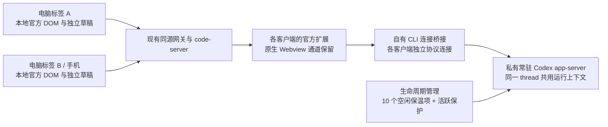

# Codex 普通刷新与再次进入：会话保温和恢复方案

日期：2026-10-14。2026-10-15 用户进一步明确要求完成所有阶段、修复期间遇到的 bug，直到最终验收；**继续实施中**。该指令覆盖此前阶段 0 失败后暂停等待 review 的流程，不降低官方 UI、本地 DOM、任务保护或两秒验收标准。阶段 0 的失败记录见 [阶段 0 验收](refresh-recovery-stage0.md)，后续定位范围见 [续案](refresh-recovery-stage0-review.md)。阶段 1–3 尚未验收或启用，不将原型连通标为产品已支持。此前同列重叠修复见 [独立验收记录](overlap-loading-fix.md)。

2026-10-15 设备验收变更：用户明确说明没有实际手机，要求“按照 iphone 16 的尺寸模拟测试和验收”。本方案因此以 **iPhone 16 尺寸模拟**替代原物理手机关卡，其余性能、交互和资源门槛保持。报告须标明浏览器引擎、模拟参数及不能实测的硬件行为，不再以缺少实机阻塞验收。

## 需求与建议默认值

| 项目 | 已确认需求或本次建议 |
| --- | --- |
| 官方界面 | 必须保留官方 Codex 插件的界面和交互，官方 VSIX 不修改。 |
| 本地文字 | 消息和输入必须在本地网页 DOM 中显示，保留选字、复制、中文输入与触控；用户已排除服务器浏览器画面转发。 |
| 恢复速度 | 已打开且后台仍保留的会话，普通刷新和再次进入以 **2 秒内真正可操作**为验收目标。首次初始化与服务重启后初始化单独计时。 |
| 多端 | 电脑、手机和多个浏览器标签可同时发送、处理审批并同步任务状态；草稿和布局各自保留。 |
| 保温 | 用户要求尽量快速恢复，并提出约 10 个缓存的数量上限，替代固定 30 分钟过期。 |
| 首批网络 | 严格验收当前局域网；外网和移动网络单独记录，不混入局域网数据。 |

建议默认策略：**整个服务的空闲保温池最多 10 个不同 thread，按最近使用顺序回收；运行中、等待审批或提问的 thread 单独保护。**同一 thread 被三端打开只计一次。10 是可配置的缓存数量，不是并发任务上限。资源不足时先回收空闲保温项，不能通过停止任务维持这个数字。该默认策略随本方案一起供 review。

## 调查结论与证据边界

### 目前已经是远程执行

浏览器通过同源 HTTP/WebSocket 代理访问服务器上的 code-server；官方插件运行在服务器的 Node extensionHost 中，并通过 stdio 启动 Codex app-server。当前问题不需要再加一层画面或普通网络转发。

- HTTP/WS 代理：[native-codex.ts](../../../apps/server/src/routes/native-codex.ts)。
- 自有 code-server 与私有运行环境：[host.mjs](../../../packages/native-codex-host/host.mjs)。
- 官方插件启动方式：本地原包 `third_party/openai.chatgpt-26.51007.21434-linux-x64/extension/out/extension.js`，包含 `Spawning codex app-server` 与 `app-server --analytics-default-enabled`。

共享磁盘上的 CODEX_HOME 历史，不等于复用同一个运行中 app-server 的已加载 thread。此区别也已写在 [宿主 README](../../../packages/native-codex-host/README.md)。

### 刷新仍要重建本地界面

普通刷新会丢掉当前文档、VS Code 客户端协议对象和官方 Webview 状态。现在的 iframe 地址缓存、隐藏模式保留挂载、可见标签优先恢复，可以减少额外工作，无法跨硬刷新保存整个页面。单独保存 code-server 的 reconnection token 也不够：原协议还依赖内存中的序号、ACK、待发队列和 RPC 对象。

原包 `extension/webview/index.html` 加载的四份 app-initial 模块及入口 JS 合计约 **19 MiB 未压缩文本**，尚未计入 VS Code 框架。HTTP 命中缓存不能证明这些代码的初始化、会话恢复和绘制都已经完成。

同日之前的隔离测量中，缓存后的刷新出现官方引导 UI 用时 9.030 秒；这是一次样本，**没有测到可发送的 composer，也不是当前真实历史的 p95**。该数据只能说明现有链路距离 2 秒仍有明显差距，不能替代本次基线。分段时间和限制见 [此前记录](overlap-loading-fix.md#启动耗时与剩余限制)。此前伴随扩展额外串行等待的修复已经部署，不能再把旧的约 30 秒等待当作本次根因。

### 不预设每次都下载完整历史

当前官方 bundle 有 tail hydration 路径，会请求 `thread/resume` 的 `excludeTurns` 和最近若干轮；也存在 `thread/read(includeTurns:true)` 等兼容路径。冷 app-server 恢复执行上下文时，仍可能读取大量磁盘历史。因此要分别测量：浏览器收到的历史量、后台读取历史的耗时、官方页面启动耗时。

公开协议支持 stdio、WebSocket 和 Unix socket，以及按需读取历史；官方文档同时标注 WebSocket transport 属于实验接口。**这不证明当前 VSIX 已支持直连常驻 app-server。**参见 [官方 App Server 文档](https://learn.chatgpt.com/docs/app-server)。

### 两个必须先验证的兼容性问题

1. **官方插件没有查到普通用户可配置的远程 app-server URL。**原包的 `chatgpt.cliExecutable` 明确是 DEVELOPMENT ONLY。拟通过自有 CLI 连接桥接保持官方 stdio 接口，但必须做版本门控和真实兼容性验证，不能称为已支持的官方部署方式。
2. **官方草稿不能默认视为多端独立。**bundle 的部分草稿使用共享持久状态；现有文档也记录了空白新聊天复制草稿的问题。需要先核对每个设备/标签的原生状态隔离。如果必须使用独立宿主 profile，应同时测量其启动与内存成本。

当前官方 VSIX 版本为 `26.51007.21434`，附带 CLI 元数据及实际安装二进制 `--version` 均为 `0.162.0-alpha.17.2`；本机另外安装的 `0.162.1` 不能直接替代它。附带 CLI 的只读 help 提供 `--listen`、`app-server proxy --sock`，但 help 不证明 proxy 与目标控制端点的字节协议兼容。clone 源码与已安装二进制也不能未经核对视为同一版本。

没有找到当前 VSIX 脱离完整 VS Code workbench 的公开浏览器入口：manifest 没有独立 browser entry，Webview 初始化依赖 `acquireVsCodeApi()` 与扩展提供的 URI、初始化和消息服务。**直接把官方 bundle 挂进普通轻量网页不纳入本轮实施路径。**它需要另一个宿主契约，不能通过伪造 API、替换 MessagePort 或复制聊天正文绕过当前仓库边界。

## 推荐架构：保持本地官方页面，让后台会话跨刷新保留

这是一条**候选路径**。桥接位于官方扩展的 CLI 连接侧，不接管 Webview MessagePort，也不重新实现聊天 renderer。常驻后台负责线程运行，浏览器刷新只重新建立客户端连接并恢复官方页面。浏览器自身的启动加速作为同等必要的工作，不能假设后台常驻就足够达到 2 秒。

### 后台和连接生命周期

- 自有服务管理 app-server 的生命周期，浏览器关闭、刷新或桥接退出只断开该客户端，不能结束共享进程或正在执行的 turn。
- 使用明确的私有运行目录、控制端点和版本记录，沿用已授权的连接方式；不接管默认 CLI socket，不扩大登录/历史授权范围。
- 每个客户端独立完成 initialize。客户端请求 ID 不能直接混进单条共享 stdio 通道；审批回复也必须保持各自连接的身份。
- 连接桥接只接受固定版本和受限启动参数。先验证附带 proxy；不兼容时才评估自有 JSONL 与私有 WebSocket/Unix socket 的适配。两个候选都须保留请求、事件和错误语义。
- 不允许旧浏览器的 Resume 覆盖已加载 thread 的模型、reasoning、cwd 或权限。普通刷新不触发“释放旧实例”、抢 writer 或 resume 到另一个 UUID。

### 服务端保温池

- 缓存按授权运行域、thread UUID、规范项目目录和运行代次识别，不按浏览器标签建重复池。
- 最近真实打开/操作过的空闲 thread 最多保留 10 个。没有固定的 30 分钟 TTL；未被挤出且资源允许时，隔天再次进入仍尝试命中。
- 超过上限回收最久未使用、无活动轮次、无待审批/提问的项；回收前重查状态，防止它刚开始任务。当前有可见消费者的项也须保护，不能回收正在阅读的页面对应上下文。
- 运行中、待审批/提问以及有可见消费者的项单独记录，不因空闲池上限而停止。全部是保护项时暂停额外保温，并显式记录资源压力，不隐藏失败。
- 保温只保留原生运行上下文与必要生命周期信息；自有管理器不额外复制完整聊天历史或工具正文，也不创建十个服务器浏览器。
- 同时限制保温数量和资源使用。阶段 0 测量单线程、10 线程及长历史的 RSS 后确定可配置的内存预算与准入策略；不能把“10 个”当作内存绝不超限的证明。
- 用当前实际版本支持的订阅/释放机制保留和回收上下文。app-server 进程常驻不等于 thread 永久加载；如果无法安全控制这个生命周期，视为兼容性关卡失败。
- 被回收、首次初始化或服务重启后的项明确进入冷恢复；仍记录其耗时。不得把它们混入热恢复平均值，也不能靠排除频繁未命中的项制造绿色结果。

### 多端操作与草稿

- 同一 thread 的所有页面连接同一个权威运行上下文，任务开始、流式进度、完成、中断和审批解决同步到各端。
- 发送和审批按实际 thread/turn/item/request/连接代次校验。并发操作由服务端协调；重复审批只生效一次，旧请求不能命中新的轮次。
- 明确区分独立的两条消息与同一次提交的重传。回执未知时保留草稿、查询实际结果，不自动重发；忙碌时采用当前官方支持的行为，不擅自广播或切换目标。
- 草稿与布局按设备和标签隔离。优先保留官方原有状态实现；若原生 profile 不够独立，再在自有宿主边界隔离 profile，不通过覆写官方 composer、读取全量聊天正文或改变 MessagePort 解决。
- 刷新和关闭 A 时，B/手机继续操作；不能要求所有设备释放原来的实例。发送、审批、附件、模型选择和中文输入都用官方实际 UI 验证。

### 本地页面启动加速

- 并行开展外壳、code-server、扩展激活、Webview 初始化与 thread 恢复的分段测量，找出真正关键路径。
- 使用稳定的官方资源 URL，核对实际缓存命中、压缩、资源加载和执行成本；只为确认可缓存的版本化静态资源优化缓存。HTML、认证、状态、历史和 RPC 不加入静态缓存。
- 核对官方 Webview 资源是否因实例 URL 变化丢失缓存。若需要稳定资源路径，必须验证 CSP、同源、资源白名单和版本失效，不修改官方 bundle 内容。
- 只恢复当前可见窗格，后台关注集合只同步元数据。已挂载的原生窗口继续保持 iframe 身份和父节点。
- 使用官方当前版本真实支持的最近历史/分页路径；先测旧历史兼容路径，不伪造短历史结果，不静默改官方 feature flag 或数据库格式。
- 在实际用户运行入口验收，同时记录构建版本的诊断对照。不能只在更快的生产构建中通过，而把用户继续留在慢的开发入口。

## 分阶段实施

| 阶段 | 具体工作 | 完成条件 |
| --- | --- | --- |
| 0：基线与隔离原型 | 记录真实刷新关键路径；使用匹配 CLI 与未修改 VSIX 验证常驻连接、保温、多端、草稿；测官方本地页面的热启动耗时。 | 实测证明连接兼容、任务不受刷新影响、必要交互保持，且优化后的真实官方页面有达到 2 秒的证据。未经这个关卡，不部署候选架构。 |
| 1：后台常驻与有界保温 | 在自有宿主实现独立运行服务、版本门控连接桥接、10 项 LRU、保护项、资源准入、重启代次和错误状态。 | 先红后绿的生命周期测试；空闲超限可回收，任务/审批不被回收，客户端退出不结束任务。 |
| 2：浏览器恢复与多端协调 | 缩短初始化关键路径，完善当前目标恢复、独立草稿/profile、服务端操作协调和回执未知处理。 | 官方真实 UI 发送/审批/中断/附件与多端刷新回归通过；缓存与历史加载不破坏协议及传输预算。 |
| 3：严格验收与受控启用 | 完成性能批次、长测与 iPhone 16 尺寸模拟联调；同步架构/功能/bug 文档；在安全窗口启用新路径。 | 下述验收全部通过。已有正式任务继续使用原路径直至自然完成；不强行迁移活跃 thread 或停止正式 Agent。 |

**阶段 0 的部署关卡：**官方插件无法可靠连接常驻服务；独立草稿无法保持；待审批请求不能跨刷新恢复；或保留官方本地 DOM 后仍无法满足 2 秒时，继续在隔离环境定位和开发，保留失败样本，不能部署候选路径。用户已要求持续完成所有阶段，不再因一次阶段失败暂停等待 review。不得自行修改 VSIX、替换成自制聊天 UI、恢复画面转发、降低验收线或只显示缓存假称成功。

先解决阶段 0 的实际失败，再推进阶段 1–3。2026-10-14 的隔离原型和失败证据保留；2026-10-15 按用户继续授权开展恢复定位。需要改变已确认的界面、传输或资源保护边界时仍须明确提出，不能以继续开发为由绕过这些边界。正式入口在全部关卡通过前继续使用原路径。

## 严格验收

### 2 秒的定义

从浏览器普通刷新的 navigation start，或点击再次进入/切换目标的用户事件开始计时。终点必须同时满足：目标 thread UUID 正确、官方页面可命中和操作、真实服务状态已恢复；空闲会话能立即经官方 composer 发送并获得正确 thread 的接受回执，待审批会话能经官方按钮提交并确认该请求解决。模型生成完整回复的时间另记。

运行中会话恢复后应显示真实进度，并允许当前官方提供的操作；不要求把繁忙会话错误开放为空闲发送。外壳、iframe onload、接口 202、历史文字或输入框的单独出现，均不作为通过。

### 验收矩阵

| 项目 | 用例与硬性检查 |
| --- | --- |
| 热刷新性能 | 桌面与 iPhone 16 尺寸模拟对应入口各至少 30 次普通刷新；分别统计空闲、运行中和待审批场景。预先定义符合保温条件的场景，批次内这些样本均须 ≤ 2 秒；超过 2 秒或恢复错误目标即计失败。记录完整分布、p50/p95/最大值，不能用平均值或 p95 隐藏失败样本。 |
| 再次进入 | 切到其他模式再返回、关闭页面后重开、10 分钟/超过 30 分钟后重开；仍在池中的会话按相同 2 秒目标检查。 |
| 缓存命中与容量 | 第 11 个空闲会话进入后，只回收符合条件的 LRU 项；回收项重新打开可完整恢复；多端打开同一 thread 只计一次。报告命中率、冷恢复次数与耗时。 |
| 生命周期竞态 | 回收前开始任务、审批刚到达、最后一个页面刷新/断连、桥接退出、后台管理器失联；保护项不得停止或丢失审批。服务重启使旧代次失效，不误报热就绪。 |
| 多端真实操作 | 电脑两标签与 iPhone 16 尺寸模拟同时打开同一 thread；各端提交、同时点击同一审批、运行中刷新一端、关闭发起端、网络断开重连；最多一次审批生效，独立消息不丢失，不抢占任务。 |
| 草稿与设置 | 同 thread 三端不同草稿，刷新/切换后各自保留；新聊天与已有 thread 分别测；模型、reasoning、cwd、权限不被旧端恢复覆盖。 |
| 官方交互 | 原生选字复制、中文组合输入、模拟触控与键盘遮挡、附件、工具明细、审批、提问、中断和继续。直接选中文字，证明本地 DOM；截图不能证明输入与发送已通过。组合事件及视口缩小模拟单独标注，不宣称覆盖 iOS 系统键盘、候选词或硬件剪贴板。 |
| 长历史与传输 | 长历史/大量工具输出/旧版历史分别测 RPC、磁盘读取与网络字节；首屏等待不随完整历史无界增长；旧兼容路径失败要保留证据。不得静默放宽现有 WS 大小/背压预算。 |
| UI 防回归 | 390/393/430/720/1440/1920 px；每个窗格仅一个可见、可交互的正确原生 frame；无重叠，保持 iframe 父节点和 MessagePort；模式切换保持草稿。 |
| 内存与进程 | 至少 30 分钟自然运行，含反复刷新和 11+ 空闲会话；记录浏览器 JS heap、renderer RSS、app-server/extensionHost RSS、连接数和进程数。空闲缓存及断开的客户端资源受控，不能只凭 JS 堆宣布稳定。 |

首批使用配置的局域网 HTTPS 入口。现有部署记录为 `https://10.30.0.24:8484/?mode=codex`（HTTPS，端口 8484），该地址是联调记录，不是源码默认值；实际验收前重新核对监听和局域网地址访问。隔离前端必须绑定 `0.0.0.0`。本轮按用户确认以 iPhone 16 尺寸模拟完成手机关卡；物理设备不再是必需条件。

模拟参数：依据 [Apple iPhone 16 技术规格](https://support.apple.com/en-us/121029) 的 1179 × 2556 屏幕像素，取 DPR 3、CSS 屏幕 393 × 852；分别覆盖完整视口、浏览器工具栏缩小视口和键盘遮挡后的视口。开启触控及移动设备模式，记录实际引擎版本、screen/viewport/DPR 和触点数。Playwright 当前安装版本没有 iPhone 16 预设，因此使用显式参数，不能把别的设备预设名称当作已测试 iPhone 16 的证据。WebKit 与 Chromium 的结果分开报告。

首次打开新会话、清空浏览器缓存和服务重启后的冷恢复单独报告；不把每次普通刷新重新初始化改名成“首次加载”。不向正式历史发送性能测试任务。回归只在独立项目/HOME/运行目录内创建可控测试线程，沿用明确授权的连接方式。

## 文件范围与测试、文档维护

拟改目录：

- `packages/native-codex-host`：后台运行生命周期、CLI 连接桥接、保温策略、版本/profile 隔离与宿主测试。
- `apps/server/src/routes/native-codex.ts`、`services/native-codex-gateway.ts`：有界同源代理与必要状态接口；仅按已验证的需求扩展。
- `apps/web/src/codex-mode`：当前目标恢复、连接/冷暖状态、缓存与启动关键路径。保持独立于会话模式正文及草稿 store。
- `tests/e2e`：官方真实宿主刷新、多端、草稿、审批和缓存容量用例。

逻辑改动先补能复现失败的测试，再实现转绿；运行宿主/网关/Codex 定向单测、真实官方宿主 E2E 与 `pnpm check`。涉及共享类型同步检查前后端。若触及会话传输、历史、状态或缓存，执行 [会话内存防回归约定](../../session-memory-contract.md) 指定的浏览器整组验收，保留既有阈值。

实施后同步 `docs/codex-workbench-mode.md`、`docs/func_list.md`、`docs/project-overview.md`、`docs/debug_list.md`；适合沉淀的实际 bug 根因同步仓库记忆镜像。新增启动契约、配置或核心工作流时更新 README、启动文档与 AGENTS.md。所有端口、目录、缓存上限和内存预算走配置，机器差异放在被忽略的 `.env*`，不硬编码，不记录凭证或聊天正文到回执。

最终交付：修改与限制说明、红绿灯测试记录、真实官方界面截图/录像、性能原始样本及分位数、缓存命中与内存数据、局域网访问方式、iPhone 16 模拟配置及边界、原生运行安全证据。文档或原型通过不代表正式产品已通过。
