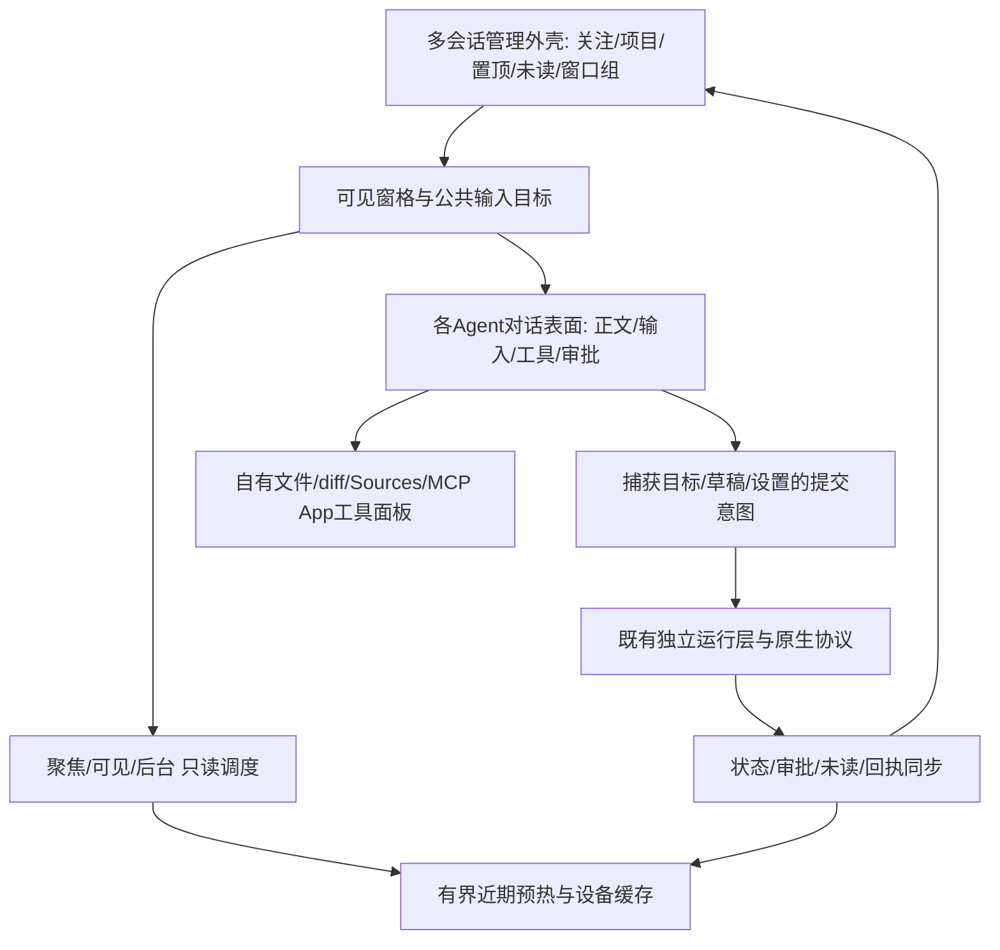
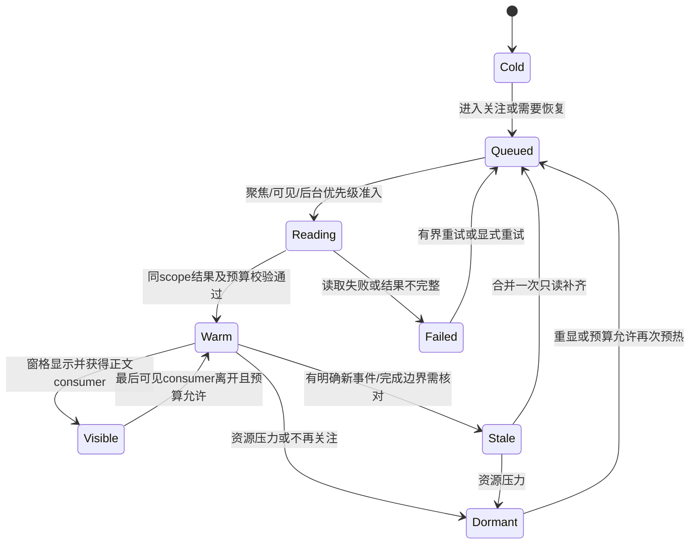

# 会话模式开发方案：多会话管理与 Codex 体验对齐

日期：2026-10-29。源码基线：`f6699ba064059009529a50b0c126cbed4402f093`。原包对照：`openai.chatgpt 26.51007.21434 linux-x64`。

**状态：用户于2026-10-29明确批准“按计划开发并做严格验收”，已开始并行实施。** 工作区原有体验优化实现按3.3整合；其旧验收不代替本期最终源码验收。本文件把Q1–Q12的明确答复作为设计约束，新增官方共享服务接入见4.1；实施顺序不缩减本期范围。全量客户端审计见 [审计主文档](session-render-alignment/codex-client-full-audit-20261029.md)。当前交付进度及证据见[实施验收台账](session-mode-implementation-20261029/README.md)。

## 1. 产品定位与本期完成标准

会话模式是一个**多会话工作台**：用户能同时管理多个项目、多个 Agent、多个运行中的任务；进入任意 Codex 对话时，正文、输入区、工具活动、审批和状态反馈保持熟悉的 Codex 体验与 UI。

设计分成三层：外层负责多会话管理，内层负责对话体验，执行层负责真实任务和可靠回执。所有功能都要服从这个划分：不能因为对齐单会话插件而牺牲跨会话切换、公共输入目标、手机体验和资源控制，也不能因为做管理外壳就把聊天交互退化成通用日志列表。

本期纳入审计中所有适用于本地会话客户端的**非 IDE、非云任务**能力。MCP App、Sources、网页快捷键、本地工作树/环境能力、听写与权限完善都属于本期，按依赖分批完成。已有正确能力主要做组合验证，不重新实现。

最终完成须同时满足：

1. 本文件和附录中的纳入条目全部实现或完成现有能力验证；没有以“后续再做”默默移出的功能。
2. 多会话、刷新、断线、失败、未知回执、审批和长历史组成的核心链路通过真实浏览器与隔离原生协议验证。
3. Codex 核心对话 UI 按固定原包真实组件/函数对照；有意网页适配有明确记录。
4. 达到第 9 节定义的两秒、输入、切换和资源标准。无数据缓存、外部历史服务变慢时按已确认的例外单独报告。
5. 不能实现的真实协议能力单独列为技术阻塞，给出证据和备选方案，返回用户 review；不能把不工作的按钮、mock 结果或能力降级当作完成。

## 2. 用户已确认的设计决策

| 决策 | 已确认内容 | 对方案的约束 |
|---|---|---|
| Q1 本期范围 | 所有非 IDE、非云端能力都列为本期必做 | 批次用于安排依赖；MCP App/Sources 等不能被移到下一期 |
| Q2 运行过程 | 默认最新进展，可展开全部 | 最新 commentary/当前工具活动突出，完整过程保留可达 |
| Q3 Agent | 公共体验覆盖 Codex、Claude、ACP | 公共导航、草稿、恢复、性能统一；专属协议和权限分别处理 |
| Q4 云端边界 | 保留模型调用、登录、MCP/插件、反馈、听写等客户端能力 | 排除云任务执行、云工作区及云服务本身；不按“需要网络”删除现有能力 |
| Q5/Q8 预热 | 所有关注会话最近页按资源保持预热；聚焦优先，其次其他可见，再后台 | 资源充足时快速切入；过多/资源不足可回收后台；更早历史按需读取 |
| Q6 归档 | 普通归档和停止并归档分开；关闭标签只移出关注 | 普通归档须确认空闲、无待处理队列/自动推进风险；停止须明确操作 |
| Q9 停止并归档 | 暂停队列和活动 Goal，停止当前轮次，再归档；内容保留，明确恢复 | 未知发送先核对；停止失败/未知不归档；不额外批量停止子 Agent |
| Q7 跨设备 | 置顶与已读/未读同步，选中、布局、阅读位置、草稿独立 | 后台预加载不标已读；手机阅读不切换电脑输入目标 |
| Q10 性能 | 30关注、桌面4可见窗格、3浏览器页为常用基准；50/100压力测试 | 每页导航、正确目标和 composer p95≤2秒；≥30样本，报告max；历史独立计时 |
| Q11 官方共享服务 | 看板与CLI及兼容官方客户端共享实时任务和交互 | 必须是同一服务中的实时线程；仅共享历史文件不算完成；退出看板不停止任务 |
| Q12 服务启动 | 允许看板按需调用官方daemon start，不建私有实例 | 只启动官方默认共享服务；无私有app-server回退，不自动stop/restart/update官方服务 |
| Q13 客户端范围 | 本期先完成看板和CLI共享 | 不做VS Code插件启动适配，原包保持不修改 |
| Q14 共享队列 | 按官方方式执行线程设置，修改设置提示影响 | 旧逐条冻结配置经确认迁移，原生队列是唯一调度权威 |

现有且继续保留的产品结构：**多个正文窗格 + 一个公共输入区**。公共输入区始终绑定当前选中的精确会话；桌面可同时显示多个窗口组，手机显示当前组。不给每个后台窗格再创建独立发送器，不引入广播发送。

## 3. 范围边界与审计更正

### 3.1 排除、保留和适配

| 类别 | 处理 |
|---|---|
| IDE 专属 | 不开发 VS Code extensionHost/provider、IDE 自动上下文、编辑器选区自动注入、VS Code 命令/CodeLens/WSL 宿主设置；无功能的 `/ide` 从会话模式入口移除 |
| 独立 Codex 模式宿主 | 不扩展 code-server/companion/profile/刷新保温原型，不把它的启动速度或桥接问题混入默认 Session；G25 风险保留在审计记录中 |
| 云端任务 | 不开发远程任务执行、云工作区、云端环境部署、云服务内部实现；明确排除 ChatGPT-only/Orbit/Aeon 等共享包分支 |
| 自有文件能力 | 完整保留文件/目录浏览、行列跳转、引用、编辑草稿、未保存保护、diff、复制/下载和文件上下文；统一使用当前项目根及精确来源会话 |
| 终端及可选 VS Code 面板 | 保留已有入口、挂载和状态；本期不扩展 IDE 面板功能，也不因“不做 IDE”删除它 |
| Git/worktree/local environment | 属于本地任务管理能力，纳入本期；只实现本项目有意义的工作目录、分支、工作树、环境选择/配置，不照搬宿主窗口管理 |
| 客户端联网能力 | 模型调用、账号/OAuth、MCP/插件、Web 搜索结果、反馈、听写与已存在服务的语音客户端能力保留/完善；不自建对应云端后端 |
| 其他 Agent | 保留 Claude/ACP 自有工具、权限、请求和运行语义；无对应原生能力时不得伪造 Codex 专属操作 |

文件跳转已核实走 `CodexMarkdown → services/openWorkspaceFileReference.ts → useEditorStore.revealFile → FilesPanel`，不依赖 VS Code。后续 Sources、工具结果和计划中的路径继续复用这条链。

### 3.2 审计基线问题与本轮协议复核

下表的原实现位置以f6699ba为基线；收尾时出现的并行未提交修改单独列在3.3。不能把已经有修复候选的基线问题重复作为“当前仍待从零开发”。

| 事实 | 代码位置 / 含义 | 对实施的影响 |
|---|---|---|
| 非关键设置可阻塞整个会话主体 | `App.tsx:61,70–78,154–155`；`lib/settings.ts:49` 目前主要合并显示名 | 解除门闩；名称后台恢复，失败局部处理，不能挡输入/导航 |
| 优先级没有贯穿读链路 | `followedSessionHistorySync.ts:113` 已有 selected 优先；`sessionReadQueue.ts` recent FIFO；`chat-history-channel.ts:79` 单 reader FIFO | 改端到端调度，不能只增加 React 层槽位或缩短请求超时 |
| IDB 恢复按打开顺序串行 | `sessionTranscriptCache.ts:442` | 按聚焦/可见目标优先恢复，并处理快速切换、过期消费者 |
| 当前 dormant 会阻止后台重新填正文 | `sessionTranscriptRetention.ts`、`codexTranscriptActivity.ts`、`codexService.ts` | 新预热策略必须明确 warm 与 inactive 的边界，不能直接删旧回收保护 |
| 归档 busy 不是任务 running | `ConversationMenu.tsx:205`；OwnerForms/ThreadList 直接 archive；运行层 mutation 可能先 resume | 已更正旧审计 LG11；“Agent 不会停止”文案不能当原生保证，须先验证生命周期 |
| 文件与文件夹入口实际只选设备文件 | `ComposerMenu.tsx` 传 directory:false；`browser-dialog.tsx` false 为 file input，true 为服务端目录选择 | 已更正 G21/CMP-27；分清设备附件与项目文件/目录两个入口 |
| 工作树分支可能只改界面 cwd | `forkSlashWorktree` 创建worktree后调用不含cwd的threadFork，再改card/workspace路径；原生ForkParams支持cwd | 必须验证 native thread 实际cwd；不能以界面项目名通过验收 |
| Resume 是空输入新轮次 | 原包 `bFa → ONa.handleResumeInterruptedTask → qQr → startEmptyTurn → vkn → turn/start(input=[])` | 建专门的显式、持久回执入口；不以thread/resume或自动发送“继续”代替 |
| 当前 pin/attention 是设备数据 | `usePinStore.ts` localStorage且仅id匹配；attention同源storage合并不等于跨设备 | 新建共享管理操作协议，迁移复合身份和手动未读修订，不上传整个map覆盖 |

另一份 [体验优化调查草案](session-mode-user-experience-plan-20261029.md) 的 UX01/02/06 静态机制已复核，其旧计时/其他浏览器结果保留原证据范围，不在本轮重新宣布通过。该草案中预热深度待定的条款，以本轮 Q5/Q8 为准；其其他未批准范围不自动并入授权。

### 3.3 与正在进行的体验优化工作合并

本轮开始时源码HEAD为f6699ba；收尾复核时工作区已出现另一工作流的未提交实现。已只读确认`App.tsx`移除了settingsReady渲染门闩，新增`useSessionSettings`，名称合并有edit revision/abort保护；还有项目/标签同步、连接诊断、同步提示和运行层重启脚本变化。其[独立验收记录](session-mode-user-experience-acceptance-20261029.md)记载A1局部单测/浏览器绿灯，其余仍在推进。**这些结果不属于本轮执行，也不表示本方案已获实施许可。**

后续实施的第一步是取得该工作流最终源码/验收清单，重新固定基线，逐项吸收兼容修改：已实现且当前验证通过的能力标为复用，未完成的部分接续，冲突按本轮确认的产品约束处理。尤其不能重写已经修复的settings逻辑，不能覆盖同步/重启脚本和无关dirty文件。

本方案B/G/H与该工作流的B/C/D有重合，合并为同一套预热、三provider和资源验收实现，不能两边分别创建调度器或恢复store。本文较广的C/D/E/F新增能力在其公共基础上接入。当前基线既包含历史审计也包含推进中的实现，最终绿灯必须对应实际合并后的源码hash。用户本轮已授权实施及多Agent并行，原“尚未批准”的描述仅属于之前的历史阶段。

## 4. 目标架构与数据所有权

不新建第二份关注集合、第二个当前会话选择或平行的发送队列。管理入口复用 `useAgentCenterStore.cards`、`useSessionTabActions` 和现有窗口组；新增模块提供明确职责的投影/操作能力。

| 数据 | 权威来源与持久化 | 恢复/冲突规则 |
|---|---|---|
| turn/item/审批/能力 | 实际 native 实例、协议事件和只读快照 | instance/account/provider/thread/turn/item/request完整身份；旧结果不覆盖新状态 |
| 关注集合/顺序 | 已有服务端 revision/journal | 复用操作协议和幂等客户端序号，不整map覆盖 |
| 置顶、手动未读、完成回复已读 | 新的有界服务端管理元数据，复合会话身份 | 操作式写入与每实体revision；不同设备最终一致，原生字段保持独立映射 |
| 当前选择、布局、阅读锚点 | 本设备/本页现有store | 远端操作不抢焦点；远端取消关注仍保留本机正在阅读的detached窗口 |
| 草稿、附件上下文、编辑版本 | 本设备现有owner/revision持久化 | 发送只清捕获版本，跨页晚ACK不清新草稿 |
| 队列与发送回执 | 既有持久队列/运行层意图与receipt | accepted/rejected/unknown分离；unknown不重发；冻结参数不换成当前UI选择 |
| 生命周期操作记录 | 服务端持久化的每会话归档/暂停/停止阶段及准入gate | 本服务Send/Resume/Steer/队列/Goal恢复共同遵守；重启只核对未知步骤，不盲目重做 |
| 最近正文预热 | 有界内存 + 设备近期缓存；原生历史仍是正文来源 | 记录新鲜度/游标/作用域；可回收、可只读重建；不保存可执行审批权限 |
| 应用undo/redo | 本页发起动作的有界事务记录 | 结果影响共享实体，但一页不直接撤销另一页的新动作；编辑器文本undo优先 |

身份分为两种：**持久管理键**使用稳定provider + 账号/历史数据域namespace + thread ID，不包含会变化的PID或运行generation，避免重启后置顶/已读像丢失；**本次操作授权**另附当前instance/generation、原生能力、请求/轮次和账号修订。新实例可以核实后恢复同一管理实体，但不能继承旧实例写权限。不能用裸thread ID假定跨provider或账号唯一；权限元数据只留内存。

### 4.1 官方共享Codex服务

Codex执行权威改为官方常驻daemon。看板的TypeScript运行层保留多会话管理、投影、收据和浏览器适配职责，主连接与只读历史/详情连接全部附着同一服务。原先`codex app-server`私有进程、reader私有进程不作为新默认路径或失败回退。安装的官方CLI基线为0.165.0；原包插件的捆绑CLI为0.162.0-alpha.17.2，兼容性单独门控。

默认官方socket不存在时可合并并发启动意图，调用一次`codex app-server daemon start`；显式配置的socket只连接、不替它启动服务。关闭页面、重启网关或替换看板运行层只释放自身连接；不对daemon或它的进程组发送停止信号，不自动升级。官方socket目录保持私有，浏览器不直接获取该路径或任意连接参数。

本机daemon的Unix socket使用WebSocket握手。原生`app-server proxy`的原始字节复制已在私有假socket验证，但不能据此把JSONL直接写入真实daemon。连接层需要实际兼容的Unix WebSocket帧和有界RPC/流式读取；既有32MiB/16MiB及工具正文裁剪保持。

共享服务中的审批可能向多个连接投递，首个响应或错误会结算原请求。看板不得对无法处理的共享请求通用回复`-32601`；初始化能力、请求归属、另一客户端先答、重连重放和特殊单owner验证分别处理。只读预热不得`thread/resume`，它可能唤醒持久队列；不从历史reader推断运行终态。

官方`thread/queue/*`一旦接收会自行调度。同一意图不能同时交给原生队列和看板pump；`clientUserMessageId`不是已验证的原生去重保证，未知add须核对队列及已开始轮次，不能重发。0.165官方源码表明队列保存输入，启动时使用线程设置，不能等价承诺逐条模型/权限冻结；原有冻结条目和不确定收据保留，迁移须显式处理。用户后续已确认：本期仅完成看板与CLI共享，不做VS Code插件启动适配；新队列按官方线程设置执行，旧冻结条目保留并显式迁移。

Codex已读优先采用原生`readState/update`及`expectedRevision`；冲突重新核对真实可见回复。0.165本机schema未提供`metadata/update.isPinned`，置顶仍用看板扩展管理协议，不能照搬较新主线接口。其他Agent按公共管理协议适配。官方服务启动时的账号/环境/全局配置属于服务域，不再靠看板子进程环境静默改写。

接入的必过原生关卡：两个独立客户端观察同一实际服务与轮次；多端审批先答失效；断开看板后任务继续且重连恢复；reader取消只释放自身连接；默认服务缺失时启动去重；错误版本/账号或作用域变化拒绝旧写入；历史/工具传输预算不退步。VS Code客户端共享须单独验证，不能由CLI两连接通过推导。现有私有进程中的活动任务不做隐式热迁移或重发。

## 5. 多会话预热、恢复和性能设计

### 5.1 四类负载与准入

状态、审批、未读和回执持续同步，不依赖正文是否挂载。正文读取按下列优先级处理：

1. 当前聚焦会话：恢复可读近期页、草稿和准确输入目标；显式翻页/搜索定位视为用户交互。
2. 其他可见窗格：各自恢复近期页及独立阅读位置，不抢公共composer。
3. 其余关注会话：在有界预算内预热最近页，保持可快速切入。
4. 低优先背景校验：事件/完成边界/序号缺口触发，合并重复请求，不恢复完整历史定时轮询。

前台操作不能永远饿死后台；后台覆盖清单记录待预热、进行中、可读、需核对、失败、资源回收。失败保留有界重试与原因；资源回收不当网络错误，也不触发无限重试。

### 5.2 调度贯穿全部层级

从可见消费者到 `sessionReadQueue → codexService/API → gateway → chat-history-channel` 传递固定枚举的自有读取意图；网关校验并按实际消费者/范围约束，**不把优先级字段传成 native RPC 参数**。

读取合并键包含provider、当前实例/账号scope、thread以及规范化的**全部读取参数和投影语义**，包括cursor、limit、sortDirection、itemsView/view及前端afterTurnId等恢复锚点；不能把同thread或同空cursor的不同范围合并。共享读取记录每个消费者的需求、优先级和取消状态；一个窗口切走只释放自身需求，不能取消其他可见窗口的读。pending后台读可提升到前台，不能在更高层再排一份重复请求。

优先调整排队顺序、公平性和取消归属，不先放大native并发。区分两种操作：消费者取消只释放该消费者，最后消费者离开才结束整个逻辑读取；调度让位只在没有聚焦/可见消费者、且隔离协议已证明安全时中止本次自有只读尝试，保留后台逻辑需求重新排队。让位不算用户取消/读取失败，不启动错误重试风暴，并限制次数、设置公平性保护。实际reader退出与资源释放确认后才归还槽位；不能中断Agent或释放别人的writer。若原生不能安全让位，则明确只能调整待执行队列，不能声称前台可越过已运行的后台慢读。

保持当前32MiB共享RPC、16MiB聊天投影和显示/缓存准入。现有recent较长deadline有防重试拥堵背景，不能统一改成2秒timeout来伪装性能改善。

### 5.3 预热、挂载与回收

预热的是**最近可读正文页**，不是全部历史，不是后台DOM。可见正文、后台warm数据、设备缓存分别计量，避免重复引用同一大字符串或将工具正文重新带回浏览器。

资源充足时保留关注会话近期页；数量增加导致达到预算或出现资源压力时，先回收最久未使用的不可见正文，聚焦和可见消费者优先保护。不能资源仍充足却仅因标签数跨某整数就清空预热或引入隐含产品上限。权限/审批、草稿、队列和未读独立保留。若仅可见内容就达到预算，继续按既有有界投影/虚拟列表工作，明确局部详情状态，不能回收任务状态或以无限内存换速度。

现有“最后可见消费者离开60秒即dormant”的契约需要在本期**有证据地替换**：从 visible consumer → bounded warm retention → inactive/dormant。不是直接禁用60秒回收。warm留存须纳入同一资源治理器，不得额外引入无限map；inactive后仍禁止迟到读/后台delta重新持有正文，重显时只读恢复。

实现先沿用总预算，给warm份额和保护优先级；预算标定使用实际传输、JS堆、外部字符串和renderer RSS。浏览器没有`performance.memory`时也必须靠自身字节/条目预算工作，不依赖Chrome独有探针才能回收。

多页读取由服务端合并并限制总量，不能三页各自对100个关注会话重复预热。设备缓存恢复先聚焦、再可见、再后台，取消过期恢复任务并防止旧HMR模块重新回填。

图中Warm/Visible/Dormant只拥有正文留存；任务、审批、未读和回执始终在独立状态层。`Dormant→Queued`受优先级和预算控制，不能刚回收就因同一个后台事件立即重建形成循环。新设计需要迟滞和最小回收驻留约束，具体参数由固定负载标定。

### 5.4 进入、切换与恢复呈现

本地导航和composer不等待显示名、插件市场、完整历史等非关键请求。已有缓存先可读并标明正在核对；历史失败显示局部错误和Retry，保留草稿/既有正文；仅收到一个delta不能清除历史错误。

区分传输状态、历史同步状态、真实turn状态、写入权限与发送回执。刷新、断线、手机切后台不创建新的interrupted，不抢writer、不自动resume、不自动重发。历史里真实已中断的旧轮次保留正确归属，不能遮住后来完成的新回答。

Codex保留现有虚拟列表并优化已证明的热点；Claude和ACP补有界可变行高呈现与稳定阅读锚点，保持它们各自的工具/审批/恢复语义。不能假设三种provider都支持原生分页；缺分页能力时在有界只读获取后做本地窗口，明确传输成本。

## 6. 交互与功能设计

### 6.1 管理外壳和跨设备状态

保留现有标签/自由分屏/网格/列表/项目入口，统一会话名称、状态图形、置顶、未读、待审批、错误和同步提示。未知状态用中性状态呈现，不能当已完成或零任务。远端添加/排序/置顶/已读同步只更新管理状态，不切本机会话、cwd或输入目标。

建立置顶、标已读、标未读的操作协议。手动未读必须带修订，不能用已读集合只增不减的合并方式吞掉操作。自动已读沿用“页面有焦点、对应会话为当前目标、最新回复实际进入视口持续确认”的规则，并提交当时实际观察的reply/turn水位及manual-unread修订；不能把请求发出后才出现的回复一并读掉，不能覆盖另一设备更新的手动未读。预载和后台可见但未聚焦不标已读。手动标未读后，当前观察器不能立即把它清回已读，需新的显式阅读进入或手动标已读。

服务端统一关注/置顶身份，置顶恢复与归档撤销走同一实体修订。原生read-state/pin是独立兼容层：只按已验证能力读取/映射，不能凭看板同步成功宣称独立CLI客户端的原子一致性。旧localStorage没有账号namespace的数据，先只读匹配线程归属；可确认项仅create-only导入，已存在共享修订优先，不能覆盖；无法确认归属的保留为本地待处理，不自动发布到当前账号。旧整map不能覆盖已初始化共享状态，迁移冲突给出可见选择。

### 6.2 归档、停止并归档、撤销

关闭标签仅整理关注集合和本地布局，Agent继续，草稿/队列保留。普通归档须重新核实原生空闲，且没有待发/发送中/未知回执队列、待处理请求或可自动推进的活动Goal；不能只看本地busy布尔值。

普通归档和停止并归档都使用服务端持久的每会话生命周期操作记录及准入gate；本服务普通Send、Resume、Steer、队列调度和Goal恢复全部遵守同一gate，避免另外两页在“已核对空闲→归档”之间开始新轮次。记录目标、操作ID、当前阶段、已完成步骤和未知回执；网关/浏览器重启后只读核对，不盲目重做interrupt/archive。该gate不是锁住所有外部native客户端；检测到外部writer/轮次变化即停止流程并重新核对，不隐式接管。

“停止并归档”明确展示会话、当前轮次、队列数量与Goal影响范围，按捕获的版本执行：

1. 确认后登记归档意图并冻结本服务的新写入/自动调度准入；这不改变已有pending消息是否已送达的判断，也不清除回执。
2. 在冻结状态下只读核对可能已送达但未确认的消息；未确认时不interrupt、不archive，保持可见的核对阶段和待发内容。
3. 对当时仍匹配的活动Goal显式暂停，等待确认；不删除目标。
4. 对精确当前turn发一次interrupt并等待真实终态。轮次已经变化时重新核对，不能误停新轮次。
5. 核对空闲、无自动推进后执行原生archive；读取确认归档结果，再从关注集合移除。

任一阶段失败/未知，不继续后续破坏性步骤；显示已完成的阶段及可恢复动作。已经暂停的队列/Goal不在错误回滚时自动恢复。保留草稿、待发内容、设置和回执；取消归档后保持暂停，用户显式继续。只操作当前会话，不另发整家族子Agent停止；native自身传播行为在技术验证中记录。

将归档、重命名、置顶接入异步应用事务：捕获before/after、scope、实体revision、操作ID；pending/committed/failed/uncertain/undoing/redoing分开。成功才入可撤销栈，失败不移动栈；undo/redo重新核对当前实体，跨端新修改冲突时不覆盖。保持归档60秒撤销入口；其它动作过期策略写明，应用undo不抢正在编辑的文字undo。

原生无跨客户端CAS时，服务端串行与写前/写后核对仅保证本服务内操作一致性，不能宣传成对任意外部native writer原子保证。归档及工作树等高影响操作的未知回执必须提供核对入口，不能盲目重复。

### 6.3 Codex 正文、运行过程与请求

默认原生式latest呈现：突出最新commentary和当前工具活动，已结束过程收起；提供“查看全部过程”，保留工具详情、失败、审批/问题和最终答案的可达性。展开状态按会话/轮次管理，不因后台更新重置，不强制阅读者回到底部。

流式Markdown按有界稳定块和变化尾段渐进解析，避免每token拼全历史或重跑整篇Markdown。代码块、表格、列表、引用、图片、链接和未闭合语法分别做增量/完成一致性验证。稳定块不可重复计算/长期保留旧大字符串；性能或边界失败时不得静默换成另一套最终正文而宣称对齐。

请求卡保持原包allowed decisions和状态语义。MCP form的Escape在该表单确实拥有焦点、非IME组合时执行原生式取消；提交中/unknown锁定并核对，未确认前保留字段。Portal和快捷键不能传到公共composer造成额外发送。审批/提问在后台到来时进入正确会话的待处理提示，不替用户批准。

控制通知不显示成普通JSON聊天行；先追清运行层转发和前端投影，保留序号、read-state、审批、子Agent等元数据。未知事件留在有界诊断入口并明确不支持，不能通过丢序号或隐藏实际错误“美化”。

原有富文本复制、分支引用选区、编辑/回退、生成图片编辑/下载、计划侧栏/新窗口、diff/review、hook、memory/file citations、子Agent观察都保留并进入组合回归。

### 6.4 公共输入、主动作、模型与权限

抽出输入主动作的明确状态投影，使用真实目标/运行/权限/附件/回执状态，而不是散落的布尔组合。空闲发送、运行空草稿Stop、运行有内容Queue/Steer、停止中、适用条件下Resume、听写结束并发送各自互斥；阻断原因在对应入口可见。

Resume专用意图捕获目标、原中断状态、设置和上下文，持久登记后显式发空输入`turn/start`并处理接受/拒绝/未知；不是页面恢复、不是`thread/resume`加载、不是定时发送“继续”。重载后不自动执行Resume，活动Goal和已有草稿按原包准入处理。

模型、effort、service tier、Plan及permission profiles来自真实能力/requirements，保留未知、自定义、默认、锁定状态和原始身份。补齐profile选择与Ultra非Full Access fallback；使用实际原生/host偏好，不固定臆造workspace-write。写入等待点击时已捕获设置的保存前缀，晚来的选择不替换本次提交。

rail按阻塞请求、队列/送达异常、运行变更、Goal、一般notice等状态建立有明确依据的组合布局，使用原包组件和真实props对照；出现审批不挤掉停止/发送，手机固定输入高度和compact queue shelf继续保留，全队列可访问。

网页快捷键实现真实录入、冲突检测、保存/重置和错误恢复，按平台显示按键。只在会话模式可见且合适焦点范围生效；文本编辑、IME、表单、文件编辑器优先，不覆盖浏览器保留快捷键。IDE命令不进入自定义清单。

### 6.5 文件、Sources与本地工作环境

输入附件明确分成“上传设备文件/图片”和“引用项目文件/目录”。项目引用由自有文件树选择，带规范工作区身份、原路径及有界内容快照；目录不等于上传整棵目录或自动展开全量文件。选区/回复引用、粘贴文本还原、绘图和expanded editor继续按原owner保存。

Sources侧栏聚合网页host、provided/read/created/updated文件和MCP来源/调用次数，保留消息/轮次来源和精确跳转。复用现有文件解析与行列跳转；来源展示只读，不加载全量工具正文。工具输入/结果按需从现有有界详情通道读取，隐藏/关闭释放内容引用。

新会话和分支明确“当前项目目录/独立工作树”，捕获真实cwd、branch、环境与原生权限。工作树创建、native start/fork和UI登记是分阶段事务：native确认真实cwd后才发布目标；失败保留可辨认结果，不删除已有/使用中的目录，不因未知回执再次创建分支。配置/脚本由现有服务器路径校验和argv约束执行，UI明确显示任何会执行命令的动作。

本地environment/branch选择采用本项目项目模型，不添加VS Code宿主依赖。已有线程运行中不偷偷改变cwd或权限；切换执行位置使用明确的新会话/分支流程。新工作区仍复用已有项目导航和FilesPanel。

### 6.6 MCP App、插件/账号、听写和其他完整能力

MCP App建立资源加载、catalog身份确认、会话/工具调用绑定、主题/尺寸握手、错误/重试和卸载状态。使用自有隔离视图承载协议支持的widget，资源和工具调用都经固定服务端能力边界；不能把任意URL当代理、不能用任意postMessage转发RPC。实际工具动作沿现有native授权流程，账号/实例/目标失效立即撤销旧view的操作能力。

widget只在需要时挂载，隐藏后停止非必要订阅并释放大资源；后台任务状态仍由运行层维护。普通MCP结果、结构化数据及不支持widget时的明确信息保留。native资源协议能力不足时必须留技术阻塞记录，不能拿静态HTML或普通JSON当widget完成。

插件安装/卸载、认证链、MCP OAuth、账号登录、用量、反馈预检/六态上传保持现有真实流程并覆盖断线、关窗、切账号和晚回执。仅增强缺失语义，不把已实现入口重做成占位。

听写按idle/starting/recording/transcribing/retry/cancelled拆开，启动可以取消；晚到的麦克风授权或转写结果只能交回原owner，取消后及时停止tracks。失败时在有界期限内保留当次录音供显式重试，成功/丢弃/账号失效后释放；与Send联动为“结束听写并发送”，保留已捕获目标和草稿版本。

普通Codex主输入可达的realtime voice客户端分支也在本期能力核查/实现范围，使用既有native/服务能力；不移植Orbit/Aeon房间功能，不自建语音云后端。可达性、启动/结束/切目标和麦克风独占须有原生协议证据，不依据包内字符串宣布支持。

图片额度失败、模型改派、所有审批/elicitation、Goal六态及子Agent状态按真实字段映射。真实版本不提供的字段明确标为不可验证或不支持，不能编造状态让UI看起来完整。

### 6.7 UI 对齐的具体边界

对话内部按原包实测字体、字号、行高、间距、边框/圆角、颜色、图标、折叠、hover/focus/disabled和loading状态建立组件基准，覆盖正文、输入区、队列、rail、工具组、请求卡和消息动作。已有严格像素/几何断言继续保留；新场景先固定字体、数据和视口，再确定可解释的对比规则，不靠放宽截图阈值通过。

多会话顶栏、窗口组、项目导航、状态汇总、自有文件/终端侧栏使用同一套视觉规范，但保持管理功能和现有信息层次。手机保留当前组导航、固定输入区、队列shelf和触控目标；短屏/横屏下先保障输入、审批和任务控制可达。原包IDE边框、宿主工具栏和窗口管理不复制到会话模式。

所有新增入口有真实能力和状态反馈；加载不抖动布局，阻断说明紧邻对应操作，成功/失败/未知回执各自准确。内部协议事件、测试术语和实现细节不占用普通对话内容。

## 7. 实施批次、依赖与交付物

**所有批次都属于本期。** 每批先红灯、再实现、再独立验收；跨批组合验收在最后统一完成。不得只完成A/B就宣称本期结束。

| 批次 | 主要工作 | 主要代码落点（现有路径优先） | 退出条件 |
|---|---|---|---|
| A 基线/协议取证 | 合并核验并行实现并重新固定版本；174项归属；保留settings原红灯、验证现修复，复现剩余调度问题；验证archive、Resume、fork cwd、权限/MCP/语音 | 既有隔离native夹具、E2E；`App.tsx`/settings；runtime codex协议测试 | 当前准确的已完成/待补表、原始失败样本、真实能力表；不重复已有修复 |
| B 预热/启动/恢复 | 接入并复验设置异步加载；优先级贯穿；多消费者去重取消；近期warm预算；IDB优先；错误/重连呈现 | `services/sessionReadQueue.ts`、`followedSessionHistorySync.ts`、`sessionTranscriptCache.ts`、`sessionTranscriptRetention.ts`、`codexService.ts`；server session路由；runtime `chat-history-channel.ts` | 当前可见优先且后台公平；全关注最近页按预算预热；0隐式任务写；传输/内存守约 |
| C 共享管理与事务 | 置顶/已读操作协议、复合身份迁移、rename、归档分页、异步undo；停止并归档 | `useAgentCenterStore`/`usePinStore`/`useSessionAttentionStore`；ThreadList/OwnerForms；`features/thread-workflows`；server管理路由/持久库；runtime队列/Goal/ownership | 双设备操作一致；晚操作/未知ACK/部分失败不覆盖新意图；草稿与自动推进正确保留 |
| D 对话与输入对齐 | latest/all、渐进Markdown、工具/请求、协议噪声；Resume、rail、模型/profile、快捷键、中文 | `components/codex/thread`/`items`/`presentation`/`composer`；`features/native-requests`；设置服务 | 原组件对照、所有主动作和组合状态通过；有界流式和输入响应不退步 |
| E 文件/来源/工作环境 | 设备/项目附件分工；Sources；worktree/new fork cwd；本地environment/branch | `features/files`、`services/openWorkspaceFileReference.ts`、ComposerMenu/slashCommands；Git现有API；新增Sources模块 | 所有跳转在正确项目；native cwd真实匹配；长路径/迟到/失败无错误导航或重复创建 |
| F 工具扩展与音频 | MCP App完整协议视图；插件认证/账号/反馈边界；听写取消重试/finish-send；可达realtime voice | 既有MCP/插件/auth/feedback模块；拟建`features/mcp-apps`；BrowserDictationButton及原生语音适配 | 真资源/能力校验；工具调用走授权；切会话、隐藏、账号变化后无串目标或资源泄漏 |
| G 三provider与多窗整合 | Claude/ACP有界正文；公共草稿/目标/恢复联动；100会话压力；阅读/状态组合 | `components/cc/session`、`components/acp`、公共AgentComposer与服务层 | 三provider各自历史/审批/工具可用；多页/多窗/手机不串目标；共同性能稳定 |
| H 全量验收/交付 | 完成范围表、功能矩阵、长测、升级迁移/回退、文档与部署 | docs/func_list/debug_list/project-overview、相关专项文档与测试 | 所有纳入行有当前证据；失败/阻塞有明确处理；用户可直接复验 |

依赖：A先建立真实基线并打通4.1共享服务；B/C提供资源和操作基础；D/E/F可在各自协议前置明确后推进，组合写入语义依赖C，资源部分依赖B；G贯穿公共层修改并在末期整合；H覆盖全部批次。用户已批准实施；部署既有服务仍按进程归属校验和当前真实任务范围执行，官方共享daemon不因看板部署重启。

## 8. 审计差异逐项去向

| 审计组 | 本期安排 | 验收重点 |
|---|---|---|
| G01 IDE入口 | 排除IDE实现，移除会话模式无效/ide入口 | 手动项目上下文与文件跳转保持；不引入extensionHost依赖 |
| G02 init | A/D补AGENTS存在预检 | 存在/不存在/读取失败/切项目，未批准时0turn |
| G03 rename | C统一菜单/列表owner form | 两入口真实可用，晚回执和跨设备名更新正确 |
| G04 快捷键 | D网页录入/保存/reset/冲突 | 真按键、IME/输入焦点优先、平台差异、失败恢复 |
| G05/G10 听写 | F取消/重试/结束发送 | 三状态切会话、晚授权/转写、未知发送、资源释放 |
| G06 archive分页 | C原生cursor继续 | >50条、并发取消归档、失败/旧页合并正确 |
| G07 流式Markdown | D有界增量渲染 | 原组件视觉/语法完成一致、输入延迟和RSS |
| G08 commentary | D默认latest/all切换 | 不丢记录；跨turn/多窗/折叠状态稳定 |
| G09 Resume | A/D空输入新turn专用意图 | 非thread/resume；精确一次接受，unknown不重试 |
| G11/G12 undo | C异步事务与冲突 | 页面本次操作可撤销、失败不丢栈、跨端新操作不覆盖 |
| G13/G15 pin/read | C管理协议与迁移 | 跨设备、复合身份、手动未读、归档restorePin对应 |
| G14 中文 | C/D统一已有入口 | 双主题/小屏/键盘可达；动态错误保持真实语义 |
| G16 profiles | A/D真实元数据驱动 | 组织requirements、Ultra fallback、unknown/晚回执 |
| G17 MCP App | A/F全部纳入 | 资源身份/握手/工具授权/隔离/错误及卸载 |
| G18 Escape | D原生式form取消 | 只命中当前表单，IME/unknown/远程已答保护 |
| G19 Sources | E完整聚合面板 | 来源可追溯，跳转精确，详情按需、有界 |
| G20 local/worktree/env | A/E非IDE部分全部纳入 | native cwd、分支/环境真实生效；明确排除宿主专属控件 |
| G21 文件/目录 | E拆分真实入口 | 设备上传与项目引用不混淆，目录不全量递归上传 |
| G22 rail/layout | D/G全组合 | Goal+queue+diff+notice+approval、手机/短屏不遮操作 |
| G23 图片额度 | A/D实际字段映射 | 真协议失败样例；通用失败与专卡各自准确 |
| G24 JSON噪声 | A/D先追转发再投影 | 序号和状态不丢，控制事件不当聊天行 |
| G25 companion | 本期排除独立IDE宿主桥 | 保留风险记录；不能假装由Session改动修好了该通道 |
| G26 性能 | 排除独立官方宿主性能，纳入Session两秒多窗目标 | 按Q10和第9节实测，不互相替代证据 |

174项功能的逐行归属与55类场景的适用性见[范围追踪附录](session-mode-multisession-plan-20261029/scope-matrix.md)。没有变化的既有功能同样有回归归属；IDE/云端排除逐行记录原因。

## 9. 验收设计

### 9.1 时间与资源指标

| 指标 | 常用基准 / 目标 | 记录方式与例外 |
|---|---|---|
| 冷进入/刷新界面可操作 | 30关注、桌面4可见、3浏览器页；每页p95≤2秒 | 从导航/刷新到可操作导航、准确目标、草稿恢复和实际输入；至少30样本，报p50/p95/max |
| 缓存正文 | 有有效近期缓存时随目标恢复立即可读，不被远端校验挡住 | 另记正确正文首显；错误正文/只有标题不能计完成 |
| 无缓存/慢历史 | 局部加载与Retry，导航和输入继续可用 | 单列排队/首字节/解析/正文可读时间；不保证外部无上限耗时，也不冒充正文已完成 |
| 暖切换 | 本方案提出批准后必过：p95≤300ms；既有1500密集历史<500ms、10000条/30会话<750ms微基准继续保留 | 正式用真实pointerdown/侧栏/快捷键到正确内容及目标；不是Playwright调度总时长；未达即红灯，不凭profile自行豁免 |
| 输入反馈 | 本方案提出批准后必过：按键到两帧p95≤100ms | 同时后台流式/多个可见长历史，包含IME、附件、切目标；改门槛需重新review |
| 全关注预热 | 1/8/30/50/100关注按预算覆盖，有界、公平、可观测 | 报完成/失败/回收数量、延迟分布、重复读取量；不要求100全历史两秒完成 |
| 内存与传输 | 既有预算/阈值不放宽；自然30分钟标准长测 + 多窗压力 | JS堆、backingStorage、逐renderer PID/start ticks/RSS、网络字节、DOM/订阅/worker/音频；无强制GC或刷新掩盖 |

30关注/4窗格/3页面是验收负载，不是产品硬上限。3页面要各自记录，而不是合并90个样本后掩盖某个慢页面。手机用已约定iPhone尺寸/触控模拟，单页显示当前窗口组；实体OS冻结/相机/语音权限验证若未执行明确标记。

单页原标准的heap/RSS增长与峰值阈值原样保留。新增多页场景同时记录逐renderer及总量，负载和总预算在实现前冻结并写入基准清单，不能看到结果后改阈值；多个页面新增进程与单进程泄漏分开判断。两秒指标同时报告完整样本，不丢弃错误/超时样本后重算好看的p95。

两秒验收覆盖用户日常实际访问的LAN入口；独立生产构建预览用于拆分开发模块开销和产品开销，单独报告，不能只让预览达标就宣称日常入口达标。

历史长测有通过也有失败：10/16同标准有绿，后续10/20亦有红，10/27及10/29短时修复不能替代当前最终源码的长测。验收保留原红灯和适用版本，不挑一次绿覆盖其余证据。

### 9.2 必过的跨状态组合

| 类别 | 必测组合 | 成功断言 |
|---|---|---|
| 进入/切换 | 冷/暖/回收、A→B→A/A→B→C、前台与后台慢读、settings永不返回 | 正确目标与草稿；前台优先，后台不饥饿，0额外发送 |
| 多窗 | 同页4窗、同源2/3页、两个设备context、跨项目/混合provider | 公共输入唯一，选中/布局/阅读独立，共享管理状态同步 |
| 运行/流式 | latest/all、Markdown边界、工具高频、多个后台完成 | 不重复/丢终稿，无false interrupted，输入不中断 |
| 断线/刷新 | 原生HTTP/EventSource实断、gap、重复/乱序、换运行代次、手机前后台 | 只读恢复、草稿/审批/未读保留；unknown无重发 |
| 历史 | 100/1500/10000条、工具密集、翻页/失败/搜索、图片迟到高度 | native cursor、锚点、正文预算与工具详情分离 |
| 请求 | 审批/permissions/user input/async questions/MCP forms、两个客户端竞争 | 精确request token一次处理；旧实例/已回复/unknown不可再次提交 |
| 发送/队列 | Send/Queue/Steer/Stop/Resume、附件或权限未就绪、晚ACK、跨页同文字新编辑 | 冻结意图与receipt正确；不覆盖新草稿、不广播 |
| 管理 | rename/pin/mark unread/archive、批量共享变化、undo/redo冲突 | 操作幂等；scope与revision隔离；远端不抢焦点 |
| 停止并归档 | 活动Goal+队列+running、未知回执、每步失败、另外两页同时Send/Resume/Goal恢复、重启/外部轮次变化 | 共享准入gate与阶段恢复正确；不重做未知步骤、不自动续跑或误停新轮 |
| 工作树/文件 | 创建/分支/取消、cwd核对、同名目录、路径别名/行号、晚返回 | 原生实际执行目录正确，自有文件跳转不跨项目 |
| 工具视图 | Sources、MCP App、diff/plan、隐藏/切scope/授权失效 | 资源边界、只读默认、实际操作授权、卸载释放 |
| 音频 | starting取消、拒绝权限、record/transcribe切目标、失败retry、finish-send | 麦克风及时结束、无串草稿/重复发送、后台不残留音频资源 |
| 外观/可达 | 深浅、1440/768/390、横屏/短屏、touch/keyboard/IME | 原包对照，文件/审批/Stop/队列操作可达、隐藏模式不截快捷键 |

### 9.3 证据层级和测试安排

1. **红绿单测**：先复现实际行为，不只测实现细节；状态投影、scope/revision、队列取消和回执用可解释失败例。
2. **真实浏览器**：使用本项目真实UI点击与输入；mock只用于隔离外部任务，明确哪些链路被替代。前端必须0.0.0.0，验收记录实际LAN协议/地址。
3. **原组件对照**：固定原包hash、相同locale/theme/font/数据/视口；测试真正执行官方组件/函数，未提供reference而skip不能计通过。
4. **原生协议**：对Resume、archive、fork cwd、请求/Goal/权限/MCP等使用自有私有目录和隔离provider，记录实际RPC/事件、唯一目标、接受与UI收尾。不依赖VSCode宿主做这些Session协议关卡。
5. **资源和HMR**：运行session-idle-memory、HTTP/EventSource传输、恢复/审批、跨页缓存/HMR释放和自然长测；warm策略必须有等效或更好的实测证据后才替换旧60秒机制。

至少运行受影响的前后端/运行层检查；跨类型修改跑`pnpm check`，相关单测和阶段浏览器全部通过后再汇总全量回归。现有测试名称和入口复用审计M表；新增管理协议、warm retention、MCP App、Sources和Resume回执需要新增对应红绿灯。仅文件名含native或HTTP200不代表真实native验收。

## 10. 迁移、启用、回退和文档交付

管理状态引入版本化持久记录和幂等操作；迁移前保留旧设备数据/服务端备份。旧客户端整map写入应被拒绝并明确提示升级，不允许旧页面覆盖新revision。临时网络失败仍可本地显示待同步意图，恢复时幂等合并。

新预热策略以可控开关启用、具备原策略回退；回退不重启Agent、不清草稿、不删除历史。新增运行层能力先编译、隔离验证和兼容探测，实际启用前核对持有进程、端口与数据目录；仅操作本项目拥有的服务。切回旧版本不破坏新状态文件或重复投递队列。

每次实际bug修复记录`docs/debug_list.md`；新增能力记录`docs/func_list.md`；核心工作流/架构更新`docs/project-overview.md`、`docs/session-memory-contract.md`、相关draft/tab/goal/model/MCP协议文档以及必要AGENTS规则。测试记录注明源码hash、原包版本、运行身份、浏览器/设备边界、LAN地址及原始结果。

最终交付包括：代码与迁移、完整本期范围勾稽表、原组件截图/交互对照、原生协议收据、当前最终源码性能/资源报告、复验命令、保留风险及回退方法。实施中的局部通过不等于全期完成，原始失败和技术阻塞保留。

## 11. 已确认的实施边界

用户已批准按本方案开发和严格验收。已确认：多会话外壳/公共输入不变的产品结构、按资源保温的最近页策略、共享管理元数据及本地操作现场边界、停止并归档的分阶段语义、所有非IDE本地能力都在本期的范围表，以及性能与原生验证标准。

Q1–Q12及用户的实施授权已经记录。原生能力与运行行为按A批次验证；Q13确认本期看板与CLI共享、插件适配排除；Q14确认统一官方队列，设置变更须提示待发消息影响。

本期批准范围仍为174项功能/55种场景，12项IDE/cloud边界排除及原scope SHA保持不变。逐场景状态、历史红绿和证据层级以[实施与严格验收](session-mode-implementation-20261029/README.md)及[执行矩阵](session-mode-implementation-20261029/execution-matrix.md)为准；不把旧freeze的通过或失败转移到新源码，也不把局部动态证据表述为全原生/全分支完成。

当前源码在38517 freeze（Web manifest `c1e4c965a8b536d5aea66cd3ce26c11d7e62bb61051e14d6b625448a8e0322b4`）验证了M08三次通过（453.1/323.6/362.0ms），history paging 4/4及列表键盘/错误恢复1/1通过。freeze记录为`.dev-runtime/root-native-memory-20261030/history-compare-final-freeze/frontend.json`；M08、history与list runner分别见同目录`m08-3x/run.log`、`history-browser-regression/run.log`、`list-browser-regression/run.log`。native-hook BigInt比较修复的红绿日志及源码hash见下节。

## 12. 实施与验收追踪

当前代码、逐层证据、174功能/55场景及历史红绿以[实施与严格验收](session-mode-implementation-20261029/README.md)和[执行矩阵](session-mode-implementation-20261029/execution-matrix.md)为权威台账；本计划保留批准设计、顺序和原scope，不复制逐场景长状态。

后续native-hook实际将数值字符串转为`bigint`时，`sessionHistoryPages`的`JSON.stringify`比较会抛错，且未变化的大回复被重复复制；修复复用`sameJsonValue`并补齐稀疏数组长度比较。修复源码SHA：`sessionHistoryPages.ts` `fe4ca9e8ea13876bd45abe2d20de6e45686f3137dfdd2e46f1c617806b8b72e3`，`session-list-stability.ts` `787721ed9a462d616edbdbfd808430337b1c8da50e4e7fa523b27b973a1676c6`。先有2项红测，之后7文件102项通过；helper另有5/5通过。原始记录依次见`.dev-runtime/root-native-memory-20261030/history-compare-red.log`、`history-compare-green.log`、`history-comparator-sparse-red-correct-command.log`、`history-comparator-sparse-green.log`。此修复不解释先前freeze的M39 RSS RED。

最终`pnpm check`已退出0，terminal/scripts侧569/569通过；完整Web已753文件/4640测试通过。日志分别为`.dev-runtime/session-full-implementation-20261029/check-final-history-compare-20261030.log`、`terminal-final-history-compare-20261030.log`、`web-final-history-compare-20261030.log`。本次仅Web四文件变更，shared/server/runtime/scripts源码及hash未变，因此不重跑scripts；之前198项（197通过、1显式browser opt-in skip、0失败）仍作为其独立证据。

当前38517 freeze上M39原始30分钟长测于2026-10-30 12:33:43 UTC启动，最终结果仍待运行结束；旧freeze的两次RSS RED继续按原source保留。portfolio尚未完成；新freeze及M08/history验证已通过，但M39尚无终态。各阶段边界、LAN canary限定结果、IDE/cloud排除以及native/外部服务边界均见中心README和矩阵。
