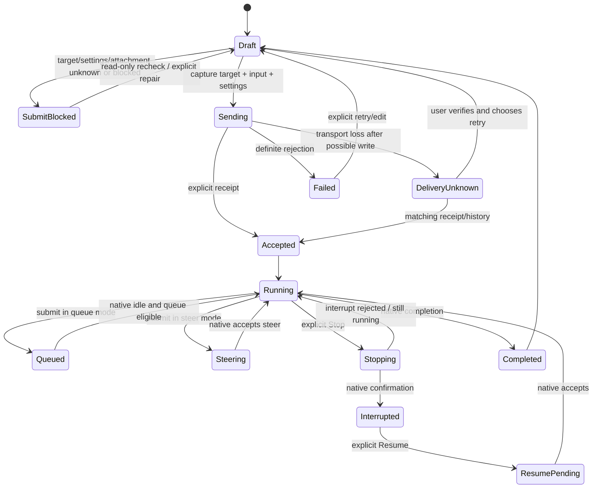

# Composer 本地客户端清单、状态机与差异（分工审计）

日期：2026-10-29。工作树 HEAD：`f6699ba`。原包：`third_party/openai.chatgpt-26.51007.21434-linux-x64/extension`。本文仅审计，不修改产品、不决定开发；cloud 执行/账号服务实现不在范围内。既有文档中的浏览器通过是历史证据，本文没有重跑真实发送或宣称当前验收通过。

## 证据读取方式与边界

本轮直接解析固定 shipped JavaScript AST、读取真实函数体和调用 props，并读取当前 TSX 实现。原包没有改写。`composer-source-index.json` 保存函数精确 UTF-16 起止（半开区间）、原始行号、exports/imports、文件摘要；`*.pretty.js` 只是 scratch 可读副本，格式化行号不当作原包行号。下文 `F:ewa` 等定位均指下表固定文件与原始 UTF-16 偏移；所有偏移用 JS 字符串/AST 计算，不是 UTF-8 byte offset。

|代号|原始文件（均在 extension/webview/assets）|SHA-256 / 关键函数|
|---|---|---|
|F|`app-initial-fee819fe4f22.js`|`460201045b5f5a4255fda737c9baa4768367a973d735cb37f3467bfe6af95316`；`bFa[5661558,5705395)` 主 composer；`ewa[5310704,5327833)` 主控件；`mPi[3899968,3902816)` placeholder；`gMa[5558767,5561127)` 提交快捷键；`hDa[5425418,5426710)` IDE context；`vDa[5426787,5428280)` init；`Iya[5191924,5192434)` rail 条件；`Yba[5225021,5230370)` 附件汇总；`hCa[5280001,5301359)` 模型控制；`lCa[5272198,5279481)` 模型菜单展示；`uca[4807115,4811579)` 模型 radio 菜单|
|U|`composer-utility-bar-f7a08ac0c453.js`|`606c0cf631ebf0f51ae3c445d2283a3d22b49e31c0f9b416475569463cf8b140`；唯一 export `Qd as ComposerUtilityBar`；`Qd[171072,183481)`；`Uu[117477,138067)` run-location 选择；`qd[167327,170914)` worktree toggle；`pd[153058,154460)` 连接状态展示|
|C|`composer-controls-7a6be63cddcf.js`|`85632e53090c39618a68595b17cd8d1cfff77d868d13e387382be8a811496210`；`cd[230993,231086)` 建立 `OrbitComposerSessionScope`；`ld[231086,231490)` active/session；`ud[231490,231631)`→`dd[231631,238701)` Orbit voice；`pd[238727,238827)` visible composer identity|
|Q|`queued-message-list-172645190dd2.js`|`b624ccec075695445cd1d86d6fc534388591948187f1800428fecb9aa3a10fbb`；`Be[5431,9606)` 列表、`We[9750,19720)` 队列行|
|P|`permissions-mode-dropdown-6fd05cb80d75.js`|`47e487782904c09ea598ad153b4ed50cfeb06e2fc6ac4681ad7b58658971c3ce`；`Ht[4223,11448)` Full Access dialog；`tn[19799,23680)` 旧模式；`an[23894,26615)` 旧 trigger；`vn[34601,36307)` 实际 export；`yn[36307,48453)` profile/自定义权限分支|

### 先纠正 chunk 归属，避免假缺口

`composer-controls` 并不是普通 Codex 主输入的全量实现。其 29 个 export 通过 AST 核对，`t=ud` 最终进入的 `dd` 使用 `OrbitComposerSessionScope`、`productSurface:'work'`；直接 import 者包含 `native-room`、`loading-chrome`、`avatar-overlay-native-page`。`Qu/$u/Uu` 等函数的大量条件与 iMessage/Aeon/Orbit 房间交互有关。普通 Codex 的实际主按钮/布局是 **F:bFa→ewa**。`app-initial` 中出现 C 文件名还可能只是动态 chunk 依赖清单，不能等价为普通 composer render 调用。

因此 C 中房间收件人、iMessage reaction、Orbit plan、Aeon 静音/讲话，不以“仓库缺失”计入待开发；但共享语音控制的存在与普通 `ewa/gMa` 语音分支交叉核对。U 的 cloud/远端 provisioning 字段同样不能直接算本次本地功能缺口。U 已逐读 Qd 的实际返回：多个计算出的远端面板最终写死 `null`，仅搜字符串会高估可见控制。

## 联动状态机

普通 composer 不是一个 `running:boolean`。至少有七条并行状态轴：

1. **目标/所有权**：new draft / 精确 local thread / side placement / 外部占用 / 恢复中 / 未知；决定读取、写入及当前设置来源。
2. **编辑**：空 / 文本 / 附件 / Goal draft / image markup / IME / 展开编辑；决定 placeholder、主动作、何时可清草稿。
3. **轮次**：idle / running / stopping / resume pending / interrupted / completed / failed；页面断线独立于该轴。
4. **投递**：准备→冻结正文、上下文、目标、设置→pending/sending→accepted/sent；失败或 unknown 不等价未发送。
5. **队列**：enabled queue / steer；每项 queued/pending/sending/failed/outcome-unknown；队列是否因显式 interruption 暂停。
6. **语音**：inactive / starting / recording / transcribing / recovery；官方还有 realtime visiblePhase 与会话静音；不能把转写中等价 turn running。
7. **权限与模型元数据**：loading/known/unknown/stale、catalog ready/error、默认/显式/锁定模型、权限能力与要求；UI 意图与运行层已生效配置分别保存。

这张图是跨层关系摘要，`DeliveryUnknown→Draft` 不是自动恢复，`Running→Queued` 也不会结束后台任务。当前项目队列存在服务端 revision/CAS、跨设备恢复，不能为“像原包”退化为页面内数组。

## 编号功能/状态对照矩阵

分类：**对应**＝当前存在语义对应，尚未宣称所有组合 runtime parity；**差异**＝已由当前代码与原函数体确认行为/呈现不同；**条件差异**＝原包分支存在，但本地 VS Code 是否启用还待宿主证据；**项目保留**＝项目特有能力，不应据官方没有同入口删除；**未闭合**＝不能凭静态/历史证据下定论。下表本地路径均相对仓库根；`CP/` 简写为 `apps/web/src/session-mode/components/codex/composer/`。

|ID|功能、触发与原包状态/退出|当前实现、差异与证据|分类|
|---|---|---|---|
|CMP-01|新建/后续输入 placeholder：F:mPi 按 image markup、Goal、Plan、follow-up type、custom override 顺序选文案；退出模式恢复对应文案。|`CP/nativeComposerPlaceholder.ts`、`Composer.tsx:840` 以 Goal→Plan→thread ID 选择；image markup/自定义 override/产品分支不是同一投影。普通 new/follow-up 已对应；完整 markup 不能据静态宣布相同。|对应/条件差异|
|CMP-02|普通编辑器与紧凑/单行：F:bFa 的 `layoutState.layout=Zs?'single-line':'multiline'`，提交/附件可改变状态；F:ewa 随 props 渲染。|`Composer.tsx:826` 固定 `data-composer-layout='multiline'`；手机固定输入高度是已批准适配。原包宿主、quick-chat 条件未全解，不能自动要求改为 auto-single-line。|差异，保留适配|
|CMP-03|焦点与隐藏输入：F:bFa 的 `disableAutoFocus`、focus target 与 `inputInert`；C:pd 排除 hidden/inert 只是另一个 Orbit 分支，不能混用当主输入证据。|`CP/composerFocus.ts`、`editor/ComposerEditor.tsx`、`NativeModelSelector.tsx:87` 当前检查可见 scope/owner；恢复被动草稿使用 SKIP_DOM_SELECTION_TAG。多窗口真实焦点关卡仍需。|对应/未闭合|
|CMP-04|普通文本、选区、撤销：F:bFa 持有 composerController/onUserInput/selection 回调，F:gMa 操作原 editor doc。|`CP/editor/ComposerEditor.tsx` 用 Lexical PlainTextPlugin、HistoryPlugin、原生选区同步插件；框架不同本身不是 bug，必须按操作效果验收。|对应|
|CMP-05|IME 与 Enter：F:gMa 屏蔽 composing/keyCode229/repeat；原 Enter 偏好经 `composerEnterBehavior` 读取。|`CP/editor/ComposerEditor.tsx:104`、`imeSubmitKey.ts`、`editor/submitIntent.ts`；当前 IME 守卫和三种 Enter 偏好对应。|对应|
|CMP-06|手机 Return：官方按实际宿主/editor keymap 决策；F:gMa 全局 body Enter 也受语音状态约束。|`ComposerEditor.tsx:123` coarse pointer 无 Ctrl/Meta 时固定换行；这是手机使用保留，不应为了桌面 Enter parity 删除。真 iOS 输入法尚未本轮验。|项目保留/未闭合|
|CMP-07|三种发送键偏好 enter/cmdIfMultiline/cmdAlways；离开菜单保持偏好。F:gMa 的 background submit 要避开代码块/特定 CtrlEnter。|`CP/ComposerEnterSettings.tsx` 三项对应；当前额外 CtrlShiftEnter 临时反向 queue/steer。普通/代码编辑/外接键盘需完整矩阵。|对应/项目保留|
|CMP-08|空闲有内容主动作 Send；F:ewa 非 loading、交互允许、submitDisabled=false 才可发送；空消息解释 tooltip nonce。|`Composer.tsx:275,1146`、`NativeSubmitButton.tsx`，Send/disabled/sending 均存在；阻断原因主要通过 statusText 展示，官方按钮内 blockedReason popover 的全部时机未等价。|对应/差异|
|CMP-09|运行空草稿 Stop；F:ewa `D==='stop'&&!ve`，stopping 变 loading，Esc 文案取决确认可见。|`Composer.tsx:1133` 主 Stop，仅显式 requestStop；失败后保持草稿。是否与原包确认/双 Esc 全组合相同未验。|对应/未闭合|
|CMP-10|运行有草稿 Queue/Steer 唯一主动作；F:ewa 根据 `isQueueingEnabled` 切按钮语义。|`Composer.tsx:275,1147` 当前 submitLabel 已按运行/模式切换，运行有内容时 Stop 移入附加菜单。旧文档最初固定“发送消息”的差异已关闭，不能重报。|对应|
|CMP-11|Resume：F:ewa 在 resume pending 或 `existingThread && resumeEnabled && !running && !hasGoal && empty-message` 时渲染 Resume，调用独立 onResume。|当前 `Composer.tsx:1133-1163` 仅 Stop/普通发送两分支，无同条件的 Resume 主动作；队列“继续”与发送“继续”不是原 onResume 证明。真正 interrupted thread API 能力由协议审计补证。|差异|
|CMP-12|主动作优先级：F:ewa 听写 finish-send→realtime send/end→Stop→Resume→voice start→normal Send；互斥渲染。|当前主动作根据 running/hasContent 分支，听写按钮独立；没有同一个完整主动作优先级投影。不是删项目额外入口授权。|差异|
|CMP-13|提交时捕获原目标、上下文、参数；F:bFa 向实际 submit controller 交出上下文，与 editor 执行分离。|`Composer.tsx:329-405` 捕获 thread start、goal checkpoint、settings、owner、draft revision、contexts/mentions；完成只清捕获版本。跨设备与持久草稿是项目保留。|对应/项目保留|
|CMP-14|确切失败 vs delivery unknown：Q:We 将 outcome-unknown 与普通 paused 错误分开；未证回执不自动重投。|`CP/FollowupQueue.tsx:57-81,146` 与 runtime followup service 区分 uncertain/failed，外部占用阻止 retry/resume；显式 recheck。不应把断线转换 interrupted 来解锁 UI。|对应|
|CMP-15|Queue waiting→pending/sending→accepted，运行中显式 steer 不 interrupt；Q:We `pending/sending && !paused` 显示 spinner。|`CP/FollowupQueue.tsx`、`FollowupSnapshot.tsx` 使用服务端 state/revision，queued/sending/uncertain 等字段；原包 submission 结构不同，需逐状态投影而非同名复制。|对应/项目保留|
|CMP-16|显式 Stop 后队列暂停与 Resume：Q:Be 的 interrupted header，首条 `canSendNow===false` 隐藏继续按钮。|`FollowupQueue.tsx:57,129` 按实际 paused/reason/unresolved/accessBlock；释放占用仅解锁显式操作，不自动重发。先前硬编码“中断”已修，不重报。原生 stop-and-archive 对队列的语义仍是单独产品决策。|对应/未闭合|
|CMP-17|每条队列送达未知：Q:We outcome-unknown tooltip 要用户查会话，不安全自动 retry。|`FollowupQueue.tsx` uncertain 项提供核对/确认 retry/remove，重试前只读 refresh access；有保存回执边界。与原包按钮禁用条件逐项需 fixture，不只测 toast。|对应/未闭合|
|CMP-18|队列 edit/delete/reorder，发送中禁 edit/delete；Q:We 用 dnd transform、hover handle，Q:Be 控制 reorderability。|`CP/QueueReorder.tsx`、`FollowupQueue.tsx`、`QueueMessagePreview.tsx` 已有拖动、编辑、删除与 undo；官方 hover 手柄/全部无障碍和 sending 状态组合未本轮重跑。|对应|
|CMP-19|队列 prompt 非模态全文预览与复制；Q:We 对文本+附件摘要最多80字符 aria，正文保持可读。|`QueueMessagePreview.tsx`、`queuePreviewText.ts`、`queue-message-preview.css`；当前已加非模态预览，不可沿旧“只显示纯文本”结论重报。完整 markdown/附件像素仍未闭合。|对应/未闭合|
|CMP-20|队列菜单 toggle queueing、side chat、send now；Q:We SendNow 要 `canSendNow` 且运行附件守卫。|`FollowupQueue.tsx:131` 菜单切偏好、side chat、retry/steer，附带项目冻结发送配置/上下文详情。当前 richer snapshot 是保留能力。|对应/项目保留|
|CMP-21|桌面列表与手机展示：Q:Be 全队列滚动、30dvh、paused header；具体 floating presentation 有条件。|`FollowupQueue.tsx` 当前桌面全显示；手机 compact shelf 仅首项+详情访问全部。不是漏消息；需区分可访问与首屏像素。|差异，批准适配|
|CMP-22|Rail 进入/退出与组合：F:Iya 由 portal/sandbox/WSL/transcript/queue/Goal/subagent/status/header 多条件决定 mount/offset。|`CP/ComposerRail.tsx`、`Composer.tsx:713-766` 包含 diff、待回答、队列、Goal；ModelChangeNotice rail 外。官方 banner/status 子集合与当前合成组合不同，不能只测容器边框宣布整体 parity。|差异/未闭合|
|CMP-23|Running changes 行主区与独立 View changes，当前 turn diff 结束后消失/保留依据上层。|`CP/RunningTurnChanges.tsx` 已有两个独立聚焦入口，同 thread/turn 的 diff。历史真实原组件几何已对过；本轮仅确认当前结构仍在。|对应|
|CMP-24|Goal rail 与其他 item 共存；F:bFa 的 `threadGoal` 参与 rail，Goal draft 改 placeholder 和权限位。|`Composer.tsx:751,1104`、`features/goals/ThreadGoalCard.tsx`；既有 Goal 元数据只写 Goal、不额外发普通 turn；新 Goal 首轮 accepted 后设置失败不能重发首轮。完整六状态由 Goal 专项审计补充。|对应/项目保留|
|CMP-25|Goal 替换/clear、退出 portal，F:ewa 的 `hasGoal/onClearGoal` 进入主控件。|`Composer.tsx:769-795` 捕获旧 objective/status/createdAt，确认前重查，`goalDrafts.ts` 按 owner 版本清理。当前 Web CAS guard 不能被描述成 native 跨客户端原子保证。|对应/未闭合|
|CMP-26|附加菜单 `@`：F:W4t actual tooltip/aria 与 F:bFa toggleContextSuggestions，image markup 时改走 addFiles。|`CP/ComposerMenu.tsx:157,225` 使用 plus 菜单与 MentionTypeahead；image markup 独立 DrawingEditor。普通菜单存在但进入 image markup 后上下文建议交互不等价。|对应/差异|
|CMP-27|文件/文件夹：F:bFa/Yba 保留 addedFiles、uploadedFileAttachments、pendingFiles、selectedText 分型和 host ID。|`ComposerMenu.tsx:42` `open({multiple:true,directory:false})` 的标签是“文件和文件夹”，实际参数不允许 directory；`ContextAttachments.tsx:29` 只读 text、拒绝 NUL/180k过长。复核 browser-dialog.tsx 后确认 false 走普通设备文件选择且无 webkitdirectory，true 才走服务端目录选择；当前标签与能力不匹配。|差异，适配器已确认|
|CMP-28|图片上传、删除、失败与 pending 防重复，F:bFa 的 Ca/images 与 imageCommentGroups 独立传入 Yba。|`common/useImageAttachments`、`Composer.tsx:213,238,653` blocked、hydration/storage error、8张限额；图片生命周期/回滚保留 owner。原包全部格式、preview 时机和截图像素不在本轮证明内。|对应/未闭合|
|CMP-29|图像标注与 sketch composer：F:bFa imageMarkupAttachment、imageCommentGroups、sketchComposer，markup ready 参与 submitReady。|`CP/v2/DrawingEditor.tsx` 和 `drawingTool.ts` 支持保存/撤销/发送引用；本地主编辑扩展不等价原生内嵌 markup，需要按坐标/注释和提交 payload 复验，不能仅因有画布判齐。|对应/未闭合|
|CMP-30|文本粘贴附件、还原正文：F:bFa `pastedTextAttachments/pendingPastes/handleShowPastedTextInTextField`。|`Composer.tsx:252`、`CP/v2/content.ts`、`ContextAttachments.tsx:108` 支持大文本归上下文、还原正文/移除；阈值和正文序号来源并不相同，需边界 fixture。|对应/未闭合|
|CMP-31|选中文本、响应注释、共享线程、MCP app context、appshot、Chrome selection、PR checks/conflict 等多个附件类型：F:bFa 明确传给 Yba。|当前统一 `ComposerContext` file/paste/message/quote 等快照与 plugins typed mentions，不能等价全部原生附件类型。部分属于桌面/浏览器/cloud分支，**需要证明 VS Code 本地可产生后才列开发缺口**。|条件差异|
|CMP-32|drop 及 Shift overlay：F:bFa interaction 有 `showShiftOverlay`、drop portal、submit block；处理根据 placement。|`CP/composerDrop.ts` 与 `Composer.tsx:806-827` 文件拖入显示提示；没有同一 Shift 行为投影。官方是否 VS Code 本地启用需宿主 fixture，不能只复制提示文字。|条件差异|
|CMP-33|文件上下文快照更新/恢复/undo：官方附件 source/order tracking 由控制器管理。|`ContextAttachments.tsx:29-151` 有15s读取超时、保存快照、检查源变化、用户更新、还原paste和undo；属于项目有用扩展，不能为原图尺寸去掉。|项目保留|
|CMP-34|IDE 自动上下文：F:hDa 真实命令 ID `ide-context`，仅 `ideContextStatus==='connected'` enabled，选中时 `setIsAutoContextOn(!current)`，不要求清空输入。F:ewa 收 `isAutoContextOn/ideContextStatus`。|`CP/slashCommands.ts:244` 的 `/ide` 只 `openDialog('ide')`；`Composer.tsx:1414-1437` 和 `SlashCommandDialogs.tsx` 没有 ide handler，当前点击无相应面板/切换。当前源码仅该一处 IDE 上下文文案。是已确认入口死路，能力补齐仍需评审 host bridge 边界。|差异，明确|
|CMP-35|`/init` 安全前置：F:vDa 对精确 cwd 的 AGENTS.md 走 `paths-exist`，存在则 toast 并 return，不提交任务。|`CP/slashCommands.ts:131-138` 确认后直接 `turnStart(await ensureThread(), initPrompt)`，没有同层存在性预检。是否模型最终覆盖不是本轮执行过的事实；缺少原检查已经确证。|差异，明确|
|CMP-36|本地/工作树位置切换：U:Uu 依据既有会话/跟随/工作树、busy与handoff决定能否改变 run location；U:Qd allowWorktree=`!followUp&&!response`。|当前 `Composer.tsx` 没有同一个新聊天 `composerMode local/worktree` utility control；`slashCommands.ts:277` 是已有thread fork+创建worktree，语义不同。不是要求删除原项目导航。|差异|
|CMP-37|Worktree toggle/命令：U:qd `composer.toggleWorktreeMode`、slash id worktree、requiresEmptyComposer=false，受工作区/可用性/feature flags 门控。|当前 slash registry 无 worktree mode toggle；已有 `forkSlashWorktree` 是另一功能。原包 flag可能隐藏该控件，需固定宿主flag再定是否VSCode必备。|条件差异|
|CMP-38|本地 environment dropdown：U:Qd 仅 `!followUp&&eligible&&workspaceKnown`，disabled/loading/error/reset；打开精确 configPath/workspaceRoot，没环境时转 `/settings/local-environments`。|当前主 composer 没有等价环境选择/加载状态；不能把 EnvKeysDialog API key 对话框算同功能。部分桌面 workspace 管理flag尚需确认在VSCode启用。|条件差异|
|CMP-39|分支 dropdown：U:Qd `cn=...&&!follower&&!outsideEditor`；按 hostId:cwd key，existingWorkspace时readOnly。|当前 CreateBranchSheet/项目工具有分支操作，主 composer 未渲染这个精确 host/cwd/follower 条件分支选择器。是否需要UI迁入由review决定，不能把所有Git能力说成缺失。|条件差异|
|CMP-40|项目选择：U:Qd 为 openProjectPicker command 计算 enabled 并聚焦composer；选中的项目与 run location 共同决定 cwd。|当前项目列表/关注标签/公共输入owner 联动为看板特有能力；它不应改成官方单项目状态。需要增加能力时复用现有 project selection，不再建平行store。|项目保留|
|CMP-41|模型默认/当前/未知/搜索：F:hCa 使用真实 authMethod/cwd/host/catalog状态、capabilities、当前model；F:lCa 包含 simple/advanced/default/locked/fallback。|`CP/NativeModelSelector.tsx:115`、`nativePickerPresentation.ts`、`ordinaryNativePickerModels.ts` 已有 simple power、advanced、搜索/最近、自定义/unknown 显示与loading/error重试。不是只一个硬编码下拉框；精确flag/capability模型集合完整parity仍待验证。|对应/未闭合|
|CMP-42|Power/effort：F:lCa 原模型支持的effort、locked model、fallback power selection决定slider和radio；选择完成与打开menu不同。|`NativeModelSelector.tsx`、`nativePowerWheel.ts`、`nativeReasoningOptions.ts`、`nativeModelIdentity.ts` 保留模型ID/canonical model双身份与实际支持的efforts，不应该为匹配alias丢identity。全部派生组合本轮未运行。|对应/未闭合|
|CMP-43|Fast/service tier：F:lCa props selectedServiceTier/options/loading 与 onSelectServiceTier；F:hCa 根据账号/host选择目录来源。|`CP/NativeServiceTierControl.tsx:12` 根据实际model.serviceTiers显示priority/fast toggle，否则多tier菜单；未知目录不伪造Fast。原包单toggle/默认tier与本地多tier extension区分。|对应/项目保留|
|CMP-44|权限 preset：P:vn 是真正 export，再按条件走旧tn或新yn；yn 读取 permission profiles、server default、requirements。不能把三个旧preset当全量权限。|`CP/AccessModePopover.tsx:18` 当前 Ask/Auto/Full + readonly/custom原生投影，`autoReviewCapability` 守卫；没有通用原生 profile 列表选择。原包profile分支是否当前VSCode enabled待门控证据。|条件差异|
|CMP-45|Full Access确认/Cancel：P:Ht 根据code/work/cyber分支展示风险与外部link，确认后才写权限；取消回原选择。|`NativeFullAccessConfirmation.tsx`、`AccessModePopover.tsx:104` 有异步ask后设置；`NativeUltraFullAccessConfirmation.tsx`/`ultraFullAccessGate.ts` 当前已存在，不能沿旧文档重报“缺Ultra”。实际组织requirements与会话权限版本仍需联合回归。|对应/未闭合|
|CMP-46|Plan是collaboration mode，不只是权限标签；F:bFa 有 activeCollaborationMode，F:mPi 改placeholder。|`AccessModePopover.tsx:51,222` Plan单独设置，`Composer.tsx` 参数捕获与goal模式互斥；“计划”翻译修正已批准，不应改回“套餐”。|对应|
|CMP-47|模型切换通知/升级/关闭：F:hCa 选择完成/菜单结束由独立回调，非所有store变化都等于用户选择。|`CP/ModelChangeNotice.tsx` 只显式accepted用户选择触发 completion notice；ModelUpgradeBanner 从真实catalog upgradeInfo生成，dismiss ID保存。全部公告优先级/当前原包notice具体分支仍需另一专项对照，不据相似文字宣称相同。|对应/未闭合|
|CMP-48|听写状态：F:ewa 从voiceControls读取 starting/dictating/transcribing/canRetry/micBusy，并在语音优先主动作中finish-send；F:gMa submit中先stopDictation('send')。|`BrowserDictationButton.tsx:19` start→record→stop→整段transcribe→append，主Send不会先finishForSend；没有相同波形/流式presentation/保留恢复UX。转写provider可用已有登录或本地Whisper，属于传输实现差异；不以云端实现为本次要求。|差异|
|CMP-49|听写取消启动：官方voice模型有abort/cancel/preserve入口，主`gMa/ewa`优先级处理starting。C:dd的Escape细节是Orbit分支，不直接归普通VSCode。|`BrowserDictationButton.tsx:174-185` starting时按钮disabled，但aria写“正在启动听写；点击可取消”，实际onClick也仅start且starting return；当前没有取消pending getUserMedia的action。描述与操作不一致是当前静态明确差异。|差异，明确|
|CMP-50|听写切目标/隐藏/卸载归属：原控制器按session和active输入守卫；C:dd另含hidden/inert防跨输入，仅作为共享设计参考。|`Composer.tsx:1124` `<DictationButton key={owner}>` 且onTranscript捕获owner；Browser button卸载mounted=false/cleanup，晚结果不追加；不能只看latest callback ref就误报串草稿bug。切模式stop会转写，可能在隐藏session保存原owner草稿，需显式产品预期验收。|对应/未闭合|
|CMP-51|Realtime voice：F:ewa 用visiblePhase选择send/end/start，remote project unsupported禁用，mic/speaker控制另行。|当前浏览器只听写，无对应realtime双向会话可见控件；原包此功能有feature/auth/host门控。仅说明本地客户端分支，不将云端语音后端列开发范围。|条件差异|
|CMP-52|展开编辑：原包普通editor controller可多行/代码块，但没有证明存在项目同样全屏 sheet。|`Composer.tsx:1325-1397`、`CP/v2/RichDraftEditor.tsx`、`CodeBlockEditor.tsx`、`formatSelection.ts` 是项目保留；普通/代码编辑、选区插入与返回保存必须继续保留，不将额外UI当缺陷。|项目保留|
|CMP-53|展开编辑提交/Stop：与主输入同frozen owner/submitLabel/queue-steer；运行草稿仍显式Stop。|`Composer.tsx:1344-1363` 展开模式保留直接Stop，与普通主输入Stop收进菜单不同；当前设计差异有明确历史批准，不自动合并删能力。|项目保留|
|CMP-54|错误可恢复性：原包按钮blockedReason、附件error、模型catalog retry、队列unknown分属不同轴，不能统一“已中断”。|当前 `Composer.tsx:657-703,1170` statusText按access/settings/attachment/queue优先级；出现一个错误不意味着轮次结束。原包所有优先级组合与当前全部文案尚未闭合；主线程的刷新/历史机器是必须独立核对项。|对应/未闭合|

## 明确差异与评审顺序（不是开发授权）

1. **优先评审可复现的入口/文案问题**：CMP-34 `/ide` 死路、CMP-35 `/init` 缺已存在AGENTS预检、CMP-49 听写启动“可取消”但不可点。CMP-27 已进一步核实 `browser-dialog`：设备文件上传与服务端目录选择是不同路径，现入口标签与能力不符。
2. **评审功能状态语义**：CMP-11 Resume、CMP-12/48 听写与主动作的联动、CMP-22 rail多banner组合。
3. **先证宿主flag，再决定是否开发**：CMP-37 worktree mode、CMP-38 local environment、CMP-39 branch selector、CMP-44 permission profiles、CMP-51 realtime。原包存在代码不保证该VSCode入口启用。
4. **保留项目能力**：多会话公共composer、按owner持久草稿、revision队列、跨设备标签、手机shelf、上下文快照/绘图与展开编辑。对照矩阵是保留这些能力后找准确差异，不以删功能作为parity捷径。

## 必须补的状态组合关卡

每一格都同时核对 UI 动作、实际目标thread、发送参数/回执与草稿归属；渲染按钮或HTTP200不足以判绿。本轮未执行这些运行验收。

|场景|主动作/编辑要求|队列/Goal/权限要求|证据状态|
|---|---|---|---|
|空闲空草稿/有正文/仅图片/仅上下文|Send disabled reason、placeholder、Enter|已存在Goal不额外普通turn|源码覆盖；原组件历史部分覆盖|
|运行空草稿|唯一Stop，停止中防重复|显式停止是否暂停队列|源码覆盖；本轮未实发|
|运行有草稿queue/steer|唯一主动作、单次反向、Stop菜单键盘可达|冻结输入/附件/设置，steer不隐式interrupt|历史1440/390证据，当前需重跑|
|失败/unknown|definite error与可能送达分别显示|先核对receipt，不自动重发|源码具保护，协议联合未闭合|
|断网→回网|草稿/编辑选区保持，独立connecting|后台running继续，metadata未知不冒充idle|需主线程连接机联合|
|运行中硬刷新/手机前后台|不得因consumer断连interrupt|SSE重播、history恢复、队列不重复|需主线程刷新机联合|
|长历史|加载不阻塞composer、旧事件不恢复错误target|tool正文预算/事件恢复不退化轮询|主线程范围；2s不是本文已验证指标|
|2/3/更多会话窗口|一个user action只能命中一个精确thread|模型/权限/Goal旧回执不得改另窗口|当前owner保护；本轮未做组合browser|
|同thread跨设备|偏好最新意图、各设备草稿独立|queue revision与运行writer独立|当前设计保护；本轮未实测|
|听写starting/recording/transcribing时切thread|pending权限结果/转写不得串owner|应明确切模式是否保存转写|CMP-48/49/50需专项runtime|
|Goal+queue+diff+notice+approval共存|rail可达、Portal离场清理、手机不遮动作|approval/Goal不可隐式发送普通turn|历史部分真实组件证据，全集未闭合|
|未知catalog/权限/外部占用|可见原因与reload，禁推导默认权限|不acquire/resume只为读取|源码具对应守卫；原包门控未全确认|

## 仍未证明的部分

- 不能称“完整逆向已完成”：本分工已提供54项清单与主调用/状态轴，但一些宿主feature gate、所有附件类型的VSCode可达性、realtime与local environments仍需实际宿主证据；云端执行明确排除。
- 未启动reference、未连接生产IPC、未发送/停止任务，故本轮没有新增浏览器绿灯和性能p95结论。历史原组件夹具只证明声明props的真实渲染，不证明顶层真实状态计算。
- 模型/权限的运行scope、Goal实际协议与队列runtime完整写入顺序，需与其他专项清单交叉；本分工只审计composer可见控制与调用。
- 本轮没有用AST alias等同功能，也没有把chunk依赖数组等同render调用。C的Aeon/Orbit分支独立留在来源索引，避免丢失包内全量清单，同时不污染VSCode本地差异。

辅助产物：`composer-source-index.cjs/json`、`composer-locate.cjs`、`composer-locations.json`、`composer-utility.pretty.js`、`composer-controls.pretty.js`、`app-fee.pretty.js`、`queue.pretty.js`。工具读取没有执行原包模块；REA总Evidence由主线程统一维护。
