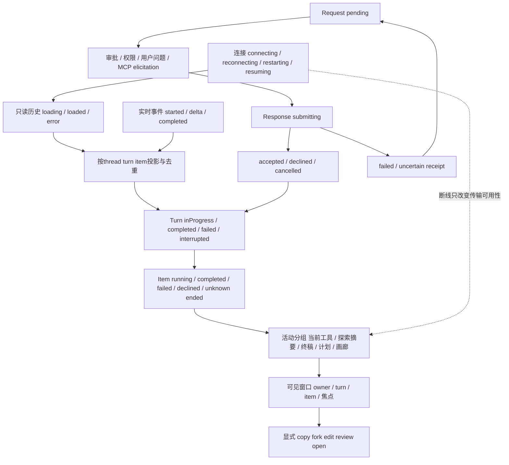

# 正文、工具、请求与轮次状态审计（供主文档合并）

本文件是只读审计产物，不是实施方案，也没有修复/重启/发送任务。当前仓库基线 `f6699ba`；官方基线固定为本地 `openai.chatgpt-26.51007.21434-linux-x64`，仅审计本地插件客户端路径。云任务/云自动化专属能力不纳入开发差异；MCP App 是本地 MCP 服务器也能提供的客户端能力，因此保留。

“静态对应”只表示已读官方实际分支与当前组件，不等于本轮真实浏览器/原生协议全组合验收。旧设计文档的未完成条目没有被直接当成当前缺陷。此轮没有读取用户正文、登录配置、默认 IPC，也没有执行模型轮次。

## 证据方法与追踪关系

原包文件保持不变，阅读副本用仓库 Prettier 通过 stdin 格式化到 `transcript-sources/`。`transcript-sources/manifest.json` 为首批副本保存SHA；`transcript-anchors.json` 对下方50个精确原包锚保存原始资产SHA、needle、excerpt与 **0-based UTF-16 offset**。格式化行号不能当原包行号；下面的 `Oxx` 均能回到原始文件偏移。

已追踪真实导入：`local-conversation-turn-fedd6e6b26d3.js` 从 `sites-end-resource-733bd1c6da06.js` 导入 `w as fa`（单项渲染器 `RD`）、`D as Mi`（包装渲染器）、`T as Ui`（计划展示）；它调用 `split-items-into-render-groups-a142b98982d4.js` 的实际 `p` 函数得到 user/agent/final/approval/elicitation/plan 等分组。以下没有跨chunk把同名minified alias视为同一函数。

原包链：原始turn/items + requests → normalized turn → split into render groups → activity/group renderer → item-specific renderer → message actions/side panels。当前链：native notifications/history → normalizeQuestion/UserMessage → projectTranscriptItems → deriveRenderItems → buildThreadRows → activityRows → projectTurnWork → 虚拟列表/EventItem/组件。两条链的抽象层数不同，按可见功能和授权状态比较，不强求同一内部数据结构。

## 相互关联的状态机

约束：

1. **连接状态不是turn状态**：reload/SSE断开不能自行构造interrupted；已有历史interrupted仍是该轮的真实终态。
2. **turn结束不证明每个item成功**：当前 `projectTranscriptItems/deriveRenderItems` 只有原生final item snapshot才可覆盖工具状态；缺失时记termination，不能把它补成completed。
3. **请求状态独立于正文**：审批/问题不以工具JSON文本代替，回复按精确request身份；uncertain不能靠切换标签重发。
4. **渲染缓存不拥有任务**：折叠/虚拟化/不可见正文回收只改变呈现，不能cancel turn、清writer或重新投递。
5. **用户动作捕获owner**：copy读当前消息；fork/edit/image editor须捕获原thread/turn/item与草稿revision；另一个窗口切换不迁移目标。

## 功能、触发、条件、错误和退出矩阵

每行的状态列同时列出触发、准入条件、错误/退出；`Oxx`与`Lxx`在后文给精确来源。覆盖54项，含已实现项和待确认项。

| ID | 功能 | 状态 / 触发 / 条件 / 错误与退出 | 官方证据 | 当前代码 | 判断 |
|---|---|---|---|---|---|
| T01 | 用户正文/Markdown | user-message到达；非空文本显示，长正文可折叠；copy/edit由权限与最新消息条件控制；用户显式关闭编辑退出。 | O11,O50 | L02,L26,L46 | 静态对应；长文本20行裁切、代码块边界/隐藏焦点均已有，非缺失功能。 |
| T02 | 用户附件与引用 | 用户文本、image/localImage、audio/localAudio、skill、mention按类型渲染；资源不可读只报附件错误，不改另一个thread。 | O11 | L02,L33 | 静态部分对应；全部官方附件组合与原生上下文chip视觉仍需成对样例。 |
| T03 | 助手流式正文 | agentMessage delta→未完成消息→completed终稿；完成前不给copy/fork；空消息隐藏。 | O09,O10,O12 | L01,L04 | 差异 D1：当前流式正文纯文本，完成后才Markdown；原包流中也执行Markdown，立即渲染代码块。 |
| T04 | 助手最终正文/行动条 | assistant completed后Markdown+copy/fork/hook/memory/Goal等；未聚焦/悬停时行动条策略受控。 | O08,O12,O34,O35 | L01,L24,L25,L38 | 静态对应主路径；无本轮真实浏览器全视觉对照。 |
| T05 | commentary 与 final_answer分层 | latest模式把多个commentary压到最后当前项，final answer独立；all显示完整工作过程；新用户消息清空currentCommentary。 | O02,O40 | L31,L05 | 差异 D2：本项目以整turn工作折叠实现过程/终稿区分，运行中过程全展开，未实现官方latest仅保留最新commentary的同一呈现。 |
| T06 | 公开reasoning摘要 | reasoning summary增量→Thinking→完成后Thought可展开；不把原始reasoning textDelta给正文。 | O17 | L19,L04,L36 | 静态对应；当前额外对稀疏索引做边界保护。 |
| T07 | turn工作时长/折叠 | 运行计时；完成/失败/中断后可折叠过程；历史时长缺失回退，不把未知时间当0。 | O16,O41 | L31,L32 | 静态对应核心，文案差异：历史中断当前另外显示“该轮已中断”Badge。 |
| T08 | 命令执行与解析动作 | exec read/search/list/unknown分支；未完成探索正文隐藏，结束显示；失败/拒绝保留状态；点击展开详情。 | O18 | L06,L43,L44 | 静态对应；历史正文受内存投影限制，见D6。 |
| T09 | 连续命令分组 | 相邻命令合并；其他可见项或turn边界冲刷；迟到completed更新原位置，不移动该命令到末尾。 | O01,O18 | L06,L05 | 静态对应；需要长历史/高频输出浏览器运行验证。 |
| T10 | 工具活动聚合 | exec/patch/mcp/web/dynamic可聚合；运行中活跃工具，已完成计数/摘要；阻塞请求使活动区进入waiting。 | O01,O42 | L05,L47 | 静态对应大类，原包语义注册表与当前实现有大量映射，不能宣称仅通用JSON。 |
| T11 | 文件变更单项 | patch等待/完成/失败/取消；readonly/work视图可隐藏raw diff；显示原始提交patch而非当前Git状态。 | O19 | L03,L22 | 静态对应；元数据历史不得伪造可撤销patch。 |
| T12 | turn文件汇总/diff入口 | turn-diff聚合本轮文件/增删数；单文件hover/点击、多个文件滚动；打开review侧栏。 | O25 | L22 | 静态对应主路径；目前mobile列表阈值4、desktop6为本项目呈现。 |
| T13 | 撤销/恢复patch | 从精确turn/batch的保存patch执行undo/apply；读入失败、缺正文/receipt未知应保留数据并阻止重复突变。 | O25 | L22,L23 | 当前SavedPatchAction已接入；与官方完整undo冲突对话的逐状态差异本范围证据不足。 |
| T14 | 代码审查结果 | assistant review findings→标题/位置/body/回复；无findings仍可显示确定审查scope；打开同scope diff失败只留错误。 | O12 | L01,L23 | 静态对应主要结果；官方原始review专用数据到当前指令解析之间仍需协议样例证明。 |
| T15 | web search/search open/find | webSearch action显示query/url/pattern；运行/已搜索；site:子句提取hostname摘要；完成退出shimmer。 | O15 | L07 | 静态对应。 |
| T16 | image-view | 一或多图；metadata-only不加载像素；有效路径只读获取；失败可重试，不跨owner复用迟到返回。 | O14 | L07 | 静态对应；动态路径读取按当前cwd/thread捕获。 |
| T17 | 生成图片占位与画廊 | 无src且inProgress→占位；完成src→缩略图画廊；失败/额度分支；已有图片可与新占位共存。 | O13 | L08 | 静态对应画廊/占位；D7：原包有image_gen额度专门failure卡，当前只通用imageFailed/imageUnavailable。 |
| T18 | 生成图片编辑/下载 | 有像素后Download/Edit；编辑捕获源thread草稿owner，异步读文件失败只报错；退出editor不送turn。 | O13 | L08 | 静态对应，功能已实现，不列旧“未实现图像编辑”。 |
| T19 | context compaction | start→compacting→完成；source与开始时间参与文案；turn提前终止不伪报成功。 | O27 | L09,L07 | 静态对应。 |
| T20 | 普通MCP调用 | started→进度→result/error；参数展开最多首4项可再展开；text/image/audio/resource与structured/raw视图。 | O28 | L10,L11 | 静态对应普通MCP；原始json只按需挂载。 |
| T21 | MCP App交互widget | mcpAppResourceUri/工具catalog→resource加载/身份验证→HTML widget；有加载、资源/目录错误与refetch状态。 | O28,O33 | L10,L11 | 差异 D3：类型声明保留mcpAppResourceUri但当前渲染链没有消费；普通结果/结构化JSON不等于MCP App交互。 |
| T22 | 动态工具注册表 | dynamic-tool-call按namespace/tool识别hidden/summary/groupable；codex_app已知目标可跳转；运行态shimmer。 | O29 | L12,L47 | 静态对应本地target；ChatGPT/远端host目标明确能力不可用（本轮排除云端，不列bug）。 |
| T23 | 隐藏工具/协议噪声 | steered/review-mode/sleep及仅控制事件不分配可见行；unknown不应冒充已支持交互。 | O13,O29 | L07,L36,L03 | 差异/候选 D8：未知method/item有CollapsedJson fallback；thread/readState/changed未在hiddenMethods。若运行层转发，仍会显示技术记录；当前端到端可达性未重验。 |
| T24 | 命令审批 | exec.approvalRequestId且未返回exitCode→阻塞；once/session/execpolicy/allow-host/block-host只显示allowed decisions；一次响应后pending→完成。 | O07 | L13 | 静态对应；网络独立领先动作、菜单、输入法/重复键保护已有。 |
| T25 | 文件变更审批 | patch approval且success未知→原patch审批；允许本次/会话或拒绝；显示精确request turn/item快照。 | O06 | L13 | 静态对应；不读当前Git以免错配旧审批。 |
| T26 | 临时权限请求 | permission-request未completed→权限卡；network/read/write/entries展示；turn/session/strict/deny响应；错误留RPC notice。 | O21 | L14 | 功能静态对应；当前卡片为通用Badge/Button布局，未证实与原生权限专卡视觉相同。 |
| T27 | 同步request_user_input | pending userInput退出普通正文、阻塞提示waiting；逐题选项/自定义/secret/跳过/键盘；提交响应恢复原turn。 | O04,O42,O46 | L15 | 静态对应主路径；当前submitting/uncertain锁与草稿身份已有。 |
| T28 | 异步问题/回答消息 | assistant async/requestUserInputAsync不当作终稿；到达问题独立提示；用户答复只更新对应source问题；重复回放去重。 | O01,O12 | L41,L03 | 静态对应主流程；后台提醒、多窗口presentation已在arrival层，运行组合未重验。 |
| T29 | MCP form elicitation | pending request→解析schema→逐字段验证→accept/decline/cancel；单选180ms进下一题，末题显式提交；不支持schema留明确信息。 | O03,O20,O46 | L16 | 静态对应大类；schema是否全覆盖须给每种schema受控样例，不能因表单组件存在就算全验。 |
| T30 | MCP form键盘Escape | 原包活跃form Escape直接Te(cancel)；之后等待取消回执；键盘不能在输入法组合中触发。 | O47 | L16 | 差异 D4：当前Escape只setCollapsed(true)，显式Cancel按钮才发送cancel。是可review交互差异，不自动改。 |
| T31 | MCP表单图片/文件选择 | imagePicker画廊/比例/多选与文件schema；仅有文件选择能力调用者暴露picker；上传失败保留字段。 | O46 | L16 | 静态部分对应；当前普通MCP无onPickFile能力时不暴露文件选择，为明确宿主能力边界。 |
| T32 | URL/auth/tool审批elicitation | pending按elicitation.kind区分表单/工具授权/browserAuth/urlAction等；completed从阻塞区退出并保留历史所需信息。 | O03,O20 | L16 | 静态对应部分；原包12种elicitation分型与当前normalized request必须另用真实请求逐个验。 |
| T33 | 自动审批审核 | inProgress/approved/denied/aborted/timedOut；approved通常隐藏、其他挂详情；denied提供明确人工授权入口。 | O30 | L17,L05 | 静态对应多状态；当前精确denial action/重放guard已有，不得据旧文档列缺失。 |
| T34 | hook消息/统计 | hookPrompt正文；非running runs加入统计；blocked/failed警告，error/feedback/stop等历史细节；关闭dialog退出。 | O08 | L18,L01,L03 | 静态对应；当前来源admin/user/project/plugin等映射已有。 |
| T35 | 模型改派通知 | model-rerouted独立notice；当前highRiskCyberActivity显示详情/复核链接；未知reason不显示确定解释。 | O26 | L17 | 静态对应已知原因；新增原包reason需真实协议证据。 |
| T36 | 子Agent工具活动 | spawn/send/resume/close/interrupt/list与状态inProgress/completed/failed；wait控制项隐藏；展开接收者与prompt。 | O31 | L27 | 静态对应；listAgents中文“房源/挂牌”当前复刻bundle措辞，属于翻译质量项而非能力缺失。 |
| T37 | 子Agent原生进展消息 | started/completed/interrupted/interacted→昵称/路径状态行；点活动打开精确子thread；不据通信推断亲子关系。 | O32 | L27 | 静态对应；原生isMessage grouping与本地kind映射仍需受控历史。 |
| T38 | 子Agent侧栏与读写边界 | active/done列表，waiting计数、elapsed/model/reasoning；详情只有canInteract===true才开放交互；返回不停止任务。 | O48 | L28 | 静态对应核心；当前独立观察集合/授权更严格是产品安全要求。 |
| T39 | 加载历史失败提示 | history loading/error/loading-state分开；失败显示Couldn’t load messages + Retry；已加载行不证明本次加载成功。 | O37 | L29 | 静态对应提示；D5：官方初始化全局error时Retry可location.reload，当前走只读retry避免整页/Agent副作用。 |
| T40 | 更早消息分页 | 顶部loading sentinel加载older page；错误替换Try again；保留原生cursor；恢复滚动锚点。 | O38 | L39,L34 | 静态对应；长历史工具正文裁剪是有意内存边界。 |
| T41 | 断线/恢复提示 | connecting/restarting/resuming/loading/reconnecting相互区分；未恢复状态不能当native turn interrupted；成功恢复回正文/输入区。 | O39 | L29,L39 | 本范围只核对提示层，实际连接恢复状态机由主审计覆盖；不能从截图推断仍有中断bug。 |
| T42 | 历史failed与错误通知去重 | system-error/stream-error分型；willRetry继续显示重连/过载，终端错误只显一次；persisted turn无error event也显示失败。 | O23,O24 | L30,L40,L03 | 静态对应主要错误；runtime重试能力与剩余策略另验。 |
| T43 | 历史interrupted呈现 | 真实turn.status=interrupted可保留历史终态；只读refresh不产生新的interrupt；旧终态不覆盖新turn正文。 | O16,O41 | L03,L31 | 静态已做明确“该轮已中断”历史解释；本轮未执行真实刷新复现，不宣称用户旧截图问题再现或已彻底关闭。 |
| T44 | 长历史/大输出与详情 | 官方支持summary items/older turns与details；本项目view=chat接收前裁正文、流式head/tail有界、只读详情按需。 | O18,O28,O38 | L37,L39,L10 | 有意差异 D6，保留；不能为了视觉对齐取消预算或完整历史轮询。 |
| T45 | 消息copy富文本 | completed assistant生成text/html clipboard；拒绝/失败提示；复制成功临时反馈；动作不能跨owner影响草稿。 | O36,O50 | L24 | 静态对应；助手2000ms/用户1500ms反馈、rich clipboard已有。 |
| T46 | 从回复分支并引用选区 | completed assistant fork按钮；捕获turn和选区；创建新thread成功后导航/草稿引用；失败或结果未知不盲目重发。 | O35 | L25,L42 | 静态对应；选区需始末都在该消息，未因为多个窗口就广播。 |
| T47 | 编辑用户消息/回退 | 官方只最后用户消息有onEdit；新输入进入inline editor；本地回退前捕获turn，运行/uncertain禁重复操作，草稿冲突合并保护。 | O40 | L02,L26 | 静态对应native editor入口；通用fallback采用确认回退与原草稿revision合并，属于产品安全差异。 |
| T48 | 计划Markdown/展开 | proposed-plan从普通agentItems分离，默认折叠；streaming Writing plan；完成后copy/open/download启用。 | O43,O44,O45 | L20 | 静态对应；当前额外计划side/window保留owner，不是缺失。 |
| T49 | 计划文档open/download/copy | 完成plan可Download、Side panel、New window；不自动发implement turn；下载失败不改变聊天状态。 | O43,O44,O45 | L20 | 静态对应入口；平台宿主保存API不同，浏览器为Blob下载。 |
| T50 | todo-list计划进度 | todo-list与proposed-plan区分；更新已有轮plan条目，不每次append；pending/inProgress/completed样式；无计划不占行。 | O22 | L21,L04 | 静态对应。 |
| T51 | 文件引用与memory citation | 正文中的路径/行号打开精确工作区；memory条目仅有有效entries时显示tooltip；copy清洗原始标记。 | O34 | L33,L38,L48 | 静态对应本地file/memory；来源完整侧栏另见T52。 |
| T52 | Sources完整聚合面板 | 官方按hostname分网页、按provided/read/created/updated分文件、MCP source调用计数与截断输入/结果预览；侧栏展开/关闭。 | O49 | L33,L48,L10 | 差异 D9：当前只有inline文件citation与MCP活动摘要，未找到完整Sources侧栏消费；待主审计shell交叉确认。 |
| T53 | 会话内查找与导航 | 按conversation/entity/item定位与高亮；更早结果需页加载后reveal；错误不制造虚拟位置；过期查询不改新thread。 | O40 | L34,L35,L39 | 静态对应本地UTF16 occurrence/cursor导航；原包完整search实现需主审计进一步跟踪。 |
| T54 | 多窗口正文身份 | 消息/工具/编辑/引用/审批都携带thread/turn/item；未聚焦与隐藏面板不捕获操作；迟到结果只写捕获源。 | O40,O48 | L01,L25,L26,L39,L13 | 静态guard存在；同一任务多窗口运行/审批/刷新全组合未做本轮动态验收。 |

## 必需场景对照矩阵

这张矩阵是“每个场景必须比较什么”，静态证据不冒充运行结果。七个场景的当前动态结果均为 **本轮未执行**；历史测试文件存在只作为可复验入口。

| 场景 | 官方明确状态/期望 | 当前源码对应 | 当前差异或必须复验点 |
|---|---|---|---|
| 空闲 | completed无shimmer；copy/fork和plan操作可用；无pending请求不留阻塞卡 | AgentMessageItem、projectWorkflowRows、NativeGeneratedImages、PlanContentItem | D1只发生流中；D3/D9依功能是否出现；验证终稿可复制、composer草稿保持 |
| 运行 | commentary/current activity、Thinking/Searching/Generating，未完成探索内容隐藏；阻塞提问显示waiting | activityRows、projectTurnWork、RequestUserInputItem、ElicitationItem | D1流式纯文本、D2过程展开不同；验证多个thread并行不混shimmer/时长 |
| 失败 | stream-error与system-error区分；willRetry时仍在恢复；终端失败一次展示；item未完成不能伪成功 | TurnFailureNotice、NativeRetryNotice、projection renderTermination | D7图像额度专卡未对齐；缺最终item快照/审批失败/unknown receipt需实测 |
| 断线 | reconnecting/resuming只代表传输，不是用户中止；pending request/已显示正文保持 | CodexHistoryNotice及stores/runtime由主审计覆盖；RPC delivery store | 待实测真网络断开、后台手机恢复、请求提交中断；不能只mock EventSource算原生验收 |
| 刷新 | 从历史恢复真实turn/item状态、未完成请求；不能刷新一次新增interrupted；重复事件不多一条用户气泡 | projectTranscriptItems、normalizeQuestion/UserMessage、row keys、turnWork | 现有“该轮已中断”历史badge不是当前断线状态；D5只读Retry与官方部分reload差异需保留产品意图 |
| 长历史 | older pages/summary items、加载失败Retry、定位搜索结果后保持阅读位置；局部详情可展开 | CodexThread虚拟列表、earlierHistoryScroll、nativeSearch、memoryBudget | D6有界投影是要求；验证assistant终稿/审批/子Agent元数据不被裁掉、JS堆+RSS与传输量 |
| 多窗口 | 每条消息/请求有host/conversation/turn/item身份；子详情只有canInteract真才写；隐藏页不截快捷键 | ownerContext、NativeMessageFork、NativeInlineUserEditor、SubagentPanel与request stores | 源码guard存在但三窗并发和跨设备多页本轮未测；输入参数/草稿不可由迟到回执写另一thread |

## 差异清单，供review选择

| ID | 范围与已证实差异 | 结论边界/建议review问题 |
|---|---|---|
| D1 | 流式Markdown：官方正文渲染器流中给Markdown `isStreaming`，`renderCodeBlocksImmediately:true`；当前AgentMessageItem流中纯文本，完成才Markdown | 确认是否需要恢复渐进Markdown/代码块呈现；实现时必须保留有界segment，不可每token join全历史 |
| D2 | latest commentary：官方latest仅留最后current commentary；当前工作turn运行时全部展开，完成后统一折叠 | 产品呈现差异，是否照搬latest还是保留完整过程由用户review；不把内部架构不同称为bug |
| D3 | MCP App widget：官方有catalog/resource load+identity verified+HTML widget；当前仅普通MCP block/JSON，未消费mcpAppResourceUri | 本地MCP也适用。若选开发，需要完整资源身份/权限/消息边界，不能直接把任意HTML放iframe |
| D4 | MCP form Escape：官方cancel；当前collapse，取消按钮才cancel | 已定位到实际事件处理分支；目前有意保护未提交字段的可能性，需用户决定交互 |
| D5 | history Retry：官方特定全局初始化error可window.reload；当前只读重新加载历史 | 当前行为符合“不因断线整页重载”的仓库要求，建议保留，不当缺陷修复 |
| D6 | 历史详情与流式正文有界：本项目接收前裁工具正文、按需详情、head/tail bounded preview，官方普通完整渲染器无此相同投影结构 | 明确项目内存/可靠性边界，必须保留，不因parity放宽预算 |
| D7 | 图片失败：官方image_gen usageLimitExceeded专卡/引导；当前无图像额度字段专门消费，只有通用失败/不可用 | 原包分支确定；此版本schema/真实本地provider是否可送该failure需协议fixture验证 |
| D8 | 未知协议事件fallback可见JSON：EventItem default + threadRows hiddenMethods未含thread/readState/changed | 只是**条件性候选**，本轮未追完运行层filter/未知通知转发，不能确认当前UI仍会出现截图里的那条技术事件 |
| D9 | 完整Sources侧栏：官方有网页host、文件provided/read/created/updated、MCP源调用次数及截断输入/结果；当前查到inline citations/MCP摘要，无同完整侧栏 | 主审计shell需要交叉核对可达入口；静态查找阴性不是全部能力不存在的绝对证明 |

额外不应误列为缺失：当前生成图片编辑/下载、native message rich copy、选区分支、计划新窗口/侧栏/下载、原生审批allowed decisions、MCP逐字段表单、原生审核denial action、hook统计、文件citation与memory tooltip均已有实现。云自动化heartbeat专用structuredOutput、云端Google Drive资源、云任务end card不纳入本轮差异；官方资产含这些分支不说明本地VS Code启动必定可达。

## 可复验入口与未做事项

本轮只检查源码/记录路径，没有运行tests，也没有发送任何原生任务。下面的测试文件已存在；若下一轮选实施，先明确每项产品语义，再挑对应失败用例与真实浏览器关卡，不能把文件存在当作绿灯。

- `components/codex/items/EventItem.performance.test.tsx` / `NativeActivityItem.test.tsx` / `NativeGeneratedImages.test.tsx`
- `components/codex/items/ApprovalItem.native.test.tsx` / `RequestUserInputItem.native.test.tsx` / `ElicitationItem.native.test.tsx`
- `components/codex/thread/activityRows.test.ts` / `turnWork.test.ts` / `turnWorkScale.test.ts`
- `features/thread-workflows/NativeMessageFork.selection.test.tsx` / `NativeMessageCopy.http.test.tsx`
- `features/subagents/SubagentEvent.native.test.tsx` / `identity-regression.test.ts`

末尾有机器检查的存在列表。

## 本地代码定位

`Lxx`指向当前HEAD源码的已读功能入口；同文件内有相关helper/guard时以表格描述为准。

| ID | 当前文件:行 | 搜索锚 |
|---|---|---|
| L01 | `apps/web/src/session-mode/components/codex/items/AgentMessageItem.tsx:39` | `export const AgentMessageItem` |
| L02 | `apps/web/src/session-mode/components/codex/items/UserMessageItem.tsx:176` | `export const EditableUserMessageItem` |
| L03 | `apps/web/src/session-mode/components/codex/items/EventItem.tsx:74` | `const getRollbackTurnsForTurn` |
| L04 | `apps/web/src/session-mode/components/codex/thread/projectTranscriptItems.ts:17` | `export function projectTranscriptItems` |
| L05 | `apps/web/src/session-mode/components/codex/thread/activityRows.ts:134` | `const groupable` |
| L06 | `apps/web/src/session-mode/components/codex/thread/deriveRenderItems.ts:35` | `export function deriveRenderItems` |
| L07 | `apps/web/src/session-mode/components/codex/items/NativeActivityItem.tsx:129` | `export function NativeActivityItem` |
| L08 | `apps/web/src/session-mode/components/codex/items/NativeGeneratedImages.tsx:197` | `export function NativeGeneratedImages` |
| L09 | `apps/web/src/session-mode/components/codex/items/NativeCompactionItem.tsx:6` | `export function` |
| L10 | `apps/web/src/session-mode/components/codex/items/McpToolCallItem.tsx:19` | `export function` |
| L11 | `apps/web/src/session-mode/components/codex/presentation/ToolContent.tsx:162` | `function ToolBlock` |
| L12 | `apps/web/src/session-mode/components/codex/items/NativeDynamicToolItem.tsx:18` | `export function` |
| L13 | `apps/web/src/session-mode/components/codex/items/ApprovalItem.tsx:33` | `export function ApprovalItem` |
| L14 | `apps/web/src/session-mode/components/codex/items/PermissionsItem.tsx:37` | `export function` |
| L15 | `apps/web/src/session-mode/components/codex/items/RequestUserInputItem.tsx:23` | `export function` |
| L16 | `apps/web/src/session-mode/components/codex/items/ElicitationItem.tsx:38` | `export function` |
| L17 | `apps/web/src/session-mode/components/codex/items/NativeSystemNotice.tsx:81` | `export function NativeAutomaticReviewItem` |
| L18 | `apps/web/src/session-mode/components/codex/items/NativeHookStats.tsx:14` | `export function NativeHookStats` |
| L19 | `apps/web/src/session-mode/components/codex/items/ReasoningSummaryItem.tsx:10` | `export function` |
| L20 | `apps/web/src/session-mode/components/codex/items/PlanContentItem.tsx:30` | `export const` |
| L21 | `apps/web/src/session-mode/components/codex/items/TurnPlan.tsx:36` | `export function TurnPlan` |
| L22 | `apps/web/src/session-mode/components/codex/items/ThreadFileChangesSummary.tsx:38` | `export const` |
| L23 | `apps/web/src/session-mode/features/git/NativeReviewFindings.tsx:13` | `export function` |
| L24 | `apps/web/src/session-mode/features/thread-workflows/NativeMessageCopy.tsx:11` | `export function` |
| L25 | `apps/web/src/session-mode/features/thread-workflows/NativeMessageFork.tsx:23` | `export function` |
| L26 | `apps/web/src/session-mode/features/thread-workflows/NativeInlineUserEditor.tsx:20` | `export function` |
| L27 | `apps/web/src/session-mode/features/subagents/SubagentEvent.tsx:46` | `export function` |
| L28 | `apps/web/src/session-mode/features/subagents/SubagentPanel.tsx:90` | `export function` |
| L29 | `apps/web/src/session-mode/components/codex/thread/CodexHistoryNotice.tsx:7` | `export function` |
| L30 | `apps/web/src/session-mode/components/codex/items/TurnFailureNotice.tsx:9` | `export function` |
| L31 | `apps/web/src/session-mode/components/codex/thread/turnWork.ts:18` | `export function` |
| L32 | `apps/web/src/session-mode/components/codex/thread/TurnWorkHeader.tsx:29` | `export function TurnWorkHeader` |
| L33 | `apps/web/src/session-mode/components/codex/presentation/CodexMarkdown.tsx:155` | `export function` |
| L34 | `apps/web/src/session-mode/features/thread-workflows/nativeSearch.ts:17` | `export async function` |
| L35 | `apps/web/src/session-mode/features/thread-workflows/useNativeThreadSearch.ts:21` | `export function` |
| L36 | `apps/web/src/session-mode/components/codex/thread/threadRows.ts:19` | `const hiddenMethods` |
| L37 | `apps/web/src/session-mode/services/codexTranscriptMemoryBudget.ts:10` | `const TRUNCATION_MARKER` |
| L38 | `apps/web/src/session-mode/components/codex/items/NativeMemoryCitations.tsx:12` | `export function` |
| L39 | `apps/web/src/session-mode/components/codex/thread/CodexThread.tsx:31` | `useVirtualizer` |
| L40 | `apps/web/src/session-mode/features/native-requests/nativeErrorContent.ts:67` | `export function nativeErrorMessage` |
| L41 | `apps/web/src/session-mode/features/async-questions/model.ts:63` | `export function readQuestions` |
| L42 | `apps/web/src/session-mode/features/thread-workflows/service.ts:12` | `export function forkAtTurn` |
| L43 | `apps/web/src/session-mode/components/codex/items/CommandActionItem.tsx:11` | `export const` |
| L44 | `apps/web/src/session-mode/components/codex/items/ShellCommand.tsx:77` | `export function ShellCommand` |
| L45 | `apps/web/src/session-mode/components/codex/stores/rpcLifecycle.ts:4` | `export` |
| L46 | `apps/web/src/session-mode/components/codex/items/NativeUserMessageContent.tsx:57` | `export function` |
| L47 | `apps/web/src/session-mode/components/codex/presentation/nativeToolSemantics.ts:126` | `export function` |
| L48 | `apps/web/src/session-mode/features/native-citations/NativeFileCitationPill.tsx:26` | `export function` |

## 官方原包精确锚

所有文件前缀：`third_party/openai.chatgpt-26.51007.21434-linux-x64/extension/webview/assets/`。offset单位为JavaScript字符串UTF-16 code units、0起点；`transcript-anchors.json`保存完整SHA256与上下文。原始JS通常只有一条长行，所以给偏移而非无用的第1行。

| ID | 原始文件 | UTF-16 offset | literal/function锚 |
|---|---|---:|---|
| O01 | `split-items-into-render-groups-a142b98982d4.js` | 360 | `function p(` |
| O02 | `split-items-into-render-groups-a142b98982d4.js` | 1100 | `r.phase===`commentary`` |
| O03 | `split-items-into-render-groups-a142b98982d4.js` | 1922 | `r.type===`mcp-server-elicitation`` |
| O04 | `split-items-into-render-groups-a142b98982d4.js` | 2192 | `r.type===`userInput`` |
| O05 | `split-items-into-render-groups-a142b98982d4.js` | 575 | `r.type===`subagent-activity`` |
| O06 | `split-items-into-render-groups-a142b98982d4.js` | 5330 | `e.type===`patch`&&e.approvalRequestId` |
| O07 | `split-items-into-render-groups-a142b98982d4.js` | 5396 | `e.type===`exec`&&e.approvalRequestId` |
| O08 | `sites-end-resource-733bd1c6da06.js` | 109754 | `function $b(` |
| O09 | `sites-end-resource-733bd1c6da06.js` | 118126 | `isStreaming:ft` |
| O10 | `sites-end-resource-733bd1c6da06.js` | 118258 | `renderCodeBlocksImmediately:!0` |
| O11 | `sites-end-resource-733bd1c6da06.js` | 311701 | `case`user-message`:` |
| O12 | `sites-end-resource-733bd1c6da06.js` | 322839 | `case`assistant-message`:` |
| O13 | `sites-end-resource-733bd1c6da06.js` | 326739 | `case`generated-image`:` |
| O14 | `sites-end-resource-733bd1c6da06.js` | 327291 | `case`image-view`:` |
| O15 | `sites-end-resource-733bd1c6da06.js` | 327458 | `case`web-search`:` |
| O16 | `sites-end-resource-733bd1c6da06.js` | 327587 | `case`worked-for`:` |
| O17 | `sites-end-resource-733bd1c6da06.js` | 327901 | `case`reasoning`:` |
| O18 | `sites-end-resource-733bd1c6da06.js` | 328134 | `case`exec`:` |
| O19 | `sites-end-resource-733bd1c6da06.js` | 328782 | `case`patch`:` |
| O20 | `sites-end-resource-733bd1c6da06.js` | 329254 | `case`mcp-server-elicitation`:` |
| O21 | `sites-end-resource-733bd1c6da06.js` | 329544 | `case`permission-request`:` |
| O22 | `sites-end-resource-733bd1c6da06.js` | 329681 | `case`todo-list`:` |
| O23 | `sites-end-resource-733bd1c6da06.js` | 329848 | `case`stream-error`:` |
| O24 | `sites-end-resource-733bd1c6da06.js` | 329979 | `case`system-error`:` |
| O25 | `sites-end-resource-733bd1c6da06.js` | 330336 | `case`turn-diff`:` |
| O26 | `sites-end-resource-733bd1c6da06.js` | 331237 | `case`model-rerouted`:` |
| O27 | `sites-end-resource-733bd1c6da06.js` | 331417 | `case`context-compaction`:` |
| O28 | `sites-end-resource-733bd1c6da06.js` | 332506 | `case`mcp-tool-call`:` |
| O29 | `sites-end-resource-733bd1c6da06.js` | 333518 | `case`dynamic-tool-call`:` |
| O30 | `sites-end-resource-733bd1c6da06.js` | 333753 | `case`automatic-approval-review`:` |
| O31 | `sites-end-resource-733bd1c6da06.js` | 334028 | `case`multi-agent-action`:` |
| O32 | `sites-end-resource-733bd1c6da06.js` | 334256 | `case`subagent-activity`:` |
| O33 | `sites-end-resource-733bd1c6da06.js` | 387507 | `function _k(` |
| O34 | `sites-end-resource-733bd1c6da06.js` | 124262 | `memoryCitationEntries:G?Ge` |
| O35 | `sites-end-resource-733bd1c6da06.js` | 124350 | `onFork:G&&n.completed?y` |
| O36 | `sites-end-resource-733bd1c6da06.js` | 132156 | `defaultMessage:`Copy response`` |
| O37 | `local-conversation-thread-4f452888666c.js` | 146964 | `id:`localConversation.historyLoadFailed`` |
| O38 | `thread-history-loading-3ffc6b005dfc.js` | 213 | `function l(` |
| O39 | `thread-recovery-notice-570d07328ee2.js` | 1222 | `function b(` |
| O40 | `local-conversation-turn-fedd6e6b26d3.js` | 15526 | `case`assistant-message`:` |
| O41 | `local-conversation-turn-fedd6e6b26d3.js` | 54105 | `type:`worked-for`,status:`stopped`` |
| O42 | `local-conversation-turn-fedd6e6b26d3.js` | 62021 | `defaultMessage:`Waiting for your answer`` |
| O43 | `plan-summary-item-content-496914b5354c.js` | 10521 | `defaultMessage:`Download plan`` |
| O44 | `plan-summary-item-content-496914b5354c.js` | 10742 | `defaultMessage:`Open plan in side panel`` |
| O45 | `plan-summary-item-content-496914b5354c.js` | 14803 | `defaultMessage:`Open in new window`` |
| O46 | `request-panel-902296ffda6f.js` | 22102 | `function Jn(` |
| O47 | `request-panel-902296ffda6f.js` | 69158 | `if(e.key===`Escape`)` |
| O48 | `local-conversation-subagents-panel-tab-e1ae2765a53e.js` | 1632 | `canInteract:i?.canInteract===!0` |
| O49 | `local-conversation-sources-side-panel-tab-c4b71005bd41.js` | 6832 | `id:`codex.localConversation.sources.panel.listLabel`` |
| O50 | `user-message-1d0c590c48c7.js` | 19399 | `id:`codex.userMessage.copyAriaLabel`` |

### 机器核对存在的相关测试（未执行）

- `apps/web/src/session-mode/components/codex/items/ApprovalItem.native.test.tsx`
- `apps/web/src/session-mode/components/codex/items/ApprovalItem.pluginLabel.test.tsx`
- `apps/web/src/session-mode/components/codex/items/ApprovalItem.session.test.tsx`
- `apps/web/src/session-mode/components/codex/items/ElicitationItem.native.test.tsx`
- `apps/web/src/session-mode/components/codex/items/NativeActivityItem.test.tsx`
- `apps/web/src/session-mode/components/codex/items/NativeGeneratedImages.test.tsx`
- `apps/web/src/session-mode/components/codex/items/RequestUserInputItem.native.test.tsx`
- `apps/web/src/session-mode/components/codex/items/RequestUserInputItem.test.tsx`
- `apps/web/src/session-mode/components/codex/thread/activityRows.test.ts`
- `apps/web/src/session-mode/components/codex/thread/turnWork.test.ts`
- `apps/web/src/session-mode/components/codex/thread/turnWorkScale.test.ts`
