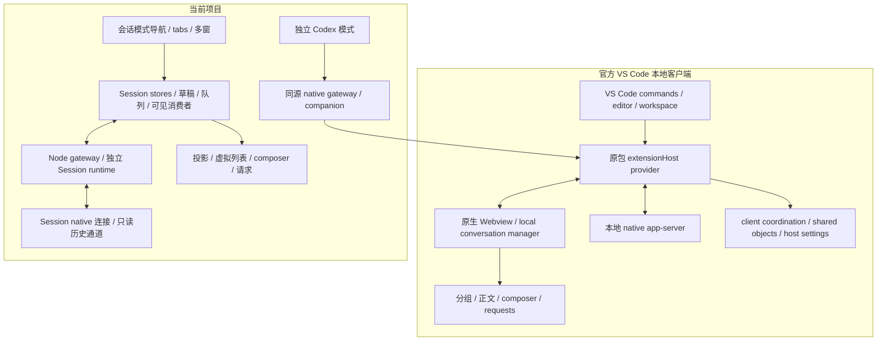
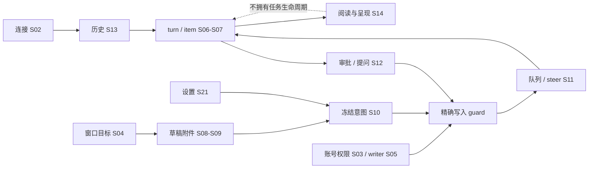

# Codex 本地客户端逆向审计、状态机与完整对照矩阵

审计日期：2026-10-29。供功能 review；**本轮只建立清单和证据，不实施产品功能，不据此恢复先前暂停的开发**。

## 1. 先看结论与阅读方式

固定原包 `openai.chatgpt 26.51007.21434 linux-x64` 已完成全包文件散列、全部 JavaScript 语法索引、显式模块依赖与导出清单；普通输入、消息/工具/请求、宿主桥接和导航设置的主要本地客户端路径已逐项追读，并与当前项目 `f6699ba064059009529a50b0c126cbed4402f093` 对照。

**全量资产索引已经完成；全部业务语义和所有真实运行组合尚未闭合。** 没有 source map，不能声称还原了原始 TypeScript 工程；代码存在、静态可达、VS Code 宿主开放、真实运行通过是四件不同的事。本文把尚未确认的宿主门控和动态组合显式列入矩阵，不把未知写成缺失，也不把少量绿灯写成全面一致。

建议 review 顺序：先看第 5 节差异决策表，再看第 4 节状态机关系和第 7 节场景矩阵；第 6 节保留逐功能对照及定位，附录保留完整机器清单。后续可直接用 `Gxx`、`CMP-xx`、`Txx`、`LGxx`、`Hxx`、`Mxx` 指定要开发或先验证的条目。

本次范围：VS Code 扩展入口、Webview 本地客户端、消息呈现、输入与队列、请求/审批、历史、窗口、配置、插件/MCP/反馈等客户端流程，以及与本地 native 协议的交界。**云端任务、云端调度、模型服务内部实现不考虑**。包内原生可执行文件登记格式与 hash，不反编译 native 核心。MCP App 是本地 MCP 也可提供的客户端能力，仍在范围内。

保留看板已有的跨设备关注标签、本设备草稿、队列持久化、多个会话窗口、手机适配和内存保护。关闭标签不停止 Agent；读取历史不 acquire/resume；归档是否新增“停止并归档”要单独 review，不能借对齐之名隐式停止任务。

## 2. 固定基线与全量清单

| 对象 | 本轮基线 / 结果 |
|---|---|
| 当前项目 | `f6699ba064059009529a50b0c126cbed4402f093`；审计开始工作树干净 |
| 原包 | `third_party/openai.chatgpt-26.51007.21434-linux-x64.vsix` |
| VSIX SHA256 | `75cee7497cf38c721cfeaa7383b579537b4e4439086f996258705de5da03ad56` |
| 扩展入口 | `extension/out/extension.js`；2,539,539 字节 |
| 扩展入口 SHA256 | `a8069de80c8f8141481d033f94c3a95e1b59f399143cb2554d3f68469dfbe5b8` |
| 文件树摘要 | `2d333bbcc707f67eb4382feaa7d65c96bb4ac05c1c7e9d32dcc01ded738433af`；不是 VSIX hash，算法见资产附录 |
| 全部文件 | 19,584；963,912,543 字节；0 symlink；全部有逐文件 SHA256 |
| JS/MJS/CJS | 14,764；381,364,587 字节；全部实际解析，0 语法诊断 |
| Webview JS | 14,762；377,725,881 字节 |
| AST / ES 导出 | 51,427,988 节点；63,368 条具名或默认导出记录，含 UTF-16 源码范围 |
| import / require | 47,038 静态 import；10,295 字面量动态 import；21 表达式动态 import；239 require 候选 |
| 包内显式引用 | 57,333 条可解析到包内；0 条相对字面量缺失 |
| HTML 入口闭包 | 静态 6 模块；允许字面量动态 import 后可能到达 14,434 模块；不等于宿主运行开放 |
| 协议/事件候选 | 50,613 处、9,291 个不同字面量；318 个符合协议前缀形状；不能当作 RPC 支持数 |
| 宿主 manifest | 10 commands、1 keybinding、8 settings；含禁用和调试命令，不等于全部可用 |
| 主 Webview 消息分发 | 154 case：29 实现、120 显式 no-op、5 显式 unsupported；仅此 handleMessage 的分类 |
| source map | 实际 `.map` 为 0；11,277 个 JS 含 sourceMappingURL 文本，不能据注释恢复源码 |
| native 资源 | `bin/` 45 文件，其中 33 ELF；本轮仅盘点，不声称完成其内部逆向 |

完整清单保存在 [审计附录目录](codex-client-audit-20261029/README.md)，包括全部文件、模块、导出、依赖边、协议候选、宿主分支、原包精确锚和当前测试源码 hash。大表压缩为确定性 `.gz`，没有复制官方大段源码或二进制进文档目录。

定位约定：原包 minified JavaScript 使用 **零基 UTF-16 code unit 偏移**，不是 UTF-8 字节，也不是格式化副本的行号。同名压缩函数别名可能指向不同 chunk 的完全不同实现，必须同时核对文件、导出、导入和调用 props。本地路径/行号对应上述项目 commit。

### 2.1 分析工具的覆盖限制

全包语法清单使用 TypeScript parser 顺序处理，未同时保留全包 AST。另用 REA 分析扩展入口及 3 个输入相关 chunk：扩展入口语法解析成功，但语义 worker 在 2 GiB 堆预算耗尽；3-chunk 的语义图达到 100,000 节点上限并受父结果预算截断。两份结果均为 **partial semantic analysis**，不能靠其缺失节点证明某功能不存在。关键结论另由原始函数体、实际导入链、生产调用点及独立复现交叉核对。

工具返回的 Evidence bundle 外层 `unknowns:0` 不代表语义无未知；实际分析记录里的 partial/truncation 才是覆盖依据。摘要及证据 ID 见 [evidence-ledger.json](codex-client-audit-20261029/evidence-ledger.json)。52.9 MB 的原始 REA 会话保留在私有 scratch，不作为全部语义已还原的证据。

### 2.2 三个必须纠正的范围误判

1. `composer-controls-7a6be63cddcf.js` 中大量实现属于 Orbit/Aeon/iMessage。普通 Codex 主 composer 是 `app-initial-fee819fe4f22.js` 的 `bFa → ewa`。前者的 room/reaction/Orbit 控件不能直接变成 VS Code 缺口。
2. 共享包含 ChatGPT、桌面应用、浏览器和云端分支；HTML 字面量依赖闭包可以到达某文件，也不说明当前 VS Code 可进入该分支。宿主 `handleMessage` 大量共享消息实际是 no-op。
3. 旧文档中的“没有全局撤销”“没有图片编辑”“插件安装纯占位”“缺 Ultra 确认”均不符合当前源码。本轮确认这些已有实现，只登记剩余的具体行为差异。

## 3. 架构关系：对比的是两条客户端链路

会话模式主要用自有 React 呈现与 Session runtime；独立 Codex 模式嵌入未修改的官方插件。两者的首屏、消息恢复、发送通道和所有权不同。Session fixture 的两秒绿灯不能证明官方宿主两秒；companion `/send` 风险也不能套用到没有调用该 API 的默认 Session 发送链。

## 4. 状态机全集及联动规则

以下是审计用的归一化状态域，用于对照行为；不是声称两边源码使用这些完全相同的枚举名。每个域的原函数/本地入口见第 6 节。单个 `running` 布尔值不足以表达完整客户端。

| 机器 | 主要状态 | 触发 / 退出 | 与其他机器的关系 |
|---|---|---|---|
| S01 宿主生命周期 | 未创建、启动、provider 注册、Webview 创建、ready、hidden、disposed、fatal | 显式打开、宿主启动/退出、页面可见性 | ready 不代表账号、历史、composer 或实际任务就绪；隐藏不等于 dispose |
| S02 连接与同步 | connecting、connected、disconnected、reconnecting、restarting、resuming | socket/SSE、实例代次、只读补齐 | 断开只使数据新鲜度/写入可用性变化，不生成 turn interrupted |
| S03 账号与权限元数据 | unknown、loading、known、stale、revoked/error | 初始化、账号通知、有效配置/requirements 重读 | 元数据未知不能推导 Full Access；账号/实例变更撤销旧请求授权 |
| S04 窗口与目标 | 新草稿、selected、focused、visible、hidden、closed | 选标签、分窗、切模式、关闭 | 关注集合共享；当前输入、布局和阅读位置本地；关闭不停止任务 |
| S05 thread 读写权 | read-only、owner、external owner、scope-invalid、unknown | 原生能力/实际写入检查、实例/账号变化 | 读取/恢复不 acquire/resume；同 threadId 不代表相同运行实例或权限 |
| S06 turn | idle、start pending、in progress、waiting、stopping、completed、failed、interrupted | 原生 start/事件/显式停止及确认 | 与连接、请求、item 独立；完成不是 composer 已清稿或 idle 的充分条件 |
| S07 item | started、delta、completed、failed、declined、termination unknown | 原生 item 事件、最终快照 | turn 结束不能把缺失最终快照的工具补成成功；终稿与 commentary 分层 |
| S08 编辑与草稿 | 空、text、attachments/context、IME、expanded、dirty、restoring | 用户输入、设备本地恢复、上下文动作 | owner/edit revision 隔离；当前相同文字不代表是发送时同一版本 |
| S09 附件 | selected、uploading、ready、error、removed、restoring | 选择/上传/删除/还原/迟到回执 | 已删除图片不能被旧 upload 复活；pending/error 阻止不完整提交 |
| S10 发送意图 | captured/frozen、sending、accepted、definitely rejected、outcome unknown | 点击/快捷键、实际 ACK、断线 | unknown 不等于未发送；保留原目标/参数/附件/意图 ID，不自动重发 |
| S11 follow-up 队列 | queued、pending/sending、failed、uncertain、paused、owner-blocked | Queue/Steer、idle eligibility、显式 Stop/重试 | 运行任务和队列并存；释放占用不自动重发；暂停原因不得一律显示中断 |
| S12 请求/审批 | pending、draft answer、submitting、accepted/denied/cancelled、failed、uncertain、obsolete | command/file/permissions/input/MCP 请求与精确回执 | 必须绑定 instance/thread/turn/item/request/token；正文折叠不消灭 pending |
| S13 历史 | empty、cache restored、recent loading、loaded、earlier loading、partial/gap、error | 进入、分页、序号 gap、只读重试 | partial live delta 不代表完整历史成功；保留原生 cursor；不轮询完整历史 |
| S14 阅读与渲染 | tail pinned、reading older、anchor restoring、group collapsed、virtualized、inactive/evicted | 滚动/尺寸/分页/可见消费者变化 | 回收正文不丢任务、审批、未读；重显只读恢复，保护现有内存预算 |
| S15 行为事务 | idle、rename/archive/pin pending、committed、undoable、undo/redo pending、failed/expired | 显式菜单操作、确认、撤销 | 官方有按 host/thread 队列的异步事务；本地同步栈和 toast undo 不是同一语义 |
| S16 Goal / Plan | Goal active、paused、blocked、usageLimited、budgetLimited、complete；Plan draft/in progress/completed | 显式设置、首轮接受、完成清理 | active 可暂停；paused/blocked/usageLimited 可恢复；预算受限/已完成无暂停恢复；已有 thread 设置 Goal 不额外发 turn；旧清理不删新目标 |
| S17 子 Agent | observed/active/waiting/done、canInteract known/false/true | 原生 metadata、独立观察、用户打开 | 通信不是亲子证据；观察不切主输入；只有明确允许才输入，停止权限独立 |
| S18 听写 | idle、starting、recording、transcribing、retry/error | 用户授权、启停、转写、切 owner | 与 turn running 分离；官方有 finish-for-send/cancel/retry，本地不同；回调不能串草稿 |
| S19 MCP/插件认证 | required、prompt、login pending、success、error、dismissed/revoked | inventory/challenge/OAuth/实例变化 | dismiss UI 不等于取消已发 OAuth；安装成功不等于所有认证完成 |
| S20 反馈 | preflight、open、uploading、uploaded/incomplete/disabled/failed/unconfirmed | 打开和提交前验证、上传回执 | 权限按真实配置核实；关闭 UI 不取消已发上传；本轮未提交反馈 |
| S21 偏好与跨页同步 | local intent、persisting、confirmed、stale/failed；shared revision/outbox | 用户选择、IDB 事务、服务端 revision | 发送等待点击时的保存前缀；晚读不能覆盖新意图；设备本地草稿不强制跨设备 |

### 4.1 关键转换表

| 触发 | 正确转换及 UI | 必须保持 / 禁止推导 |
|---|---|---|
| 空闲提交 | 冻结目标+正文+附件+上下文+设置 → sending → 明确接受后运行 | 晚 ACK 只清捕获版本；不能清另一页刚编辑的草稿 |
| 运行且空草稿 | 主动作 Stop；显式操作后 stopping，等待原生确认 | 操作失败回到实际运行；不能按钮一按就造永久终态 |
| 运行且有草稿 | Queue 或 Steer；一次反向快捷键只改变此提交 | 不 broadcast；steer 不隐式 interrupt |
| 请求出现 | pending 卡绑定精确身份；交互后 submitting | uncertain 保留待核对；远程已答/旧实例卡不得再次提交 |
| socket/SSE 断开 | disconnected/reconnecting；保留正文/草稿/最后已知任务 | 不能新增“已中断”，也不能把任务假定为空闲 |
| 刷新 / 手机前后台 | 新 consumer 只读重连、重放、历史校验，恢复原目标与阅读 | 0 隐式 task 写入；旧 interrupted 留在旧 turn，不替代新 turn |
| history 失败后收到 delta | 可更新对应 live 内容，history error 仍保持 | 不能收到一个事件就宣称历史完整、清掉 Retry |
| gap 或运行代次变化 | 重置错误 cursor/scope；只读有界恢复；拦旧 ACK | 禁止把新实例误认旧 writer；禁止以大历史轮询掩盖缺口 |
| turn completed | 原生精确终态一次，更新对应 item/最终正文 | 还要检查 composer 清稿、正确唯一 thread、无 busy/Stop/Queue；completed 不是 UI idle |
| 工具未完整快照就 turn 结束 | 保留已知结果及明确 termination | 不能补造 completed 或取消所有工具错误 |
| delivery outcome unknown | durable pending 保留，先核对，再显式决策 | timeout/断线不是 definite rejection；禁止自动重投同意图 |
| 隐藏/关闭窗口 | 当前可见消费者退出，宽限后回收正文 | Agent、审批、未读/回执仍继续；不停止/删除线程 |
| 重新显示旧窗口 | 精确原目标只读恢复、还原 anchor、按预算挂载 | 不回退其他 native profile，不抢 writer，不重新投递队列 |
| archive / undo | 捕获 thread、完成归档、进入可撤销事务或明确通知 | 原生 restorePin 与关注行恢复不同；stop-and-archive 要显式授权范围 |
| 切账号/实例 | 撤销旧授权/请求/元数据，按新 scope 重新只读核实 | 旧回执不能恢复权限；同邮箱/套餐不是组织策略证明 |

## 5. 当前差异及 review 决策表

下表合并重复项，`G` 是 review 索引；详细原包偏移和本地行号在第 6 节对应条目。优先级仅帮助评审，**不表示已批准开发**。静态确认表示行为分支已确认，不表示真实模型或完整宿主已复现。

| ID | 当前差异 / 限制 | 证据与适用边界 | 对照索引 / review 选择 |
|---|---|---|---|
| G01 | `/ide` 只打开无 handler 的 dialog，不能切换 IDE 自动上下文 | 当前入口死路；官方实际 ide-context 命令依 connected 切 isAutoContextOn | CMP-34；修入口，还是先建立 IDE bridge 能力？ |
| G02 | `/init` 缺精确 cwd 的 AGENTS.md 已存在检查 | 官方 paths-exist 后存在则不发任务；当前确认后直接 turnStart；本轮未执行，不声称已覆盖文件 | CMP-35；补只读预检与明确提示？ |
| G03 | 会话动作菜单重命名 disabled | 两个生产调用点未传 onRename；列表另一路可以重命名 | LG07；接通原目标 owner form？ |
| G04 | 快捷键录入无按键捕获/保存，Reset 固定报错 | 本地占位确定；官方共享设置有 set/reset mutation，但该 VSIX 暴露性仍需 host 证明 | LG25–26；先验证宿主能力再设计网页持久化？ |
| G05 | 听写 starting 按钮 disabled 却提示“点击可取消” | 本地状态与可操作性不符，官方有取消启动分支 | CMP-49；补可取消状态？ |
| G06 | 归档设置只读 50 条，无游标继续 | 本地第 51 条以后不可达为静态确认；官方设置长列表实际呈现尚未复验 | LG14；补游标分页和迟到请求保护？ |
| G07 | 流式正文纯文本，完成才 Markdown | 官方正文流中也 Markdown，立即渲染代码块；本地有界分段必须保留 | T03/D1；是否做渐进 Markdown？ |
| G08 | running commentary 展示全过程，官方 latest 模式只保留当前 commentary | 当前 turn 折叠模型与原分组呈现不同；并非消息丢失证明 | T05/D2；保留全过程还是提供 latest/all？ |
| G09 | 缺普通主输入的同条件 Resume 主动作 | 当前队列“继续”与独立 onResume 不等价；需核 native 能力和 interrupted 条件 | CMP-11；先定义 Resume 的准确协议语义？ |
| G10 | 听写与 Send 主动作未按官方 finish-for-send 联动；失败后无保留音频 retry | 本地录完整段后转写追加，官方有独立语音优先级；不要求逆向云端转写实现 | CMP-12/48、LG38；是否补结束并发送、取消、重试？ |
| G11 | 归档未进已有全局 undo；列表重命名亦未入栈 | 当前 toast 撤销 60 秒存在；不能误报“完全没有全局撤销” | LG08–09；统一异步事务覆盖？ |
| G12 | undo/redo 是同步 void 栈，无官方按 host/thread 串行事务及失败回滚/过期语义 | 单次本地 pin 有入栈；异步操作不能用同一实现直接冒充对齐 | LG09；明确失败、切账号、跨页、过期语义？ |
| G13 | 归档撤销恢复关注行，未等价原生 restorePin | 原生 pin 与 usePinStore 不是同数据域；跨设备未闭合 | LG13/17；原生 pin、看板 pin 如何共存？ |
| G14 | 列表动作及归档设置仍有硬编码英文 | 官方有中文资源；当前列表归档成功/失败提示已中文，不重报旧问题 | LG15–16；统一中文与文案？ |
| G15 | 未读标记写看板 attention store，非原生 read-state | 是数据域差异；不能仅看红点一致判断语义相同 | LG18；保留、双写还是只同步读取？ |
| G16 | Ultra gate 已有，但缺 permissionProfile/per-host 非 full-access fallback | 当前固定 workspace-write/on-request，原生可能没有该 fallback；权限元数据必须真实核实 | LG40/CMP-44；先补能力/requirements 验证？ |
| G17 | MCP App widget 未消费 mcpAppResourceUri，仅普通 block/JSON | 当前类型字段存在，实际 render 链无 widget 消费；官方有 resource/catalog/identity 校验；具体 host 门控待验证 | T21/D3；需要交互 widget 吗？ |
| G18 | MCP form Escape 折叠而非取消 | 官方实际 Escape cancel；当前有独立 Cancel 按钮；可能是项目保护字段意图 | T30/D4；选择关闭、折叠还是取消语义？ |
| G19 | 未找到完整 Sources 聚合侧栏 | 当前 inline citation、MCP sources 摘要存在；已交叉检查正文与工具面板入口，仍无等价聚合消费；不是全局能力不存在的绝对证明 | T52/D9；先用受控 host 验证入口，再决定实现？ |
| G20 | 新聊天 local/worktree utility 与当前 fork+worktree 不同 | 主输入没有同样模式选择；具体 worktree/branch/environment 的 VSIX flags 尚未闭合 | CMP-36–39；先确认宿主开放，勿整体照搬桌面 UI |
| G21 | 文件和文件夹菜单实际请求 directory:false | 适配器已核实：false为设备文件上传，无目录选择；true另走服务端BrowserProjects。当前标签与能力不符 | CMP-27；区分设备附件与项目文件/目录入口 |
| G22 | rail 全组合/banner 优先级及紧凑布局不完全同原包 | 当前四项局部 rail 对照通过，不代表所有 status/notice/Goal/queue/approval 共存一致；手机固定高度/shelf 为批准适配 | CMP-02/21–22；保留适配，选哪些原生布局语义？ |
| G23 | 图像额度失败没有 image_gen 专卡 | 原包分支确定，本地 schema/provider 是否送该字段待协议样例；当前已有通用失败/画廊 | T17/D7；先验证字段可达性 |
| G24 | 未知协议 fallback 可能显示技术 JSON | thread/readState/changed 不在前端 hiddenMethods；运行层是否转发未闭合，不能据此断言截图现象仍在复现 | T23/D8；先复现端到端路径 |
| G25 | 独立 Codex companion 把 failed+delivery.stage=outcome-unknown 当作明确拒绝并删除 receipt | **隔离 fake 连接已复现**：同 submissionId 第二次显式 send 可再次写 turn/start；不是原生重复送达证明；sendToNativeCodex 当前无生产 UI 调用，默认 Session 发送不走这里 | H13；若启用该桥，优先修投递分类；不要把它归因于所有刷新问题 |
| G26 | 独立官方宿主并发刷新、composer 收尾与≤2秒缺当前完整验收 | 10/16 有手机 completed 后仍 Stop、15秒级/性能红记录；当前未复验。Session fixture 的旧 p95 绿不能覆盖 | M31–33/54–55；先选独立宿主验证还是 Session 性能验证 |

### 5.1 保留项与不能自动修的差异

| 项目规则 | 官方不同之处 / 审计结论 | review 边界 |
|---|---|---|
| 跨设备关注标签、设备本地布局/当前输入/草稿 | 官方协调与看板 revision/outbox 不是同协议 | 保留，不为 parity 建第二套目标 store |
| 关闭/隐藏标签不停止 Agent | UI 生命周期不拥有任务 | 保留；显式 Stop 为独立动作 |
| 归档的显式生命周期 | 官方有 Stop and archive 变体；本地“说明不停止”缺原生验证，busy 不是 running guard | 由新方案明确普通归档、停止并归档与队列/Goal规则，不能从文案推断保证 |
| 归档即时中文 toast | 官方 local 成功路径无同一 success toast | 可保留项目反馈；别误用 ChatGPT 云归档逻辑 |
| 只读历史重试、无自动整页 reload | 官方特定初始化全局错误可 reload | 保留无隐式刷新和 Agent 副作用；模块失败可由用户显式刷新 |
| 网络接收前工具正文裁剪、有界流式正文、60s 不可见回收 | 与官方普通渲染器投影不同 | 保留 32 MiB RPC/16 MiB chat 等现有边界，不以隐藏行替代裁剪 |
| 手机 Return 换行、固定输入高度、compact queue shelf | 与桌面/某些原生布局不同 | 已批准适配；全部队列仍需可达 |
| 展开编辑、上下文快照、绘图、冻结发送设置 | 看板能力更多或容器不同 | 保留 owner/revision 与恢复能力 |
| 模型目录未知时不伪造 Fast/默认权限 | 比固定按钮更保守的网页投影 | 保留实际元数据准入，不用套餐/邮箱推断组织政策 |

### 5.2 Review 回填模板

| 决策组 | 候选 | 选择（留给用户） |
|---|---|---|
| 当前入口与文案 | G01/G02/G03/G05/G06/G14 | 待 review |
| 输入状态语义 | G07/G08/G09/G10/G21/G22 | 待 review |
| 操作事务与跨端数据域 | G11/G12/G13/G15 | 待 review |
| 权限与工具交互 | G16/G17/G18/G19 | 待 review |
| 先证宿主能力 | G04/G20/G23/G24 | 待 review |
| 独立 Codex 模式风险与性能 | G25/G26 | 待 review |
| 显式停止并归档 / 现有不停止规则 | LG11–12 | 待 review |

## 6. 全量功能对照

下方逐项清单含已存在功能、确定差异、条件差异与项目特色。**条目数量不是缺失数量**；重复出现于不同状态域的差异已在 G 表合并。某项“对应”仅指描述的已读子集，动态覆盖仍看第 7 节。

### 6.1 输入、队列、模型、权限、Goal与听写（54项）

`F/U/C/Q/P` 文件、函数与SHA定义见[输入审计来源表](codex-client-audit-20261029/composer.md)。`CP/`为`apps/web/src/session-mode/components/codex/composer/`。

|ID|功能、触发与原包状态/退出|当前实现、差异与证据|分类|
|---|---|---|---|
|CMP-01|新建/后续输入 placeholder：F:mPi 按 image markup、Goal、Plan、follow-up type、custom override 顺序选文案；退出模式恢复对应文案。|`CP/nativeComposerPlaceholder.ts`、`Composer.tsx:840` 以 Goal→Plan→thread ID 选择；image markup/自定义 override/产品分支不是同一投影。普通 new/follow-up 已对应；完整 markup 不能据静态宣布相同。|对应/条件差异|
|CMP-02|普通编辑器与紧凑/单行：F:bFa 的 `layoutState.layout=Zs?'single-line':'multiline'`，提交/附件可改变状态；F:ewa 随 props 渲染。|`Composer.tsx:826` 固定 `data-composer-layout='multiline'`；手机固定输入高度是已批准适配。原包宿主、quick-chat 条件未全解，不能自动要求改为 auto-single-line。|差异，保留适配|
|CMP-03|焦点与隐藏输入：F:bFa 的 `disableAutoFocus`、focus target 与 `inputInert`；C:pd 排除 hidden/inert 只是另一个 Orbit 分支，不能混用当主输入证据。|`CP/composerFocus.ts`、`editor/ComposerEditor.tsx`、`NativeModelSelector.tsx:87` 当前检查可见 scope/owner；恢复被动草稿使用 SKIP_DOM_SELECTION_TAG。多窗口真实焦点关卡仍需。|对应/未闭合|
|CMP-04|普通文本、选区、撤销：F:bFa 持有 composerController/onUserInput/selection 回调，F:gMa 操作原 editor doc。|`CP/editor/ComposerEditor.tsx` 用 Lexical PlainTextPlugin、HistoryPlugin、原生选区同步插件；框架不同本身不是 bug，必须按操作效果验收。|对应|
|CMP-05|IME 与 Enter：F:gMa 屏蔽 composing/keyCode229/repeat；原 Enter 偏好经 `composerEnterBehavior` 读取。|`CP/editor/ComposerEditor.tsx:104`、`imeSubmitKey.ts`、`editor/submitIntent.ts`；当前 IME 守卫和三种 Enter 偏好对应。|对应|
|CMP-06|手机 Return：官方按实际宿主/editor keymap 决策；F:gMa 全局 body Enter 也受语音状态约束。|`ComposerEditor.tsx:123` coarse pointer 无 Ctrl/Meta 时固定换行；这是手机使用保留，不应为了桌面 Enter parity 删除。真 iOS 输入法尚未本轮验。|项目保留/未闭合|
|CMP-07|三种发送键偏好 enter/cmdIfMultiline/cmdAlways；离开菜单保持偏好。F:gMa 的 background submit 要避开代码块/特定 CtrlEnter。|`CP/ComposerEnterSettings.tsx` 三项对应；当前额外 CtrlShiftEnter 临时反向 queue/steer。普通/代码编辑/外接键盘需完整矩阵。|对应/项目保留|
|CMP-08|空闲有内容主动作 Send；F:ewa 非 loading、交互允许、submitDisabled=false 才可发送；空消息解释 tooltip nonce。|`Composer.tsx:275,1146`、`NativeSubmitButton.tsx`，Send/disabled/sending 均存在；阻断原因主要通过 statusText 展示，官方按钮内 blockedReason popover 的全部时机未等价。|对应/差异|
|CMP-09|运行空草稿 Stop；F:ewa `D==='stop'&&!ve`，stopping 变 loading，Esc 文案取决确认可见。|`Composer.tsx:1133` 主 Stop，仅显式 requestStop；失败后保持草稿。是否与原包确认/双 Esc 全组合相同未验。|对应/未闭合|
|CMP-10|运行有草稿 Queue/Steer 唯一主动作；F:ewa 根据 `isQueueingEnabled` 切按钮语义。|`Composer.tsx:275,1147` 当前 submitLabel 已按运行/模式切换，运行有内容时 Stop 移入附加菜单。旧文档最初固定“发送消息”的差异已关闭，不能重报。|对应|
|CMP-11|Resume：F:ewa 在 resume pending 或 `existingThread && resumeEnabled && !running && !hasGoal && empty-message` 时渲染 Resume，调用独立 onResume。|当前 `Composer.tsx:1133-1163` 仅 Stop/普通发送两分支，无同条件的 Resume 主动作；队列“继续”与发送“继续”不是原 onResume 证明。真正 interrupted thread API 能力由协议审计补证。|差异|
|CMP-12|主动作优先级：F:ewa 听写 finish-send→realtime send/end→Stop→Resume→voice start→normal Send；互斥渲染。|当前主动作根据 running/hasContent 分支，听写按钮独立；没有同一个完整主动作优先级投影。不是删项目额外入口授权。|差异|
|CMP-13|提交时捕获原目标、上下文、参数；F:bFa 向实际 submit controller 交出上下文，与 editor 执行分离。|`Composer.tsx:329-405` 捕获 thread start、goal checkpoint、settings、owner、draft revision、contexts/mentions；完成只清捕获版本。跨设备与持久草稿是项目保留。|对应/项目保留|
|CMP-14|确切失败 vs delivery unknown：Q:We 将 outcome-unknown 与普通 paused 错误分开；未证回执不自动重投。|`CP/FollowupQueue.tsx:57-81,146` 与 runtime followup service 区分 uncertain/failed，外部占用阻止 retry/resume；显式 recheck。不应把断线转换 interrupted 来解锁 UI。|对应|
|CMP-15|Queue waiting→pending/sending→accepted，运行中显式 steer 不 interrupt；Q:We `pending/sending && !paused` 显示 spinner。|`CP/FollowupQueue.tsx`、`FollowupSnapshot.tsx` 使用服务端 state/revision，queued/sending/uncertain 等字段；原包 submission 结构不同，需逐状态投影而非同名复制。|对应/项目保留|
|CMP-16|显式 Stop 后队列暂停与 Resume：Q:Be 的 interrupted header，首条 `canSendNow===false` 隐藏继续按钮。|`FollowupQueue.tsx:57,129` 按实际 paused/reason/unresolved/accessBlock；释放占用仅解锁显式操作，不自动重发。先前硬编码“中断”已修，不重报。原生 stop-and-archive 对队列的语义仍是单独产品决策。|对应/未闭合|
|CMP-17|每条队列送达未知：Q:We outcome-unknown tooltip 要用户查会话，不安全自动 retry。|`FollowupQueue.tsx` uncertain 项提供核对/确认 retry/remove，重试前只读 refresh access；有保存回执边界。与原包按钮禁用条件逐项需 fixture，不只测 toast。|对应/未闭合|
|CMP-18|队列 edit/delete/reorder，发送中禁 edit/delete；Q:We 用 dnd transform、hover handle，Q:Be 控制 reorderability。|`CP/QueueReorder.tsx`、`FollowupQueue.tsx`、`QueueMessagePreview.tsx` 已有拖动、编辑、删除与 undo；官方 hover 手柄/全部无障碍和 sending 状态组合未本轮重跑。|对应|
|CMP-19|队列 prompt 非模态全文预览与复制；Q:We 对文本+附件摘要最多80字符 aria，正文保持可读。|`QueueMessagePreview.tsx`、`queuePreviewText.ts`、`queue-message-preview.css`；当前已加非模态预览，不可沿旧“只显示纯文本”结论重报。完整 markdown/附件像素仍未闭合。|对应/未闭合|
|CMP-20|队列菜单 toggle queueing、side chat、send now；Q:We SendNow 要 `canSendNow` 且运行附件守卫。|`FollowupQueue.tsx:131` 菜单切偏好、side chat、retry/steer，附带项目冻结发送配置/上下文详情。当前 richer snapshot 是保留能力。|对应/项目保留|
|CMP-21|桌面列表与手机展示：Q:Be 全队列滚动、30dvh、paused header；具体 floating presentation 有条件。|`FollowupQueue.tsx` 当前桌面全显示；手机 compact shelf 仅首项+详情访问全部。不是漏消息；需区分可访问与首屏像素。|差异，批准适配|
|CMP-22|Rail 进入/退出与组合：F:Iya 由 portal/sandbox/WSL/transcript/queue/Goal/subagent/status/header 多条件决定 mount/offset。|`CP/ComposerRail.tsx`、`Composer.tsx:713-766` 包含 diff、待回答、队列、Goal；ModelChangeNotice rail 外。官方 banner/status 子集合与当前合成组合不同，不能只测容器边框宣布整体 parity。|差异/未闭合|
|CMP-23|Running changes 行主区与独立 View changes，当前 turn diff 结束后消失/保留依据上层。|`CP/RunningTurnChanges.tsx` 已有两个独立聚焦入口，同 thread/turn 的 diff。历史真实原组件几何已对过；本轮仅确认当前结构仍在。|对应|
|CMP-24|Goal rail 与其他 item 共存；F:bFa 的 `threadGoal` 参与 rail，Goal draft 改 placeholder 和权限位。|`Composer.tsx:751,1104`、`features/goals/ThreadGoalCard.tsx`；既有 Goal 元数据只写 Goal、不额外发普通 turn；新 Goal 首轮 accepted 后设置失败不能重发首轮。完整六状态由 Goal 专项审计补充。|对应/项目保留|
|CMP-25|Goal 替换/clear、退出 portal，F:ewa 的 `hasGoal/onClearGoal` 进入主控件。|`Composer.tsx:769-795` 捕获旧 objective/status/createdAt，确认前重查，`goalDrafts.ts` 按 owner 版本清理。当前 Web CAS guard 不能被描述成 native 跨客户端原子保证。|对应/未闭合|
|CMP-26|附加菜单 `@`：F:W4t actual tooltip/aria 与 F:bFa toggleContextSuggestions，image markup 时改走 addFiles。|`CP/ComposerMenu.tsx:157,225` 使用 plus 菜单与 MentionTypeahead；image markup 独立 DrawingEditor。普通菜单存在但进入 image markup 后上下文建议交互不等价。|对应/差异|
|CMP-27|文件/文件夹：F:bFa/Yba 保留 addedFiles、uploadedFileAttachments、pendingFiles、selectedText 分型和 host ID。|`ComposerMenu.tsx:42` `open({multiple:true,directory:false})` 的标签是“文件和文件夹”，实际参数不允许 directory；`ContextAttachments.tsx:29` 只读 text、拒绝 NUL/180k过长。复核 browser-dialog.tsx 后确认 false 走普通设备文件选择且无 webkitdirectory，true 才走服务端目录选择；当前标签与能力不匹配。|差异，适配器已确认|
|CMP-28|图片上传、删除、失败与 pending 防重复，F:bFa 的 Ca/images 与 imageCommentGroups 独立传入 Yba。|`common/useImageAttachments`、`Composer.tsx:213,238,653` blocked、hydration/storage error、8张限额；图片生命周期/回滚保留 owner。原包全部格式、preview 时机和截图像素不在本轮证明内。|对应/未闭合|
|CMP-29|图像标注与 sketch composer：F:bFa imageMarkupAttachment、imageCommentGroups、sketchComposer，markup ready 参与 submitReady。|`CP/v2/DrawingEditor.tsx` 和 `drawingTool.ts` 支持保存/撤销/发送引用；本地主编辑扩展不等价原生内嵌 markup，需要按坐标/注释和提交 payload 复验，不能仅因有画布判齐。|对应/未闭合|
|CMP-30|文本粘贴附件、还原正文：F:bFa `pastedTextAttachments/pendingPastes/handleShowPastedTextInTextField`。|`Composer.tsx:252`、`CP/v2/content.ts`、`ContextAttachments.tsx:108` 支持大文本归上下文、还原正文/移除；阈值和正文序号来源并不相同，需边界 fixture。|对应/未闭合|
|CMP-31|选中文本、响应注释、共享线程、MCP app context、appshot、Chrome selection、PR checks/conflict 等多个附件类型：F:bFa 明确传给 Yba。|当前统一 `ComposerContext` file/paste/message/quote 等快照与 plugins typed mentions，不能等价全部原生附件类型。部分属于桌面/浏览器/cloud分支，**需要证明 VS Code 本地可产生后才列开发缺口**。|条件差异|
|CMP-32|drop 及 Shift overlay：F:bFa interaction 有 `showShiftOverlay`、drop portal、submit block；处理根据 placement。|`CP/composerDrop.ts` 与 `Composer.tsx:806-827` 文件拖入显示提示；没有同一 Shift 行为投影。官方是否 VS Code 本地启用需宿主 fixture，不能只复制提示文字。|条件差异|
|CMP-33|文件上下文快照更新/恢复/undo：官方附件 source/order tracking 由控制器管理。|`ContextAttachments.tsx:29-151` 有15s读取超时、保存快照、检查源变化、用户更新、还原paste和undo；属于项目有用扩展，不能为原图尺寸去掉。|项目保留|
|CMP-34|IDE 自动上下文：F:hDa 真实命令 ID `ide-context`，仅 `ideContextStatus==='connected'` enabled，选中时 `setIsAutoContextOn(!current)`，不要求清空输入。F:ewa 收 `isAutoContextOn/ideContextStatus`。|`CP/slashCommands.ts:244` 的 `/ide` 只 `openDialog('ide')`；`Composer.tsx:1414-1437` 和 `SlashCommandDialogs.tsx` 没有 ide handler，当前点击无相应面板/切换。当前源码仅该一处 IDE 上下文文案。是已确认入口死路，能力补齐仍需评审 host bridge 边界。|差异，明确|
|CMP-35|`/init` 安全前置：F:vDa 对精确 cwd 的 AGENTS.md 走 `paths-exist`，存在则 toast 并 return，不提交任务。|`CP/slashCommands.ts:131-138` 确认后直接 `turnStart(await ensureThread(), initPrompt)`，没有同层存在性预检。是否模型最终覆盖不是本轮执行过的事实；缺少原检查已经确证。|差异，明确|
|CMP-36|本地/工作树位置切换：U:Uu 依据既有会话/跟随/工作树、busy与handoff决定能否改变 run location；U:Qd allowWorktree=`!followUp&&!response`。|当前 `Composer.tsx` 没有同一个新聊天 `composerMode local/worktree` utility control；`slashCommands.ts:277` 是已有thread fork+创建worktree，语义不同。不是要求删除原项目导航。|差异|
|CMP-37|Worktree toggle/命令：U:qd `composer.toggleWorktreeMode`、slash id worktree、requiresEmptyComposer=false，受工作区/可用性/feature flags 门控。|当前 slash registry 无 worktree mode toggle；已有 `forkSlashWorktree` 是另一功能。原包 flag可能隐藏该控件，需固定宿主flag再定是否VSCode必备。|条件差异|
|CMP-38|本地 environment dropdown：U:Qd 仅 `!followUp&&eligible&&workspaceKnown`，disabled/loading/error/reset；打开精确 configPath/workspaceRoot，没环境时转 `/settings/local-environments`。|当前主 composer 没有等价环境选择/加载状态；不能把 EnvKeysDialog API key 对话框算同功能。部分桌面 workspace 管理flag尚需确认在VSCode启用。|条件差异|
|CMP-39|分支 dropdown：U:Qd `cn=...&&!follower&&!outsideEditor`；按 hostId:cwd key，existingWorkspace时readOnly。|当前 CreateBranchSheet/项目工具有分支操作，主 composer 未渲染这个精确 host/cwd/follower 条件分支选择器。是否需要UI迁入由review决定，不能把所有Git能力说成缺失。|条件差异|
|CMP-40|项目选择：U:Qd 为 openProjectPicker command 计算 enabled 并聚焦composer；选中的项目与 run location 共同决定 cwd。|当前项目列表/关注标签/公共输入owner 联动为看板特有能力；它不应改成官方单项目状态。需要增加能力时复用现有 project selection，不再建平行store。|项目保留|
|CMP-41|模型默认/当前/未知/搜索：F:hCa 使用真实 authMethod/cwd/host/catalog状态、capabilities、当前model；F:lCa 包含 simple/advanced/default/locked/fallback。|`CP/NativeModelSelector.tsx:115`、`nativePickerPresentation.ts`、`ordinaryNativePickerModels.ts` 已有 simple power、advanced、搜索/最近、自定义/unknown 显示与loading/error重试。不是只一个硬编码下拉框；精确flag/capability模型集合完整parity仍待验证。|对应/未闭合|
|CMP-42|Power/effort：F:lCa 原模型支持的effort、locked model、fallback power selection决定slider和radio；选择完成与打开menu不同。|`NativeModelSelector.tsx`、`nativePowerWheel.ts`、`nativeReasoningOptions.ts`、`nativeModelIdentity.ts` 保留模型ID/canonical model双身份与实际支持的efforts，不应该为匹配alias丢identity。全部派生组合本轮未运行。|对应/未闭合|
|CMP-43|Fast/service tier：F:lCa props selectedServiceTier/options/loading 与 onSelectServiceTier；F:hCa 根据账号/host选择目录来源。|`CP/NativeServiceTierControl.tsx:12` 根据实际model.serviceTiers显示priority/fast toggle，否则多tier菜单；未知目录不伪造Fast。原包单toggle/默认tier与本地多tier extension区分。|对应/项目保留|
|CMP-44|权限 preset：P:vn 是真正 export，再按条件走旧tn或新yn；yn 读取 permission profiles、server default、requirements。不能把三个旧preset当全量权限。|`CP/AccessModePopover.tsx:18` 当前 Ask/Auto/Full + readonly/custom原生投影，`autoReviewCapability` 守卫；没有通用原生 profile 列表选择。原包profile分支是否当前VSCode enabled待门控证据。|条件差异|
|CMP-45|Full Access确认/Cancel：P:Ht 根据code/work/cyber分支展示风险与外部link，确认后才写权限；取消回原选择。|`NativeFullAccessConfirmation.tsx`、`AccessModePopover.tsx:104` 有异步ask后设置；`NativeUltraFullAccessConfirmation.tsx`/`ultraFullAccessGate.ts` 当前已存在，不能沿旧文档重报“缺Ultra”。实际组织requirements与会话权限版本仍需联合回归。|对应/未闭合|
|CMP-46|Plan是collaboration mode，不只是权限标签；F:bFa 有 activeCollaborationMode，F:mPi 改placeholder。|`AccessModePopover.tsx:51,222` Plan单独设置，`Composer.tsx` 参数捕获与goal模式互斥；“计划”翻译修正已批准，不应改回“套餐”。|对应|
|CMP-47|模型切换通知/升级/关闭：F:hCa 选择完成/菜单结束由独立回调，非所有store变化都等于用户选择。|`CP/ModelChangeNotice.tsx` 只显式accepted用户选择触发 completion notice；ModelUpgradeBanner 从真实catalog upgradeInfo生成，dismiss ID保存。全部公告优先级/当前原包notice具体分支仍需另一专项对照，不据相似文字宣称相同。|对应/未闭合|
|CMP-48|听写状态：F:ewa 从voiceControls读取 starting/dictating/transcribing/canRetry/micBusy，并在语音优先主动作中finish-send；F:gMa submit中先stopDictation('send')。|`BrowserDictationButton.tsx:19` start→record→stop→整段transcribe→append，主Send不会先finishForSend；没有相同波形/流式presentation/保留恢复UX。转写provider可用已有登录或本地Whisper，属于传输实现差异；不以云端实现为本次要求。|差异|
|CMP-49|听写取消启动：官方voice模型有abort/cancel/preserve入口，主`gMa/ewa`优先级处理starting。C:dd的Escape细节是Orbit分支，不直接归普通VSCode。|`BrowserDictationButton.tsx:174-185` starting时按钮disabled，但aria写“正在启动听写；点击可取消”，实际onClick也仅start且starting return；当前没有取消pending getUserMedia的action。描述与操作不一致是当前静态明确差异。|差异，明确|
|CMP-50|听写切目标/隐藏/卸载归属：原控制器按session和active输入守卫；C:dd另含hidden/inert防跨输入，仅作为共享设计参考。|`Composer.tsx:1124` `<DictationButton key={owner}>` 且onTranscript捕获owner；Browser button卸载mounted=false/cleanup，晚结果不追加；不能只看latest callback ref就误报串草稿bug。切模式stop会转写，可能在隐藏session保存原owner草稿，需显式产品预期验收。|对应/未闭合|
|CMP-51|Realtime voice：F:ewa 用visiblePhase选择send/end/start，remote project unsupported禁用，mic/speaker控制另行。|当前浏览器只听写，无对应realtime双向会话可见控件；原包此功能有feature/auth/host门控。仅说明本地客户端分支，不将云端语音后端列开发范围。|条件差异|
|CMP-52|展开编辑：原包普通editor controller可多行/代码块，但没有证明存在项目同样全屏 sheet。|`Composer.tsx:1325-1397`、`CP/v2/RichDraftEditor.tsx`、`CodeBlockEditor.tsx`、`formatSelection.ts` 是项目保留；普通/代码编辑、选区插入与返回保存必须继续保留，不将额外UI当缺陷。|项目保留|
|CMP-53|展开编辑提交/Stop：与主输入同frozen owner/submitLabel/queue-steer；运行草稿仍显式Stop。|`Composer.tsx:1344-1363` 展开模式保留直接Stop，与普通主输入Stop收进菜单不同；当前设计差异有明确历史批准，不自动合并删能力。|项目保留|
|CMP-54|错误可恢复性：原包按钮blockedReason、附件error、模型catalog retry、队列unknown分属不同轴，不能统一“已中断”。|当前 `Composer.tsx:657-703,1170` statusText按access/settings/attachment/queue优先级；出现一个错误不意味着轮次结束。原包所有优先级组合与当前全部文案尚未闭合；主线程的刷新/历史机器是必须独立核对项。|对应/未闭合|

### 6.2 消息、工具、审批、提问、历史与子Agent（54项）

`Oxx`的原包文件/偏移/SHA及`Lxx`当前文件行号在[正文审计完整来源表](codex-client-audit-20261029/transcript.md)，另有可检索JSON锚。

| ID | 功能 | 状态 / 触发 / 条件 / 错误与退出 | 官方证据 | 当前代码 | 判断 |
|---|---|---|---|---|---|
| T01 | 用户正文/Markdown | user-message到达；非空文本显示，长正文可折叠；copy/edit由权限与最新消息条件控制；用户显式关闭编辑退出。 | O11,O50 | L02,L26,L46 | 静态对应；长文本20行裁切、代码块边界/隐藏焦点均已有，非缺失功能。 |
| T02 | 用户附件与引用 | 用户文本、image/localImage、audio/localAudio、skill、mention按类型渲染；资源不可读只报附件错误，不改另一个thread。 | O11 | L02,L33 | 静态部分对应；全部官方附件组合与原生上下文chip视觉仍需成对样例。 |
| T03 | 助手流式正文 | agentMessage delta→未完成消息→completed终稿；完成前不给copy/fork；空消息隐藏。 | O09,O10,O12 | L01,L04 | 差异 D1：当前流式正文纯文本，完成后才Markdown；原包流中也执行Markdown，立即渲染代码块。 |
| T04 | 助手最终正文/行动条 | assistant completed后Markdown+copy/fork/hook/memory/Goal等；未聚焦/悬停时行动条策略受控。 | O08,O12,O34,O35 | L01,L24,L25,L38 | 静态对应主路径；无本轮真实浏览器全视觉对照。 |
| T05 | commentary 与 final_answer分层 | latest模式把多个commentary压到最后当前项，final answer独立；all显示完整工作过程；新用户消息清空currentCommentary。 | O02,O40 | L31,L05 | 差异 D2：本项目以整turn工作折叠实现过程/终稿区分，运行中过程全展开，未实现官方latest仅保留最新commentary的同一呈现。 |
| T06 | 公开reasoning摘要 | reasoning summary增量→Thinking→完成后Thought可展开；不把原始reasoning textDelta给正文。 | O17 | L19,L04,L36 | 静态对应；当前额外对稀疏索引做边界保护。 |
| T07 | turn工作时长/折叠 | 运行计时；完成/失败/中断后可折叠过程；历史时长缺失回退，不把未知时间当0。 | O16,O41 | L31,L32 | 静态对应核心，文案差异：历史中断当前另外显示“该轮已中断”Badge。 |
| T08 | 命令执行与解析动作 | exec read/search/list/unknown分支；未完成探索正文隐藏，结束显示；失败/拒绝保留状态；点击展开详情。 | O18 | L06,L43,L44 | 静态对应；历史正文受内存投影限制，见D6。 |
| T09 | 连续命令分组 | 相邻命令合并；其他可见项或turn边界冲刷；迟到completed更新原位置，不移动该命令到末尾。 | O01,O18 | L06,L05 | 静态对应；需要长历史/高频输出浏览器运行验证。 |
| T10 | 工具活动聚合 | exec/patch/mcp/web/dynamic可聚合；运行中活跃工具，已完成计数/摘要；阻塞请求使活动区进入waiting。 | O01,O42 | L05,L47 | 静态对应大类，原包语义注册表与当前实现有大量映射，不能宣称仅通用JSON。 |
| T11 | 文件变更单项 | patch等待/完成/失败/取消；readonly/work视图可隐藏raw diff；显示原始提交patch而非当前Git状态。 | O19 | L03,L22 | 静态对应；元数据历史不得伪造可撤销patch。 |
| T12 | turn文件汇总/diff入口 | turn-diff聚合本轮文件/增删数；单文件hover/点击、多个文件滚动；打开review侧栏。 | O25 | L22 | 静态对应主路径；目前mobile列表阈值4、desktop6为本项目呈现。 |
| T13 | 撤销/恢复patch | 从精确turn/batch的保存patch执行undo/apply；读入失败、缺正文/receipt未知应保留数据并阻止重复突变。 | O25 | L22,L23 | 当前SavedPatchAction已接入；与官方完整undo冲突对话的逐状态差异本范围证据不足。 |
| T14 | 代码审查结果 | assistant review findings→标题/位置/body/回复；无findings仍可显示确定审查scope；打开同scope diff失败只留错误。 | O12 | L01,L23 | 静态对应主要结果；官方原始review专用数据到当前指令解析之间仍需协议样例证明。 |
| T15 | web search/search open/find | webSearch action显示query/url/pattern；运行/已搜索；site:子句提取hostname摘要；完成退出shimmer。 | O15 | L07 | 静态对应。 |
| T16 | image-view | 一或多图；metadata-only不加载像素；有效路径只读获取；失败可重试，不跨owner复用迟到返回。 | O14 | L07 | 静态对应；动态路径读取按当前cwd/thread捕获。 |
| T17 | 生成图片占位与画廊 | 无src且inProgress→占位；完成src→缩略图画廊；失败/额度分支；已有图片可与新占位共存。 | O13 | L08 | 静态对应画廊/占位；D7：原包有image_gen额度专门failure卡，当前只通用imageFailed/imageUnavailable。 |
| T18 | 生成图片编辑/下载 | 有像素后Download/Edit；编辑捕获源thread草稿owner，异步读文件失败只报错；退出editor不送turn。 | O13 | L08 | 静态对应，功能已实现，不列旧“未实现图像编辑”。 |
| T19 | context compaction | start→compacting→完成；source与开始时间参与文案；turn提前终止不伪报成功。 | O27 | L09,L07 | 静态对应。 |
| T20 | 普通MCP调用 | started→进度→result/error；参数展开最多首4项可再展开；text/image/audio/resource与structured/raw视图。 | O28 | L10,L11 | 静态对应普通MCP；原始json只按需挂载。 |
| T21 | MCP App交互widget | mcpAppResourceUri/工具catalog→resource加载/身份验证→HTML widget；有加载、资源/目录错误与refetch状态。 | O28,O33 | L10,L11 | 差异 D3：类型声明保留mcpAppResourceUri但当前渲染链没有消费；普通结果/结构化JSON不等于MCP App交互。 |
| T22 | 动态工具注册表 | dynamic-tool-call按namespace/tool识别hidden/summary/groupable；codex_app已知目标可跳转；运行态shimmer。 | O29 | L12,L47 | 静态对应本地target；ChatGPT/远端host目标明确能力不可用（本轮排除云端，不列bug）。 |
| T23 | 隐藏工具/协议噪声 | steered/review-mode/sleep及仅控制事件不分配可见行；unknown不应冒充已支持交互。 | O13,O29 | L07,L36,L03 | 差异/候选 D8：未知method/item有CollapsedJson fallback；thread/readState/changed未在hiddenMethods。若运行层转发，仍会显示技术记录；当前端到端可达性未重验。 |
| T24 | 命令审批 | exec.approvalRequestId且未返回exitCode→阻塞；once/session/execpolicy/allow-host/block-host只显示allowed decisions；一次响应后pending→完成。 | O07 | L13 | 静态对应；网络独立领先动作、菜单、输入法/重复键保护已有。 |
| T25 | 文件变更审批 | patch approval且success未知→原patch审批；允许本次/会话或拒绝；显示精确request turn/item快照。 | O06 | L13 | 静态对应；不读当前Git以免错配旧审批。 |
| T26 | 临时权限请求 | permission-request未completed→权限卡；network/read/write/entries展示；turn/session/strict/deny响应；错误留RPC notice。 | O21 | L14 | 功能静态对应；当前卡片为通用Badge/Button布局，未证实与原生权限专卡视觉相同。 |
| T27 | 同步request_user_input | pending userInput退出普通正文、阻塞提示waiting；逐题选项/自定义/secret/跳过/键盘；提交响应恢复原turn。 | O04,O42,O46 | L15 | 静态对应主路径；当前submitting/uncertain锁与草稿身份已有。 |
| T28 | 异步问题/回答消息 | assistant async/requestUserInputAsync不当作终稿；到达问题独立提示；用户答复只更新对应source问题；重复回放去重。 | O01,O12 | L41,L03 | 静态对应主流程；后台提醒、多窗口presentation已在arrival层，运行组合未重验。 |
| T29 | MCP form elicitation | pending request→解析schema→逐字段验证→accept/decline/cancel；单选180ms进下一题，末题显式提交；不支持schema留明确信息。 | O03,O20,O46 | L16 | 静态对应大类；schema是否全覆盖须给每种schema受控样例，不能因表单组件存在就算全验。 |
| T30 | MCP form键盘Escape | 原包活跃form Escape直接Te(cancel)；之后等待取消回执；键盘不能在输入法组合中触发。 | O47 | L16 | 差异 D4：当前Escape只setCollapsed(true)，显式Cancel按钮才发送cancel。是可review交互差异，不自动改。 |
| T31 | MCP表单图片/文件选择 | imagePicker画廊/比例/多选与文件schema；仅有文件选择能力调用者暴露picker；上传失败保留字段。 | O46 | L16 | 静态部分对应；当前普通MCP无onPickFile能力时不暴露文件选择，为明确宿主能力边界。 |
| T32 | URL/auth/tool审批elicitation | pending按elicitation.kind区分表单/工具授权/browserAuth/urlAction等；completed从阻塞区退出并保留历史所需信息。 | O03,O20 | L16 | 静态对应部分；原包12种elicitation分型与当前normalized request必须另用真实请求逐个验。 |
| T33 | 自动审批审核 | inProgress/approved/denied/aborted/timedOut；approved通常隐藏、其他挂详情；denied提供明确人工授权入口。 | O30 | L17,L05 | 静态对应多状态；当前精确denial action/重放guard已有，不得据旧文档列缺失。 |
| T34 | hook消息/统计 | hookPrompt正文；非running runs加入统计；blocked/failed警告，error/feedback/stop等历史细节；关闭dialog退出。 | O08 | L18,L01,L03 | 静态对应；当前来源admin/user/project/plugin等映射已有。 |
| T35 | 模型改派通知 | model-rerouted独立notice；当前highRiskCyberActivity显示详情/复核链接；未知reason不显示确定解释。 | O26 | L17 | 静态对应已知原因；新增原包reason需真实协议证据。 |
| T36 | 子Agent工具活动 | spawn/send/resume/close/interrupt/list与状态inProgress/completed/failed；wait控制项隐藏；展开接收者与prompt。 | O31 | L27 | 静态对应；listAgents中文“房源/挂牌”当前复刻bundle措辞，属于翻译质量项而非能力缺失。 |
| T37 | 子Agent原生进展消息 | started/completed/interrupted/interacted→昵称/路径状态行；点活动打开精确子thread；不据通信推断亲子关系。 | O32 | L27 | 静态对应；原生isMessage grouping与本地kind映射仍需受控历史。 |
| T38 | 子Agent侧栏与读写边界 | active/done列表，waiting计数、elapsed/model/reasoning；详情只有canInteract===true才开放交互；返回不停止任务。 | O48 | L28 | 静态对应核心；当前独立观察集合/授权更严格是产品安全要求。 |
| T39 | 加载历史失败提示 | history loading/error/loading-state分开；失败显示Couldn’t load messages + Retry；已加载行不证明本次加载成功。 | O37 | L29 | 静态对应提示；D5：官方初始化全局error时Retry可location.reload，当前走只读retry避免整页/Agent副作用。 |
| T40 | 更早消息分页 | 顶部loading sentinel加载older page；错误替换Try again；保留原生cursor；恢复滚动锚点。 | O38 | L39,L34 | 静态对应；长历史工具正文裁剪是有意内存边界。 |
| T41 | 断线/恢复提示 | connecting/restarting/resuming/loading/reconnecting相互区分；未恢复状态不能当native turn interrupted；成功恢复回正文/输入区。 | O39 | L29,L39 | 本范围只核对提示层，实际连接恢复状态机由主审计覆盖；不能从截图推断仍有中断bug。 |
| T42 | 历史failed与错误通知去重 | system-error/stream-error分型；willRetry继续显示重连/过载，终端错误只显一次；persisted turn无error event也显示失败。 | O23,O24 | L30,L40,L03 | 静态对应主要错误；runtime重试能力与剩余策略另验。 |
| T43 | 历史interrupted呈现 | 真实turn.status=interrupted可保留历史终态；只读refresh不产生新的interrupt；旧终态不覆盖新turn正文。 | O16,O41 | L03,L31 | 静态已做明确“该轮已中断”历史解释；本轮未执行真实刷新复现，不宣称用户旧截图问题再现或已彻底关闭。 |
| T44 | 长历史/大输出与详情 | 官方支持summary items/older turns与details；本项目view=chat接收前裁正文、流式head/tail有界、只读详情按需。 | O18,O28,O38 | L37,L39,L10 | 有意差异 D6，保留；不能为了视觉对齐取消预算或完整历史轮询。 |
| T45 | 消息copy富文本 | completed assistant生成text/html clipboard；拒绝/失败提示；复制成功临时反馈；动作不能跨owner影响草稿。 | O36,O50 | L24 | 静态对应；助手2000ms/用户1500ms反馈、rich clipboard已有。 |
| T46 | 从回复分支并引用选区 | completed assistant fork按钮；捕获turn和选区；创建新thread成功后导航/草稿引用；失败或结果未知不盲目重发。 | O35 | L25,L42 | 静态对应；选区需始末都在该消息，未因为多个窗口就广播。 |
| T47 | 编辑用户消息/回退 | 官方只最后用户消息有onEdit；新输入进入inline editor；本地回退前捕获turn，运行/uncertain禁重复操作，草稿冲突合并保护。 | O40 | L02,L26 | 静态对应native editor入口；通用fallback采用确认回退与原草稿revision合并，属于产品安全差异。 |
| T48 | 计划Markdown/展开 | proposed-plan从普通agentItems分离，默认折叠；streaming Writing plan；完成后copy/open/download启用。 | O43,O44,O45 | L20 | 静态对应；当前额外计划side/window保留owner，不是缺失。 |
| T49 | 计划文档open/download/copy | 完成plan可Download、Side panel、New window；不自动发implement turn；下载失败不改变聊天状态。 | O43,O44,O45 | L20 | 静态对应入口；平台宿主保存API不同，浏览器为Blob下载。 |
| T50 | todo-list计划进度 | todo-list与proposed-plan区分；更新已有轮plan条目，不每次append；pending/inProgress/completed样式；无计划不占行。 | O22 | L21,L04 | 静态对应。 |
| T51 | 文件引用与memory citation | 正文中的路径/行号打开精确工作区；memory条目仅有有效entries时显示tooltip；copy清洗原始标记。 | O34 | L33,L38,L48 | 静态对应本地file/memory；来源完整侧栏另见T52。 |
| T52 | Sources完整聚合面板 | 官方按hostname分网页、按provided/read/created/updated分文件、MCP source调用计数与截断输入/结果预览；侧栏展开/关闭。 | O49 | L33,L48,L10 | 差异 D9：当前只有inline文件citation与MCP活动摘要，未找到完整Sources侧栏消费；待主审计shell交叉确认。 |
| T53 | 会话内查找与导航 | 按conversation/entity/item定位与高亮；更早结果需页加载后reveal；错误不制造虚拟位置；过期查询不改新thread。 | O40 | L34,L35,L39 | 静态对应本地UTF16 occurrence/cursor导航；原包完整search实现需主审计进一步跟踪。 |
| T54 | 多窗口正文身份 | 消息/工具/编辑/引用/审批都携带thread/turn/item；未聚焦与隐藏面板不捕获操作；迟到结果只写捕获源。 | O40,O48 | L01,L25,L26,L39,L13 | 静态guard存在；同一任务多窗口运行/审批/刷新全组合未做本轮动态验收。 |

### 6.3 导航、事务、设置、认证、插件与外围能力（42项）

状态为“确定差异/对应/项目特色/门控或未验证/不适用”；其中LG14的本地50条限制已确认，官方对等分页尚未复验。详细上下文见[导航审计](codex-client-audit-20261029/navigation.md)。

| ID | 功能 | 状态 | 官方实际来源 | 本地实际来源 | 结论 |
|---|---|---|---|---|---|
| LG01 | 关闭标签与实际任务解耦 | 项目特色 | `app-initial-41ab338a184f.js` @2432947（源码实现） | `apps/web/src/session-mode/hooks/useSessionTabs.ts:20` | 本地 closeTab 只 removeCard/切到下一目标；不 interrupt/delete。官方本地聊天窗口操作有独立动作；不能把保留 Agent 当缺陷。 |
| LG02 | 跨设备关注标签集合 | 项目特色 | `app-initial-fee819fe4f22.js` @707234（协议注册，不证明官方同功能） | `apps/web/src/session-mode/stores/useAgentCenterStore.ts:5` | 本地 journal + shared revision + pending operations 保留跨设备关注集合；官方 thread/list 协议不等于此看板关注协议。官方对等跨设备集合未证实。 |
| LG03 | 手机列表长按菜单 | 项目特色 | `zh-CN-b05cfd55c534.js` @1766889（源码实现） | `apps/web/src/session-mode/components/codex/thread/ThreadList.tsx:455` | 本地自有 touch 长按定时器，pointer move/up/cancel 撤销；官方 VS Code 客户端是否同样在手机触发没有真实浏览器证据。 |
| LG04 | 三模式与二级导航 | 项目特色 | `app-initial-41ab338a184f.js` @3221688（源码实现） | `apps/web/src/session-mode/components/layout/SessionTopNavigation.tsx:93` | 本地会话/终端/Codex 与 agent/automations/设置共用导航，非官方 VS Code 侧栏路由等价物。 |
| LG05 | 项目选择与输入目标联动 | 项目特色 | `app-initial-fee819fe4f22.js` @706265（协议注册） | `apps/web/src/session-mode/hooks/useSessionTabs.ts:32` | 本地选标签同时切 agent、cwd、当前 thread；官方 project RPC 仅可证明协议能力，不能说明本地项目/跨设备交互一致。 |
| LG06 | 列表内重命名 | 已对齐 | `app-initial-41ab338a184f.js` @2433350（源码实现） | `apps/web/src/session-mode/components/codex/thread/ThreadList.tsx:426` | 列表已有真实编辑表单、保存/错误/迟到回执保护；仅重命名动作存在对齐。官方重命名额外进入 app undo，本地列表未登记，撤销语义见 LG09。 |
| LG07 | 会话动作菜单重命名可用性 | 确定差异 | `app-initial-41ab338a184f.js` @2433225（源码实现） | `apps/web/src/session-mode/components/codex/composer/ConversationMenu.tsx:423` | 菜单要求 onRename，Composer.tsx:877 与 SessionSecondaryHeader.tsx:16 均没有传入，因此有 thread 时动作仍 disabled；列表另一路可重命名不弥补菜单入口。 |
| LG08 | 归档接入全局撤销 | 确定差异 | `app-initial-41ab338a184f.js` @2425338（源码实现） | `apps/web/src/session-mode/components/codex/composer/archiveThreadUndo.ts:91` | 官方 s2n 用 bu 登记 perform/redo/undo 与 transitionQueueKey、restorePin:true。本地归档只给 toast 60 秒按钮，没有 recordAppAction；全局 undo 菜单虽然已存在，却不能撤销归档。 |
| LG09 | 全局撤销事务与覆盖范围 | 确定差异 | `app-initial-41ab338a184f.js` @2426203（源码实现） | `apps/web/src/session-mode/components/codex/composer/appActionHistory.ts:1` | 本地已有 past/future 栈，不能再报告“完全无全局撤销”；但只有同步 void 回调、无 host/thread 分区、无异步事务/失败回滚/60 秒窗口，列表重命名也未入栈。官方 s2n 的异步队列事务有明确差异。 |
| LG10 | 归档成功即时反馈 | 确定差异 | `app-initial-41ab338a184f.js` @2428311（源码实现） | `apps/web/src/session-mode/components/codex/thread/ThreadList.tsx:324` | 官方 local archive 的成功路径回调+d()，没有此处直接 success toast；本地列表与 OwnerForms 都显示“已归档聊天”及撤销。旧文档“列表静默/错误为英文”已过时。 |
| LG11 | 运行中归档语义与确认 | 差异/原生生命周期待验 | `app-initial-41ab338a184f.js` @3854891（源码实现） | `apps/web/src/session-mode/components/codex/composer/ConversationOwnerForms.tsx:97` | 官方运行确认明确 Stop and archive/停止工作。复核更正：本地 busy 仅为操作提交状态，不是 native running；菜单/列表没有运行或队列守卫。运行层 archive 可能先 resume，尚未验证 native archive 对运行线程的生命周期影响，因此表单“Agent 不会被停止”不能当保证。停止与归档语义须由方案明确。 |
| LG12 | 已计划任务/运行组合归档确认 | 门控或未验证 | `app-initial-41ab338a184f.js` @3855600（源码实现） | `apps/web/src/session-mode/components/codex/composer/ConversationOwnerForms.tsx:97` | 本地只有单一固定归档文案；官方当前源码可直接确认 Priority running 批量变体。计划任务四态细分在旧 handoff 有证据，本轮未逐条追到当前可达调用，不能扩大为所有宿主必缺。 |
| LG13 | 归档撤销恢复原置顶 | 确定差异 | `app-initial-41ab338a184f.js` @1723823（源码实现） | `apps/web/src/session-mode/components/codex/composer/archiveThreadUndo.ts:26` | 官方 unarchive 带 restorePin。当前本地捕获 thread/card 原索引并恢复关注行，不是原生 pin 事务；本地置顶另存 usePinStore。跨设备/重复撤销不能以普通 unarchive 成功代替 restorePin 验收。 |
| LG14 | 归档列表长历史分页 | 门控或未验证 | `app-initial-fee819fe4f22.js` @707234（协议注册） | `apps/web/src/session-mode/components/settings/codex/ArchivedThreadSettings.tsx:24` | 已确认本地固定 cursor:null/limit:50，无 nextCursor 消费及加载更多，因此第 51 条以后归档不可达。官方 RPC 支持列表不直接证明官方设置页分页呈现；此条是本地静态限制，官方长列表实际表现待补。 |
| LG15 | 归档设置页中文与错误文案 | 确定差异 | `zh-CN-b05cfd55c534.js` @1766889（源码实现） | `apps/web/src/session-mode/components/settings/codex/ArchivedThreadSettings.tsx:69` | 本地 Archived Threads/Refresh/Unarchive/Loading/Failed to load... 为硬编码英文；官方该版本中文资源提供归档和取消归档相关中文。页面整体布局未做像素判定。 |
| LG16 | 列表操作中文标签 | 确定差异 | `zh-CN-b05cfd55c534.js` @1779070（源码实现） | `apps/web/src/session-mode/components/codex/thread/ThreadList.tsx:503` | 当前仍是 Rename/Pin/Unpin/Fork/Archive/Delete/Copy Id；官方本地 Codex 中文资源有重命名聊天/归档聊天。不能用动作菜单的中文覆盖列表缺口。 |
| LG17 | 置顶的数据域与撤销 | 项目特色 | `app-initial-41ab338a184f.js` @2426613（源码实现） | `apps/web/src/session-mode/components/codex/composer/ConversationMenu.tsx:453` | 本地 usePinStore.togglePin，并登记本地 recordAppAction；官方 l2n 由原生 threadIds/useAppServerPins 决定。两种持久化和跨端域不同；不能称原生 pins 已完全复用。 |
| LG18 | 标记未读写入域 | 确定差异 | `app-initial-41ab338a184f.js` @2429464（源码实现） | `apps/web/src/session-mode/components/codex/composer/ConversationMenu.tsx:957` | 官方 GG 调原生 manager.markConversationAsUnread，受 canMarkUnread 约束。本地直接 useSessionAttentionStore.markUnread 并自有 toast，属于看板注意力语义，与官方原生 read-state 写入不同。 |
| LG19 | 复制为 Markdown | 已对齐 | `app-initial-41ab338a184f.js` @2432311（源码实现） | `apps/web/src/session-mode/components/codex/composer/ConversationMenu.tsx:898` | 当前已有捕获 thread 的复制 workflow/正文投影；本轮仅确认入口与目标绑定存在，不把 clipboard 权限、超长历史或全部原生 Markdown 语法判为通过。 |
| LG20 | 复制深度链接 | 门控或未验证 | `app-initial-41ab338a184f.js` @2427726（源码实现） | `apps/web/src/session-mode/components/codex/composer/ConversationMenu.tsx:907` | 官方 d2n 生成 codex://threads/UUID 并按 host/access 改写。本地请求 copyDeeplink workflow；最终看板 HTTP 路由与官方 URI schema 的开箱互通未执行真实跳转。 |
| LG21 | 在新窗口打开聊天 | 项目特色 | `app-initial-41ab338a184f.js` @2432947（源码实现） | `apps/web/src/session-mode/components/agent/SessionTabs.tsx:1` | 官方存在 open in new window。看板窗口/网格/标签/分享源属于网页编排；本轮没有逐一证明独立浏览器窗口与 VS Code 窗口焦点/唯一实例一致。 |
| LG22 | 文件浏览器移动端与未保存保护 | 项目特色 | `app-initial-fee819fe4f22.js` @704778（协议注册） | `apps/web/src/session-mode/features/files/FilesPanel.tsx:62` | 本地有文件编辑草稿、关页确认、手机树 overlay、项目根匹配与已访问文档保留；官方在 VS Code host 打开文件，两种编辑容器不同，不能当作原生缺失。 |
| LG23 | VS Code 面板保持挂载 | 项目特色 | `app-initial-41ab338a184f.js` @2432947（源码实现） | `apps/web/src/session-mode/features/vscode/VsCodePanel.tsx:102` | 本地每 canonical workspace 保留 iframe，隐藏 inert/hidden，不卸载；Bridge owner 变化只重绑桥。官方已运行于 VS Code，本地嵌套编辑工作区是看板专有。 |
| LG24 | 设置页手机布局 | 项目特色 | `settings-page-b3a9b4fa84ae.js` @35004（共享 chunk/可达性门控） | `apps/web/src/session-mode/components/settings/SettingsView.tsx:80` | 本地小屏 Select 切 section，桌面 Sidebar，section state 在组件内存；官方 shared settings router 的 mcp-settings 不是证明此 VSIX 侧栏所有大应用设置均可达。 |
| LG25 | 自定义快捷键保存与重置 | 确定差异 | `keyboard-shortcuts-settings-ae054b113aa1.js` @8969（共享设置实现，宿主门控待验） | `apps/web/src/session-mode/components/codex/composer/KeyboardShortcutsSheet.tsx:5` | 本地固定 9 项；录入只 setRecording，没有按键事件/持久化；全部重置无条件提示无法保存。官方此 chunk 有 set/reset mutation、缓存失效、onKeyDown 捕获。需要先验证当前 VSIX host 是否允许 webview 配置，不能直接等同 desktop 全量。 |
| LG26 | 数字键聊天/标签目标偏好 | 门控或未验证 | `keyboard-shortcuts-settings-ae054b113aa1.js` @6564（共享设置实现，宿主门控待验） | `apps/web/src/session-mode/components/codex/composer/KeyboardShortcutsSheet.tsx:5` | 官方该设置源提供 primary/secondary modifier 与聊天/标签目标偏好；本地固定清单不呈现该偏好。官方 VSIX 暴露性及本地全局快捷键能力需专门 browser/host 验证。 |
| LG27 | 插件安装与认证后续 | 门控或未验证 | `app-initial-fee819fe4f22.js` @705803（协议注册） | `apps/web/src/session-mode/features/plugins/hooks/usePluginsView.ts:102` | 本地真实 pluginInstall、appsNeedingAuth/installUrl、安装状态/详情重读/能力失效均存在；不能再报“纯占位”。本轮仅核协议和本地流程，当前 VSIX 插件页面可达/全部 authTargets 顺序交互未做宿主实测。 |
| LG28 | 插件卸载与状态刷新 | 门控或未验证 | `app-initial-fee819fe4f22.js` @706123（协议注册） | `apps/web/src/session-mode/features/plugins/hooks/usePluginsView.ts:155` | 本地精确 pluginUninstallId，成功刷新 detail/list 并 invalidatePluginCapabilities；原生安装/卸载错误、多个市场同 ID 与多窗口传播需真实夹具验收。 |
| LG29 | 插件/技能/连接器导航 | 项目特色 | `plugins-settings-db3c5e2f03ef.js` @1740（共享 chunk/可达性门控） | `apps/web/src/session-mode/features/plugins/hooks/usePluginsView.ts:20` | 本地 Plugins/Skills/Connectors 三主 tab + manage/add/detail overlay，自有 skill group/scope。官方 shared marketplace/settings 存在不等于 VSIX 所有分支开放。 |
| LG30 | MCP 重新认证状态机 | 已对齐 | `app-initial-fee819fe4f22.js` @6030106（源码实现） | `apps/web/src/session-mode/features/native-mcp-auth/controller.ts:42` | 已对齐已检查子集：required/context/login/prompt、重复挑战不重复 OAuth、取消提示不取消已发 OAuth、完成后 reload、失败可重试。官方 eQa 解析 scope，RPC 断线清理；本地 capability/version 门控附 threadId。未声明 OAuth 真账号/UI 全量已验。 |
| LG31 | MCP 认证账号/实例切换失效 | 项目特色 | `app-initial-fee819fe4f22.js` @6030106（源码实现） | `apps/web/src/session-mode/features/native-mcp-auth/service.ts:143` | 本地 pairing endpoint/凭据身份、account namespace、runtime restart 均重建 metadata controller；断开停止自有观察，不停止 MCP/native Agent。是网页多端适配额外身份约束。 |
| LG32 | MCP 管理页与配置 | 门控或未验证 | `mcp-settings-d97bd675286f.js` @496（源码实现） | `apps/web/src/session-mode/features/mcp/CodexMcpView.tsx:1` | 本地存在 MCP server form/card/add/default 与认证状态；官方设置 chunk 仅表明外部工具入口。安全配置文件写入/连接器多页一致性及 VSIX 页面真实呈现未验，不以文件存在声明全量对齐。 |
| LG33 | ChatGPT/API key/device code 登录 | 门控或未验证 | `app-initial-fee819fe4f22.js` @703816（协议注册） | `apps/web/src/session-mode/components/codex/CodexAuth.tsx:135` | 本地 OwnedLogin 捕获 epoch/source/runtime/loginId，支持 OAuth/device code/API key，异步早到 completed 保留后核对。真实账号登录/套餐策略本轮不读秘密、不发登录，因此保留未验证。 |
| LG34 | 登录取消与未知回执 | 项目特色 | `app-initial-fee819fe4f22.js` @703783（协议注册） | `apps/web/src/session-mode/components/codex/CodexAuth.tsx:61` | 本地显式 idle/sending/uncertain、runtime identity 变更使旧登录作废；关闭视图不冒充取消服务端登录。官方 exact cancellation GUI 及晚到通知对比仍待夹具。 |
| LG35 | 原生账户用量与复原 | 已对齐 | `app-initial-fee819fe4f22.js` @245967（源码实现） | `apps/web/src/session-mode/features/codex-account/NativeCodexUsage.tsx:49` | 已对齐子集：account/get(refreshToken:false)、rate-limits、多 bucket/window、remaining/reset、notification 与断线 resync。Claude 用量卡是看板特有；未验真实套餐/额度刷新，不能以百分比界面证明计费一致。 |
| LG36 | 反馈入口与权限预检 | 门控或未验证 | `app-initial-fee819fe4f22.js` @704661（协议注册及本地防护） | `apps/web/src/session-mode/features/native-feedback/preflightWorkflow.tsx:88` | 本地捕获可见 host/thread/cwd/draftOwner，打开和提交前只读预检，实例/账号/可见性变化 revoke，timeout 15 秒。属于已有实现，非缺失；官方组织/有效 config 分支与 ChatGPT 实际策略未动用账号验证。 |
| LG37 | 反馈上传六态及关窗后继续 | 已对齐 | `feedback-upload-10d8b6133f0f.js` @11978（源码实现） | `apps/web/src/session-mode/features/native-feedback/controller.ts:1` | 官方该原包上传错误映射 incomplete/disabled/failed/unconfirmed 与本地一致；本地上传 UI 关闭不取消已发任务，只有 failed 保存 submit 支持重试。只读源码子集对齐，未发送反馈。 |
| LG38 | 听写启动/转录/失败重试 | 确定差异 | `app-initial-fee819fe4f22.js` @4412674（源码实现） | `apps/web/src/session-mode/BrowserDictationButton.tsx:27` | 官方 u4i 明确 idle/starting/dictating/retry、canRetryDictation、retryDictation 和 cancel-start 分支。本地 browser starting/recording/processing/failure，stop 后 finally 清 chunks，失败无保留音频重试入口；移植了模型下载/Whisper fallback，非同一听写状态机。 |
| LG39 | 听写与会话草稿归属 | 已对齐 | `app-initial-fee819fe4f22.js` @4412674（源码实现） | `apps/web/src/session-mode/components/codex/composer/Composer.tsx:1126` | 本地 key={owner} 重建 DictationButton，onTranscript 闭包 readDraft(owner)/setText(owner)；BrowserDictationButton cleanup 停麦克风/断开音频节点。未发现仅凭 latest callback 可串写另会话的证据。官方起停状态可比，手机后台音频权限仍未实测。 |
| LG40 | Ultra+Full Access 二次确认 | 确定差异 | `app-initial-fee819fe4f22.js` @3221386（源码实现） | `apps/web/src/session-mode/components/codex/composer/ultraFullAccessGate.ts:24` | 确认框和 keep full access/fallback/dismiss 已实现，不能报缺失。官方 permissionProfileId 条件与 per-host preferred non-full-access；本地 permissionsKnown+sandbox，fallback 固定 workspace-write/on-request，不能产生原生无 fallback 的实际运行分支。 |
| LG41 | 共享大应用设置的适用性 | 门控或未验证 | `settings-page-b3a9b4fa84ae.js` @34799（共享 chunk，禁止当作已开放） | `apps/web/src/session-mode/components/settings/SettingsView.tsx:35` | 原包带 ChatGPT/家庭/账单/安全/云端 shared 代码，不能把路径枚举当 VSIX 本地可达功能。只有 host/feature gate/实际入口证明后才能进入本地缺口清单。 |
| LG42 | 云端任务/服务器内部逻辑 | 不适用 | `app-initial-fee819fe4f22.js` @977361（范围排除） | `apps/web/src/session-mode/components/settings/SettingsView.tsx:35` | 用户明确云端不考虑；仅保留客户端可观察错误/能力边界，不逆向模型云端内部，也不将云端调度/ChatGPT-only archive toast 列本地必须实现。 |

### 6.4 宿主、连接、刷新和桥接（24项）

完整manifest与全部154分支分类见[宿主审计](codex-client-audit-20261029/host.md)。

| ID | 功能/状态域 | 官方实际锚（out/extension.js，UTF-16） | 当前实现/证据 | 当前判断 |
|---|---|---|---|---|
| H01 | 扩展注册与入口 | manifest：onStartupFinished/onUri、sidebar/custom editor/chatSessions | host-manifest-inventory.json；packages/native-codex-host | 注册存在，不等于运行就绪；禁用 implementTodo 不算可用功能 |
| H02 | 命令/快捷键/设置 | 10 commands、1 Ctrl/Cmd+N、8 settings；存在 when/enablement | host-manifest-inventory.json；SessionTopNavigation/ComposerEnterSettings | 网页入口与 VS Code 命令宿主不同；共享快捷键设置不能假定全部开放 |
| H03 | provider/Webview 初始化 | Ch.initializeWebview @2306857；sidebar @2299450；custom editor @2301667 | packages/native-codex-host/companion/extension.cjs；apps/web/src/codex-mode | 自有 companion 捕获 provider、核精确官方版本；不是重写 VSIX |
| H04 | ready 与待发送消息 | Ch.onPanelReady @2309581；sendMessageToPanel @2309789 | apps/web/src/codex-mode；native gateway | HTTP/opened/frame 可见都不证明 composer 交互/实际接受；需精确目标证据 |
| H05 | 隐藏上下文保持 | Ch.createEditorPanel @2311448 retainContextWhenHidden:true | 独立 Codex iframe 保持挂载；Session 正文另按内存约定回收 | 有意架构差异：保留任务，不把 iframe 存活当正文内存无界的理由 |
| H06 | 多 editor/文档 | supportsMultipleEditorsPerDocument:false；Ch.editorPanels + ensurePanel @2312141 | SessionTabs/多窗 与 native profile/column 路由 | 同文档限制不等于整个扩展只能开一个窗口；网页pane也不等于独立宿主 |
| H07 | 本地 app-server 生命周期 | uF.startCodexProcess @2191051、teardownProcess @2193732、dispose @2203342 | Session runtime 独立进程；native host service | 两条运行链独立；重启/附着不得因页面恢复隐式停止别的任务 |
| H08 | RPC/通知/请求回到原 Webview | mcp-request @2317779、notification @2318547、response @2318656；deliverMcpResponseToOrigin @2327909 | Session runtime 原生服务及 request/token scope | 必须保留来源身份，不能 broadcast response 或用另一 writer 代发 |
| H09 | 请求预热/放弃 | thread-prewarm-start @2318219、mcp-request-abandon @2318399 | 当前 Session 只读恢复与显式发送流程 | 预热、放弃等待、native cancel/interrupt 是不同语义；本轮不把它们互相推导 |
| H10 | 共享对象订阅/写入 | shared-object-subscribe @2321364、shared-object-set @2321476 | 看板 stores/journal/revision/outbox | 共享对象存在不证明与看板跨设备关注集合等价，不能强行合并数据域 |
| H11 | 持久 atom 同步/更新/重置 | persisted-atom-* @2312529..2312816；readPersistedAtomState @2310904 | useThreadModelStore/本地偏好/IDB | 按 thread 事务、意图和 scope 保存；nativePermissionMetadata 不落盘是项目规则 |
| H12 | 客户端协调/已读状态 | registerClientCoordinationForWebview @2305275；getThreadReadStateContext @2324951 | 看板 attention 与 native 元数据分开 | LG18 未读写入域不同；真实多宿主同步未在本轮闭合 |
| H13 | 可能写出后的失败投递 | uF.failPendingRequests @2194364：failed + delivery.stage=outcome-unknown | companion/appserver-send.cjs:125-133,170；G25 | 隔离复现风险：failed 被误当 definite rejection 删除 receipt；默认 Session 发送无该调用 |
| H14 | 桥接发送准入 | uF provider/sendRequest @2195702/2195911；精确 target 路由 | companion/appserver-send.cjs:152-168 | 当前桥有版本、column/editor URI、cwd、thread idle、submissionId/hash保护；这些不消除H13分类问题 |
| H15 | 刷新目标/实例隔离 | Ch.resolveCustomEditor @2301667；initialRoute/pendingMessages | apps/server/src/routes/native-codex.ts；native-codex-gateway.ts | 固定profile/UUID/instance，不得因旧目标失联回退另一宿主；当前并非所有存量宿主自动启用原型 |
| H16 | 私有刷新原型/租约/保温 | 官方客户端连接/协调；无本项目同名refresh manager | packages/native-codex-host/refresh-prototype | 项目独有可选原型；授权锚/资源预算/租约保护存在，正式自动启用和全矩阵仍未完成 |
| H17 | 历史只读与工具正文投影 | Webview local history 与 native list/turn metadata | packages/session-runtime/src；thread/turns/list?view=chat | 项目独立只读通道、不resume/acquire、接收前裁正文；保留32MiB RPC/16MiB chat边界 |
| H18 | 字体/语言/宿主设置 | Ch.getChatFontSettings @2310170；localeOverride/extension settings | 会话 .session-mode 样式与设置；open-extension-settings @2319331 | 宿主font/locale与页面主题需分别记录；不是CSS近似便认定全部对齐 |
| H19 | diff/plan/open 文件容器 | show-diff @2320437、show-plan-summary @2320553、open-vscode-command @2319136 | features/git、PlanContentItem、features/vscode | 浏览器侧栏/下载/保留iframe 是适配容器；原生目标与可用动作需逐项核对 |
| H20 | IDE上下文与文件加入 | manifest addToThread/addFileToThread；Ch.addContextFile @2303306 | ComposerMenu/ContextAttachments、/ide；G01/G21 | 有手动文件能力不等于自动 IDE context；/ide 当前入口死路已确认 |
| H21 | worker/fetch 取消 | worker-request/cancel @2319221/2319242；fetch/cancel @2321013/2321120 | 自有 HTTP/API/文件读取超时与取消 | 该取消不是停止 native turn；共享fetch能力不证明支持任意云端动作 |
| H22 | fatal与显式重启 | Ch.reportAppServerFatalError @2298370；codex-app-server-restart @2316481 | runtime status/recovery、显式UI恢复 | fatal/传输断线/turn failed 分层；本轮不执行正式restart，不能宣称恢复已测 |
| H23 | 本机环境/WSL/CLI设置 | manifest cliExecutable/openOnStartup/runCodexInWindowsSubsystemForLinux | native host launcher/preload/service config | 跨宿主环境纪律不同；不硬编码机器端口，不继承任意NODE_OPTIONS；Windows行为本轮未验 |
| H24 | 实际部署与包身份 | 安装目录manifest/extension.js/index.html与固定原包一致 | host-runtime-status.json：host-ready-awaiting-browser，sendAvailable:false | 只读可达/已安装一致；未激活浏览器broker、真账号或完整turn，不能称端到端通过 |

## 7. 完整场景对照矩阵

“完整”指已把本次定义的场景和检查轴完整列成清单，**不是宣称所有格子已执行或所有未知已消除**。矩阵覆盖空闲、运行、失败、断线、刷新、长历史、多窗，以及审批、提问、延迟回执、队列、设置、Goal、子 Agent、手机/主题/内存/性能。

所有适用场景还需横跨以下维度；不适用必须写原因，不能静默省略。

| 维度 | 必比的取值 | 必记录 |
|---|---|---|
| 页面 | 桌面 1440、手机约390/393、平板768、横屏/短屏 | viewport、DPR、touch、字体；模拟手机不冒充实体系统行为 |
| 外观/交互 | light/dark、hover/touch、focus/disabled、IME | 原包组件身份、同数据/locale，布局与动作同时核对 |
| 多端 | 同页多 pane、同源多页、独立 browser context、不同 origin、独立官方宿主 | 实际组合数量、profile/instance，不能合称“多端” |
| 生命周期 | 冷进入、暖切换、刷新、hidden→visible、pagehide、断线重连 | 起止时刻、socket实断/模拟、0隐式任务写入 |
| 历史 | 空、短、长、工具密集、超预算、缺页/gap、失败 | native cursor、传输字节、阅读anchor、最终答复/审批不丢 |
| 投递 | 明确接受、明确拒绝、发送前失败、可能写出后未知、晚 ACK | submission/request/turn/item身份、原始回执类别、durable记录 |
| 运行 | idle、running、approval/question waiting、failed、interrupted、completed待UI收尾 | native终态与composer收尾分别记录 |
| 所有权 | 当前writer、外部占用、只读、账号/实例变化 | scope guard、无抢占/错误目标；仅thread UUID不足 |
| 响应性能 | 单窗、多窗≤2s的可操作性、输入流畅 | 导航+composer实际可输入；样本数/p95、长任务、堆+renderer RSS |

证据标记：`O-S`本轮原包静态；`O-C`实际原组件受控回放；`O-N`官方CLI隔离协议；`O-F`完整官方VSCode宿主。`P-S`当前项目源码；`P-H`历史执行；`P-C`本轮执行。表中`C`=本轮有限通过、`H`=历史未重跑、`S`=仅源码入口、`U`=缺当前证据。**没有任何一行声称完整O-F矩阵全绿。** `D/M/T`为桌面/手机尺寸/平板；pane/page/context/origin/host不能混计。

### 7.1 初始、空闲、运行与呈现

| ID | 状态/触发与必要断言 | 当前项目可执行入口（`tests/e2e/`） | 已有视口/客户端粒度 | 本轮证据与剩余差异/缺口 |
|---|---|---|---|---|
| M01 | 空白工作台：无关注会话、导航可操作、无隐式新建/发送 | `session-startup-performance.spec.ts`、`session-composer-v2.spec.ts` | D1440/M393；1p、3p | S/H；fixture 的空白外壳不能代替官方 onboarding/new-chat 空状态；O-F U |
| M02 | 官方空白新线程：未发送 UUID、独立草稿、刷新仍相同目标 | `codex-refresh-newchat-acceptance.mjs` | 两桌面+M393×852/DPR3；官方宿主 | H/O-F：10/15 早期第3列/布局恢复红灯后来有9/9三端功能闭合；当前未重跑，非≤2s证明 |
| M03 | 新线程首发：仅一次接受；新资源路由与 editor URI/thread 正确 | `codex-refresh-newchat-send-acceptance.mjs`、`codex-refresh-initial-prompt.mjs` | 显式自有官方夹具 | S；不能把打开 frame/opened HTTP 或新资源路由看作实际首发确认；O-F U |
| M04 | idle 已完成历史：最新回答动作始终可见、旧 turn 按原分组隐藏 | `session-latest-message-actions.spec.ts:131,393` | D1440/M390 × light/dark；1p | **C/P-C+O-C**；本轮固定原包分组与有限动作验证绿；host command/全部消息分支 U |
| M05 | running+空草稿：显示 Stop；无“已中断”假终态；不显示错误引导 | `session-composer-action-labels.spec.ts` 与 `session-background-interruption.spec.ts`、`session-state-transitions.spec.ts` | M393/D1280；1p fixture | S/H；主动作具体原包分支需跟随父报告代码索引；无完整 O-F paired 样本 |
| M06 | running+草稿：主动作为 Queue/Steer，草稿不被旧完成覆盖 | `session-composer-attached-rail.spec.ts`、`session-codex-composer-native.spec.ts` | D1440/M390、light/dark | S/H；API fixture；full official native queue/steer ACK U |
| M07 | 流式 assistant：增量与最终正文合并为一行，无闪失/重复 | `session-codex-native-render.spec.ts:620`、`session-codex-stream-memory.spec.ts:4` | 当前测试指定视口；1p | S；“native”文件名不代表真实 native：此入口实际注入事件/存储；O-F/O-C streaming U |
| M08 | 1万交错事件：有界行/字符串，最新答复可见，序号不丢 | `session-codex-native-render.spec.ts:676` | 1p fixture | S；10k synthetic 不代替真实长时流、网关传输量、自然GC与 renderer RSS |
| M09 | tool 执行：command输出有界、显式展开详情、完成/失败状态 | `session-codex-native-render.spec.ts:99,339`、`session-codex-native-targets.spec.ts` | D1440/M390 × light/dark | S/H；保留chat投影；ANSI/MCP/所有工具O-C/O-F全状态尚未统一闭合 |
| M10 | running diff + queue rail：边框/计数/滚动/多行队列共存 | `session-rail-theme.spec.ts:68` | 640/360内容容器 × light/dark × base/coexist | **C/P-C+O-C**；本轮4项绿；仅所测组件数据，非完整官方composer |
| M11 | Markdown/代码/表格/图片：字体、wrap、高亮、copy/download | `session-codex-native-render.spec.ts`、`session-codex-visual-acceptance.spec.ts`、`session-native-markdown-reference.ts` | D1440/T768/480/M390/844×390/390×420，双主题分批 | S/H；实际原 Markdown 参考有历史样本；全消息×视口不是一次当前paired运行 |
| M12 | expanded composer：插入代码、选择区、关闭/刷新/返回主输入 | `session-composer-v2.spec.ts:98`、`session-rich-draft-insert.spec.ts` | D/M fixture | S/H；原组件所有 toolbar/action/attachment 像素与状态组合 U |
| M13 | 完成通知/未读/提示音：后台收尾后状态独立于正文挂载 | `session-background-sync.spec.ts`、`session-idle-memory.spec.ts`、`session-state-recovery.spec.ts:487` | D/M，多标签 | S/H；必须同时核对完成回复/未读/音频资源关闭；不因正文回收推断任务终止 |

### 7.2 审批、提问、失败与中断

| ID | 状态/触发与必要断言 | 当前可执行入口 | 视口/客户端粒度 | 本轮证据与剩余差异/缺口 |
|---|---|---|---|---|
| M14 | pending审批：精确thread/turn/item/request/token、所有按钮可达 | `session-codex-requests-native.spec.ts:402`、`session-approval-reviewer.spec.ts` | D/M/390×420 × light/dark | S/H；此E2E为API fixture，不因native命名升格O-N |
| M15 | 两客户端竞争同一审批：只有一次native accept，旧请求409 | `scripts/fixtures/session-approval-multiclient/acceptance.py` | D1440×1000 + M393×852；2ctx | H/O-N+项目真实ApprovalItem：10/27精确样本通过；本轮未跑；不是官方VSCodeUI或跨native-writer CAS |
| M16 | 审批期间B断线再接：since游标补回新请求、旧token不得批准 | 同 M15；`session-state-transitions.spec.ts:65` | 2ctx；真实browser-facing SSE socket | H/O-N；曾发现setOffline不必断已有SSE，最终样本确实关闭socket；不得用旧失败夹具推断产品bug |
| M17 | 审批失败：卡片保留可重试；已resolve/过期/账号变化不可迟到提交 | `session-codex-requests-native.spec.ts:848`、`session-native-request-parity.spec.ts` | D1440/M390 × light/dark | S/H；原包错误source card有O-C入口；所有审批类型/授权变更O-F U |
| M18 | requestUserInput：选项/文字/schema验证；仅本轮自动展开一次 | `session-async-questions.spec.ts:74,174,268`、`session-codex-requests-reference.spec.ts` | D/M；双主题 | S/H；typed原卡 O-C入口独立env gate；原包真实host问题生命周期 U |
| M19 | 问题回复拒绝/未知ACK/远程已答：保留草稿、显式继续、不自动重发 | `session-async-questions.spec.ts:374,486` | D/M、split | S/H；fixture可断言身份与显式动作；O-N同类端到端证据未在本轮确认 |
| M20 | turn failed：错误source卡、Markdown链接、安全可点击、可重试 | `session-native-request-parity.spec.ts:9`、`session-state-transitions.spec.ts:26` | D1440/M390 × light/dark | S/H；reference env缺失会skip；错误card比对不是整个失败turn O-F |
| M21 | 显式用户中断：停止精确turn一次，队列暂停；终态不能反复追加 | `codex-refresh-interrupt-acceptance.mjs`、`session-state-transitions.spec.ts` | 显式自有官方夹具/项目fixture分层 | S；本轮不点击Stop；完整官方中断→继续→刷新组合U |
| M22 | 刷新时旧 interrupted + 迟到 completed：真终态收敛，不凭连接失败捏造中断 | `session-state-recovery.spec.ts`、`session-background-interruption.spec.ts`、`session-codex-native-render.spec.ts:99` | D/M；API/SSE fixture | S/H；这是用户截图核心，需将精确原生历史/事件时间线与UI同时对齐；现有测试不是当前复现证明 |
| M23 | older-runtime 已暂停原因：中性文案，不误称“你中断了”，不自动resume | `session-background-interruption.spec.ts:61` | M393；1p | S；旧原因归一不代表刷新事件真的中断过任务；需区分UI文案与真实native状态 |

### 7.3 断线、刷新、历史与内存

| ID | 状态/触发与必要断言 | 当前可执行入口 | 视口/客户端粒度 | 本轮证据与剩余差异/缺口 |
|---|---|---|---|---|
| M24 | 无法加载历史：真实503仍提示错误，局部SSE不能伪装同步完成 | `session-render-recovery.spec.ts:6` | 375/1440；原生HTTP/EventSource夹具 | S/H；消息error notice实际原卡O-C入口为`session-history-native-reference.spec.ts`；完整host U |
| M25 | 重试history warning：双主题616/390尺寸、点击只读重试一次 | `session-history-native-reference.spec.ts` | 616/390 × light/dark | S；原包warningCallout真实组件配对；不是原包真实读取失败；本轮未运行 |
| M26 | SSE断开→重连：清连接/同步提示、草稿不丢、无隐式写请求 | `session-connection-recovery.spec.ts` | 1p fixture | S/H；低版本AbortSignal兼容另有case；浏览器WiFi/蜂窝/OS suspend U |
| M27 | SSE序号gap/malformed/无完成：仅只读history修复、保留reader | `session-background-sync.spec.ts:517`、`session-state-recovery.spec.ts:268,398,487` | D/M；多标签；有真实EventSource辅助夹具 | S/H；原包client同类完整paired U；需要同时记传输字节、游标、终态 |
| M28 | 运行实例重启或较小快照：reset旧cursor，挡住旧实例ACK | `session-state-recovery.spec.ts:124` | 1p fixture | S；原生服务generation/账号与网页store实例必须分层，不能仅用threadId |
| M29 | 普通刷新：tabs/status/draft恢复，失败可重试，阅读位置不动 | `session-restoration.spec.ts:82`、`session-background-sync.spec.ts:433` | 测试viewport loop；多tabs | S/H；项目层恢复不等于官方编辑器已ready；场景不得隐式resume/interrupt |
| M30 | 手机切后台/pagehide/refresh：运行不中断，排队保持，0新写 | `session-background-interruption.spec.ts:5` | M393/D1280 | S/H；通过覆盖visibility/pagehide模拟；未模拟OS真实挂起、进程驱逐、页面冻结恢复 |
| M31 | 官方running刷新/关闭一端：精确turn持续active，完成一次，UI收尾 | `codex-refresh-running-acceptance.mjs` | 三页面；桌面+M393；自有官方夹具 | S/H/O-F分层：需显式manifest，受控provider释放；结果`measuresRecoveryPerformance:false`，不能当性能绿 |
| M32 | 官方pending approval刷新：无composer不显示误导onboarding | `codex-refresh-approval-acceptance.mjs` | 三页面；自有官方夹具 | S/H/O-F：有历史有限样本；完整手机/断线/多host组合当前U |
| M33 | 原生completed后composer settle：正确唯一thread、清稿、无busy/Stop/Queue、有Send | `codex-refresh-ui-settlement.mjs` | 单页/3host显式选择 | S/H：10/16并发手机曾completed但15s仍Stop；另组绿不可擦除该红；不能只看native completed |
| M34 | 翻页：保留native cursor、view=chat裁正文、滚动锚不跳，不acquire/resume | `session-background-sync.spec.ts:433`、`session-reading-resize.spec.ts:22`；运行层专项测试 | D/M、两个可见长历史 | S/H；完整官方同数据长history paired U；不能用前端隐藏工具行替代网络剪裁 |
| M35 | 1200项长历史+两页：独立位置/草稿/未读、后台不轮询大history | `session-multi-client-recovery.spec.ts:64` | 同源2p、一页split；HTTP fixture | H：10/27 9次history1,449,222UTF8字节、anchor0px；不等于真实native长history/10k流/30minRSS |
| M36 | 首次cold history超显示预算：首次发布前有界，5MiB prompt头尾保留 | `session-cold-memory-budget.spec.ts:6` | 1p；注入20turn+大prompt | S：当前测试断言事件≤8MiB、prompt≤256KiB、0写；模拟响应非原包对照；本轮未跑 |
| M37 | 高堆压不重复发布相同受保护附件：防渲染反馈循环 | `session-memory-feedback-loop.spec.ts:3` | 1p空fixture+实际store/governor | S：人为performance.memory=300MiB，等待2.3s；不是分配300MiB或自然GC实测；本轮未跑 |
| M38 | 不可见正文60s回收→只读重显：终态/审批/未读独立保留 | `session-idle-memory.spec.ts:195`、`session-transcript-memory.spec.ts`、`session-memory-governor.spec.ts` | 多标签/后台 | S/H；必须同时记录JS堆+renderer RSS；默认长测skip不能变绿 |
| M39 | 自然长测：30min、真实HTTP/EventSource、RSS/堆/传输/回显都闭合 | `session-idle-memory.spec.ts:341`、`session-network-memory.spec.mts`、`session-react-performance-memory.spec.mts` | 当前场景依具体参数 | S/H；`SESSION_MEMORY_SOAK_MINUTES`默认0会跳过自然长测。历史红灯不能推断新HEAD仍红，也不能以新单测绿代替复验 |
| M40 | composer模块加载失败：显式reload入口恢复草稿，无隐式task操作 | `session-module-recovery.spec.ts:5` | 393/1440 | S/H；历史22nd-context ERR_NETWORK_CHANGED中断性能批次；不是30个有效样本，不能与后续2/2功能恢复合并成p95 |

### 7.4 多窗、身份、草稿、附件及体验

| ID | 状态/触发与必要断言 | 当前可执行入口 | 视口/客户端粒度 | 本轮证据与剩余差异/缺口 |
|---|---|---|---|---|
| M41 | split多可见窗：每窗reading/更新/目标独立、拖拽不串输入 | `session-split.spec.ts`、`session-split-drag.spec.ts`、`session-reading-resize.spec.ts` | D/M；同页多pane | S/H；同页多pane≠多标签≠独立contexts≠独立native hosts，禁止合并计数 |
| M42 | 跨设备tabs：共享关注/顺序/关闭，输入目标与布局/阅读本地 | `session-tabs-sync.spec.ts:31`、`session-projects-cross-context.spec.ts:47` | D + M390，2ctx，离线编辑 | H：10/27有Fastify状态/isolatedAPI证据；未验实体手机网络/OS；属于Kanban特有设计，不要求移除 |
| M43 | 20/50后台tabs：状态推进，slow history不阻塞其它窗，0大轮询 | `session-background-sync.spec.ts:174,633` | D/M、20或50标签fixture | S/H；50标签不等于50官方iframe；需资源与interaction latency单独计量 |
| M44 | owner外部占用：禁止retry/continue/重复投递，保留草稿/附件，可移除失败项 | `session-queue-recovery.spec.ts:9,172` | 390/1440 | S/H；同Session runtime保护非跨独立writer原子CAS；外部释放后不能自动重发 |
| M45 | uncertain ACK：显式确认前不重发；reload后重试沿原意图ID | `session-queue-recovery.spec.ts:129`、`session-submission-multitab.spec.ts:228` | 两页/真实Fastify+disk queue | H：10/27 10项提交安全样本；autoStart:false，无native写出；不能当模型执行通过 |
| M46 | 迟到send ACK：另一页新草稿/相同文字独立edit不能被清空 | `session-drafts-cross-page.spec.ts:19`、`session-submission-multitab.spec.ts` | 同源2p、独立context | S/H；不是只比字符串，要原owner/edit/revision；需跨端草稿本来就独立的规则 |
| M47 | 附件异步upload/delete/restore：旧upload不能复活已删图，不误删其它页bytes | `session-attachments-multitab.spec.ts:89,130`、`session-queue-attachments.spec.ts:629,691` | 同源2p；D/M原组件有分批参考 | S/H；系统选图/相机/真实OS权限/大型图片内存U；本轮未验证原生图片上传 |
| M48 | 大粘贴/context/file引用/expanded draft：刷新保留、发送捕获冻结、undo不串设置 | `session-composer-v2.spec.ts:20,98,139`、`session-context-drafts-hmr.spec.mts`、`session-contexts-multitab.spec.ts` | 同源2p/HMR/D/M | S/H；草稿是设备本地设计，不能当缺跨设备同步bug；完整原组件context chips U |
| M49 | 模型/权限设置双页事务、晚read/ACK、A→B→A：不覆盖新意图 | `session-thread-settings-multitab.spec.ts:74,163,213,284,385`、`session-model-menu-selection-view.spec.ts` | 2p/重载 | S/H；nativePermissionMetadata不落盘；UI当前设置不替换已捕获发送参数；完整官方设置事件paired U |
| M50 | Goal完成清理晚ACK：新goal不被旧清除、只读完成不接管 | `session-goals-completion.spec.ts:72,95,111,127` | 项目fixture + 条件原组件 | S/H；reference比对为条件分支，无env测试依然可绿但不能记O-C；跨客户端native CAS不支持 |
| M51 | 子Agent readonly观察：不改变主输入/project、不resume；审批精确身份 | `session-subagents.spec.ts:465,530,896,1054,1093` | D/M、split、batch stop | S/H；通信不当父子证据；旧权限/旧轮stop挡住；原包完整family UI/协议组合仍待对照 |
| M52 | Enter/IME/touch：手机Return不误发；external keyboard明确组合发送 | `session-composer-enter.spec.ts:46,72,84,146` | touch与键盘fixture；D/M | S/H；composition事件模拟不能冒充系统候选词/实体键盘；原包可信compositionend历史也未闭合 |
| M53 | 主工作台布局：控件不被裁、landscape/short viewport可达、hidden mode不监听键 | `session-codex-visual-acceptance.spec.ts:104`、`session-latest-message-actions.spec.ts:131` | 1440/768/480/390/844×390/390×420，双主题 | C仅latest-actions有限hidden行为；其余S/H。390×420为缩小viewport，不是物理软键盘；safe-area/OS行为U |
| M54 | 单窗/三窗≤2s：导航/composer实际可输入，typing顺畅、样本分位数 | `session-startup-performance.spec.ts:15,229,352` | 393/1440；30冷样本；同context三页×10批 | H：10/27 fixture p95约1.3s单窗/1.56s三页；当前未复跑；不等于3host官方插件或所有场景≤2s |
| M55 | 三独立官方宿主刷新并发send：thread唯一、各输入仅一次、UI收尾、2s | `codex-refresh-concurrent-send-acceptance.mjs`、`codex-refresh-browser-acceptance.mjs` | 明确共享诊断profile或3精确profile、3origin | H/O-F：10/16并发组仍有手机Stop/15s红，另一独立组绿；顺序11.9–13.9s性能红；当前复验缺条件 |

表内路径按当前仓库核对；没有把“尚未执行”写成“失败”。

## 8. 本轮验证记录与下一步边界

| 验证 | 本轮结果 | 能证明 / 边界 |
|---|---|---|
| 固定资产 SHA | VSIX/extension入口重新核对；reference 11份资产hash一致 | 固定版本身份，不证明全部分支运行 |
| 全包语法索引 | 14,764文件、0语法诊断；57,333包内引用无缺失 | 全量显式语法索引，不是完整业务语义 |
| 生产调用点 | 原函数/props、实际import/export、当前生产调用交叉核对 | 避免共享chunk、同名alias、已有功能误报 |
| 报告来源复核 | 42项导航原包needle/偏移及本地路径行号全部有效；54项正文表的原包SHA/锚全部吻合；当前测试源码hash吻合 | 174项/55行ID无重复；附件链接、11份gzip及产物manifest校验通过 |
| 原组件/当前UI有限回放 | **9 passed，0 skipped，0 unexpected，0 flaky；62.054秒** | rail4项真实配对；latest-actions4项项目交互+1项原包函数/组件；不外推全官方composer/native链路 |
| companion投递分类 | fake连接的两种delivery shape对照，已复现重准入差异 | 不证明native接收/模型重复执行；无当前生产UI调用 |
| 实际宿主只读status | host/gateway available，host-ready-awaiting-browser；sendAvailable=false；已安装入口hash一致 | 未激活browser broker、未登录或实发，不算完整宿主验收 |
| 追加queue像素4项 | **执行被本轮中途交互打断，只有dotenv前缀，无完整runner结果** | 既不计通过也不计产品失败；本报告不把它加入9项 |

9项命令、fixture隔离和准确视口见[场景矩阵的验证章节](codex-client-audit-20261029/matrix.md)。项目页拦截全部`/api/`并关闭WebSocket；原组件页只运行只读fixture与未修改资产。使用本轮LAN前端`https://10.30.0.24:8484`与临时原组件参考`http://10.30.0.24:36601/native-goal.html`。临时服务已随中断退出、原PID不存在，不是长期入口；复验必须重新取得当次实际LAN URL。

历史证据仅保留原日期和范围：Session fixture的10/27单窗约1.3秒/三页约1.56秒p95，与10/16完整官方独立宿主的十余秒/手机收尾红灯分属不同架构、不同版本现场。不能以任何一组覆盖另一组，也不能断言历史红灯在当前HEAD仍复现。

本轮没有修改产品代码/测试，没有发送模型任务、审批、反馈或登录，没有停止或重启正式服务，没有连接默认 CLI IPC。仅审计自有只读参考服务用于组件回放；它的临时地址不是新的产品入口。

本轮没有运行整个 `pnpm check`/`pnpm test`：没有产品行为修改，验证重点是原包身份、静态索引完整性、实际生产调用点、有限原组件对照及报告链接/计数一致性。测试文件存在、历史绿灯、HTTP 200、iframe 可见均没有升级成当前完整端到端验收。

后续实施须由用户选择 G 表条目，再为选定行为写红灯并实现。要关闭“刷新看似中断后又出现回复”或“两秒多窗”结论，仍需按 M22/M24/M27/M29–33/M54–55 对精确原生 turn、事件顺序、只读历史、真实 socket 与 composer 收尾联合取证，不能用本次静态清单代替复现。用户要求的两秒基线是界面/导航/composer可操作，并保留多窗流畅；不再沿用严格一秒指标。

## 9. 附录与复核入口

| 附录 | 内容 |
|---|---|
| [README / 文件索引](codex-client-audit-20261029/README.md) | 完整机器表、解压与复现方法、逐产物hash |
| [资产/模块审计](codex-client-audit-20261029/inventory.md) | 19,584文件、14,764模块、21表达式import、共享代码范围限制 |
| [输入详细报告](codex-client-audit-20261029/composer.md) | 54项、真实主composer调用链、chunk归属、状态与差异 |
| [正文/工具/请求详细报告](codex-client-audit-20261029/transcript.md) | 54项、50个原包锚、48个本地入口及原函数映射 |
| [导航/设置详细报告](codex-client-audit-20261029/navigation.md) | 42项、归档/undo/登录/MCP/反馈/外围状态 |
| [宿主详细报告](codex-client-audit-20261029/host.md) | 24项、全部154case、10commands/8settings、投递隔离复现 |
| [矩阵与验证命令](codex-client-audit-20261029/matrix.md) | 55类、证据层级、历史红绿边界、后续实际验收入口 |
| [证据摘要](codex-client-audit-20261029/evidence-ledger.json) | 固定基线、覆盖数、REA partial边界、当前9项结果 |

本报告是固定版本、固定项目 commit 的审计快照。升级 VSIX、改变 capability/feature flags、改 Session runtime 或切换宿主后，受影响行需重新核对，不能把本次状态机械套到新版本。
